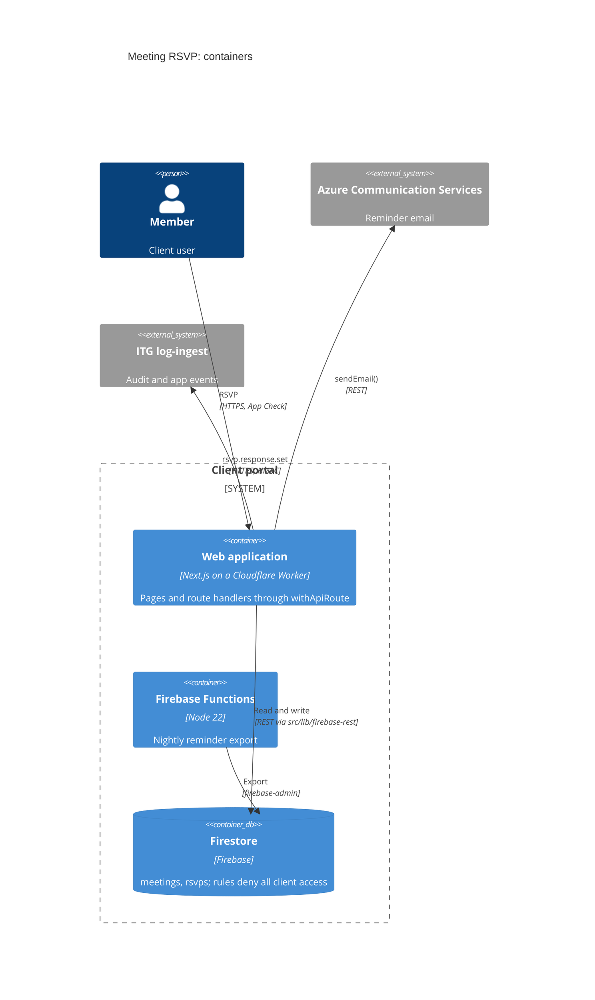
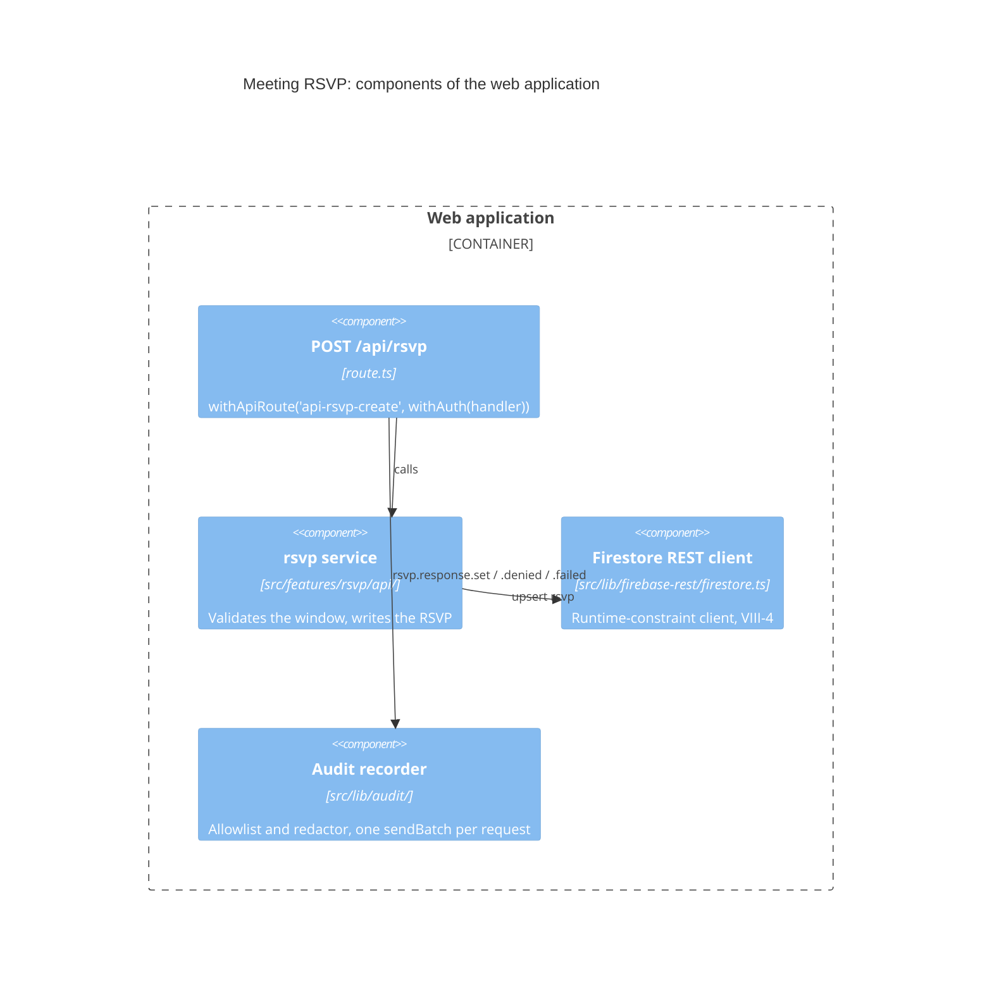
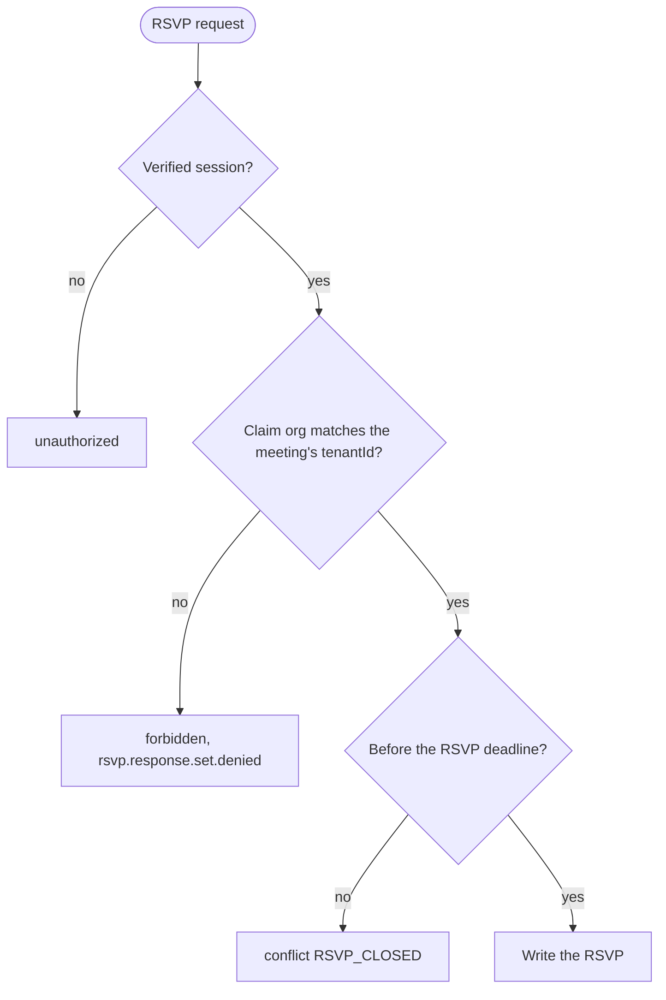
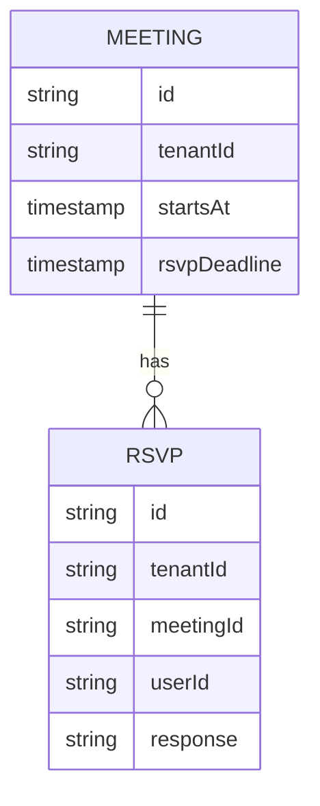

# SDD Design Command

Generate technical design from requirements.

---

## Instructions for Claude

You are executing the `/sdd-design [feature-name]` command to create a technical design specification.

### Command Format

```bash
/sdd-design authentication
/sdd-design payment-processing
/sdd-design user-dashboard
```

### Your Task

Generate a comprehensive technical design that implements the requirements while adhering to constitutional governance.

---

## Process

### 1. Read Context (Article VI)

**CRITICAL**: Read these files BEFORE designing:

```bash
# Steering Context
steering/structure.md    # Architecture patterns to follow
steering/tech.md         # Technology stack to use
steering/rules/itg/README.md  # ITG delivery policies: read the files mapped to your task
steering/product.md      # Product goals and users
steering/project.yml     # constitution.profile (library | cli | application)

# Requirements
storage/specs/{{feature-name}}-requirements.md  # What to implement
```

**Extract**:

- Architecture pattern (monolith, microservices, library-first)
- Project profile (`constitution.profile`, `core_paths`, `delivery_paths`; `library` when absent)
- Approved technologies (languages, frameworks, databases)
- Requirements to implement
- Non-functional requirements (performance, security, scale)

---

### 2. Verify Requirements Exist

Check if requirements file exists:

**If NOT found**:

```markdown
❌ **Requirements file not found**

Expected: storage/specs/{{feature-name}}-requirements.md

Please run `/sdd-requirements {{feature-name}}` first.

Design cannot proceed without requirements (Article V: Traceability).
```

**If found**: Proceed with design

---

### 3. Generate Design Document

Use template from `templates/design.md`:

#### A. Architecture Design (Mermaid C4)

**Format rule (ITG-DEL-12)**: every architecture diagram SHALL be a Mermaid C4 block (`C4Context`, `C4Container`, `C4Component`), and every decision tree SHALL be a Mermaid `flowchart`. Do not draw ASCII boxes and do not describe decision logic as long if/else prose. Start from the context and container views in `steering/tech.md` and keep their element ids.

Create **3 levels** of C4 diagrams:

**Level 1: Context Diagram** (`C4Context`): users, the system, external systems (Firebase, ACS, Vertex AI, ITG log-ingest, vendor APIs), integration points

**Level 2: Container Diagram** (`C4Container`): Worker, log queue and log-relay Worker, Firebase Functions, Firestore, Firebase Storage, PostgreSQL on Neon only if ITG-DAT-02 applies, n8n only if ITG-INT-06 applies

**Level 3: Component Diagram** (`C4Component`): route handlers, the `withApiRoute` wrapper and guards, feature services, `src/lib` modules, and the data flow between them

**Example**:

````markdown
### C4 Model: Container Diagram



### C4 Model: Component Diagram



### Decision: who may RSVP


````

#### B. Requirements Mapping

**CRITICAL (Article V)**: Each requirement SHALL map to at least one design decision (V-1), and the design document SHALL include a requirements coverage matrix (V-5).

Create matrix:

```markdown
| Component                     | Requirements               | Design Rationale                     |
| ----------------------------- | -------------------------- | ------------------------------------ |
| POST /api/rsvp (route.ts)     | REQ-RSVP-001               | API exposure through withApiRoute    |
| src/features/rsvp/api/        | REQ-RSVP-001, REQ-RSVP-002 | Feature logic, unit-tested first     |
| Firestore rules (rsvps)       | REQ-SEC-001                | Deny all client access              |
| Reminder email (src/lib/email) | REQ-RSVP-003              | ACS from application code            |
```

**Coverage Validation**:

- [ ] All functional requirements mapped
- [ ] All non-functional requirements addressed
- [ ] 100% requirements coverage

#### C. ITG Policy Compliance

Read `steering/rules/itg/README.md` and the policies for this design (at least ITG-PLT, ITG-DAT, ITG-INT, ITG-SEC and ITG-LOG). Add a table that names every ITG rule the design relies on or deviates from:

```markdown
| Rule        | How the design meets it                                  |
| ----------- | -------------------------------------------------------- |
| ITG-SEC-13  | Every route exported through withApiRoute with a guard   |
| ITG-SEC-05  | Organization id read from custom claims only             |
| ITG-LOG-02  | rsvp.response.set with .denied and .failed variants      |
| ITG-DAT-02  | Firestore: small, non-relational data                    |
| ITG-INT-03  | Reminder email through sendEmail() (ACS)                 |
```

A deviation goes in this table with its reason, and in the Deviations table of `steering/tech.md` or `steering/structure.md`.

---

### 4. API Design

Every endpoint is a `src/app/api/**/route.ts` exported through `withApiRoute` with a guard, a rate-limit profile and a zod schema, and returns the ITG response envelope (ITG-SEC-13, ITG-SEC-14).

For each API endpoint:

**Structure**:

````markdown
#### POST /api/rsvp

**Purpose**: Record a member's RSVP for a meeting

**Maps to Requirements**: REQ-RSVP-001

**Route**: `withApiRoute('api-rsvp-create', withAuth(handler), { rateLimit: 'write', schema: createRsvpSchema })`

**Request**:

```http
POST /api/rsvp
Authorization: Bearer <Firebase ID token>
X-Firebase-AppCheck: <token>
Content-Type: application/json

{
  "meetingId": "m_123",
  "response": "yes"
}
```

**Response (Success)**:

```http
HTTP/1.1 200 OK

{
  "success": true,
  "data": { "rsvpId": "r_456", "response": "yes" }
}
```

**Response (Error)**:

```http
HTTP/1.1 409 Conflict

{
  "success": false,
  "error": { "code": "RSVP_CLOSED", "message": "The RSVP deadline has passed" }
}
```

**Status Codes** (typed `ApiRouteError` helpers):

- 200: Success
- 400: `badRequest` (schema validation failed)
- 401: `unauthorized`
- 403: `forbidden` (wrong organization)
- 409: `conflict` (`RSVP_CLOSED`)
- 429: `tooManyRequests`
- 500: generic error, recorded in `error_events`

**Events**: `rsvp.response.set`, `.denied`, `.failed` (ITG-LOG-07)

**Acceptance Criteria** (from REQ-RSVP-001):

- ✅ Rejects a member of another organization
- ✅ Rejects an RSVP after the deadline
- ✅ Emits the audit event
````

**Generate OpenAPI Spec** (if REST API):

```yaml
openapi: 3.0.0
info:
  title: RSVP API
  version: 1.0.0
paths:
  /api/rsvp:
    post:
      summary: Record an RSVP
      requestBody:
        required: true
        content:
          application/json:
            schema:
              type: object
              required: [meetingId, response]
              properties:
                meetingId:
                  type: string
                response:
                  type: string
                  enum: [yes, no, maybe]
```

---

### 5. Data Design

#### A. Database Choice

Decide with the diagram in `steering/rules/itg/data.md` (ITG-DAT-02). Firestore is the default; PostgreSQL only for large, relational or reporting-heavy data. Record the decision in `steering/tech.md`.

#### B. Data Model

Draw the model as a Mermaid `erDiagram`. Every entity holds only the fields the product needs (ITG-DAT-10) and, in a multi-tenant system, its tenant field (ITG-SEC-10). Roles live in custom claims; a user document holds at most a role copy written by the claim endpoint (ITG-SEC-06).



**Firestore** (default): list collections, document ids, indexes (`firestore.indexes.json`) and the rules: Firestore denies all client access, Storage allows tenant-scoped uploads only (ITG-SEC-15).

**PostgreSQL** (only when ITG-DAT-02 applies): numbered, append-only SQL migrations with `IF NOT EXISTS` (ITG-DAT-05, ITG-DAT-06), mapped to requirements:

```sql
-- database/migrations/0003_add_rsvps.sql  (REQ-RSVP-001)
CREATE TABLE IF NOT EXISTS rsvps (
  id UUID PRIMARY KEY DEFAULT gen_random_uuid(),
  tenant_id TEXT NOT NULL,
  meeting_id UUID NOT NULL REFERENCES meetings(id) ON DELETE CASCADE,
  user_id TEXT NOT NULL,
  response TEXT NOT NULL CHECK (response IN ('yes', 'no', 'maybe')),
  created_at TIMESTAMPTZ NOT NULL DEFAULT NOW(),
  UNIQUE (meeting_id, user_id)
);
CREATE INDEX IF NOT EXISTS idx_rsvps_meeting ON rsvps(meeting_id);
ALTER TABLE rsvps ENABLE ROW LEVEL SECURITY;
```

#### C. Migration Strategy

- Firestore: rules, indexes and backfills versioned in git, applied to staging first, deployed to both projects in the same change (ITG-DAT-09)
- PostgreSQL: the deploy workflow applies new migrations with `scripts/ci/migrate.mjs` before `wrangler deploy`, on staging and production; a deploy with a migration runs in the deploy window (ITG-DAT-07, ITG-DAT-08)

---

### 6. Component Design (Testable Core, Article I)

**CRITICAL**: Read `constitution.profile` from `steering/project.yml` before designing components. IF no profile is declared, THEN use `library` (P-2). The profile decides what a core module is and which variant below applies. ITG projects use `application`.

- The design SHALL name the core module for each feature (I-1).
- WHERE the project profile is `application`, the design SHALL list the delivery paths of each feature and each machine-facing endpoint with its input schema and documented status and error codes (II-A4, II-A5).

#### Variant: `library` / `cli` profile

Design features as libraries first (I-L1–I-L3), each with a CLI (II-L1).

````markdown
### RSVP Library

**Location**: `lib/rsvp/`

```text
lib/rsvp/
├── src/
│   ├── index.ts         # Public API
│   ├── service.ts       # recordRsvp(), closeRsvps()
│   └── types.ts
├── tests/
│   └── service.test.ts
├── cli.ts               # CLI interface (Article II)
└── package.json
```

**CLI Interface** (Article II):

```bash
rsvp record --meeting=m_123 --user=u_1 --response=yes
rsvp close --meeting=m_123
```
````

#### Variant: `application` profile (ITG)

Shared, framework-light logic lives in the core path `src/lib/` (I-A1, I-2). Each feature is a self-contained folder `src/features/<domain>/` (delivery code in Article I terms, ITG-GIT-02). Route handlers delegate to the feature's `api/` service (I-A3). The HTTP API is the automation interface, so there is no `cli.ts` (II-A1, II-A3).

````markdown
### RSVP Feature

**Feature folder**: `src/features/rsvp/`

```text
src/features/rsvp/
├── components/          # RsvpButtons (shadcn/ui)
├── hooks/               # useRsvp (TanStack Query)
├── api/
│   ├── rsvp-service.ts       # recordRsvp(), uses src/lib/firebase-rest
│   └── rsvp-service.test.ts  # Written first, runs without the app (ITG-TST-01)
└── types.ts
src/types/rsvp/rsvp.ts        # Rsvp entity type (ITG-GIT-03)
```

**Core modules used**: `src/lib/firebase-rest/` (runtime-constraint client, VIII-4), `src/lib/email/`, `src/lib/audit/`

**Delivery paths**:

- `src/app/api/rsvp/route.ts`: `withApiRoute` + `withAuth`, zod schema, calls `recordRsvp()`
- `src/app/meetings/[id]/page.tsx`: renders `RsvpButtons`

**Machine-facing endpoints** (II-A4, II-A5):

| Endpoint       | Caller   | Input schema                | Status and error codes                                     |
| -------------- | -------- | --------------------------- | ---------------------------------------------------------- |
| POST /api/rsvp | Web UI   | `createRsvpSchema` (zod)    | 200; 400 `VALIDATION_FAILED`; 403 `FORBIDDEN`; 409 `RSVP_CLOSED` |

**Runtime-constraint clients** (VIII-5): `src/lib/firebase-rest/firestore.ts` replaces `firebase-admin`, and `src/lib/vertex-ai/` replaces the Google AI SDKs, which cannot run on Cloudflare Workers.
````

---

### 7. Security Design (REQ-SEC-001)

Always include security design, following `steering/rules/itg/security.md`:

```markdown
### Authentication

- **Method**: Firebase Authentication with Identity Platform; the ID token in `Authorization: Bearer` is the only session, no session cookie; protected pages are client shells (ITG-SEC-11)
- **Account state**: `accounts:lookup` on every request; disabled, deleted or revoked users rejected on the next request (ITG-SEC-04)
- **Bot protection**: App Check on every API call and on Storage; reCAPTCHA enforcement on sign-in (ITG-SEC-01)
- **Admins**: TOTP MFA enforced server-side (ITG-SEC-02)
- **Session lifetime**: 12 hours absolute from `auth_time`, 30 minutes client idle sign-out (admin app) (ITG-SEC-12)

### Authorization

- **Roles**: custom claims, e.g. `admin`, `member`; authorization never reads the role copy on the user document (ITG-SEC-05, ITG-SEC-06)
- **Tenant**: `tenantId` from the claim; queries scoped server-side through the tenant-scoped helper; Storage rules scope uploads to the tenant (ITG-SEC-10)
- **Guards**: `withAuth`, `withRole('<role>')`, `withTenant` in the route wrapper (ITG-SEC-13)

### Data Protection

- **Rules**: Firestore denies all client access; Storage allows tenant-scoped uploads with type and size limits; reads through signed URLs (ITG-SEC-15)
- **Logs**: ids only, no names or emails; redactor on every event (ITG-LOG-03, ITG-LOG-11)
- **AI**: Vertex AI in `europe-west4` through REST; prompts fingerprinted, never stored (ITG-SEC-19, ITG-SEC-20)

### Input Validation

- **Schemas**: zod for body and query in the wrapper (ITG-PLT-06)
- **Rate limiting**: Cloudflare Rate Limiting binding, profile per route (ITG-SEC-14)
- **Headers**: nonce-based CSP and security headers in middleware, explicit `ALLOWED_ORIGINS` (ITG-SEC-22)
- **Feature**: declared in the registry and named in the wrapper options, so it can be switched off (ITG-SEC-23)
```

---

### 8. Performance Design (REQ-PERF-001)

```markdown
### Runtime

- **Worker bundle**: within the plan limit; no heavy SDKs in the Worker (ITG-PLT-18)
- **Shared state**: Cloudflare KV, Durable Objects or Rate Limiting bindings, never isolate memory (ITG-PLT-17)
- **Server state on the client**: TanStack Query caching and invalidation

### Data

- **Firestore**: composite indexes for every query in `firestore.indexes.json`
- **PostgreSQL** (if used): indexes in the migration; pooled connections

### API Performance Targets

- **Response Time**: < 200ms (95th percentile)
- **Throughput**: [requests/second]
- **Concurrency**: [concurrent users]
```

---

### 9. Constitutional Compliance Validation

#### Article I: Testable Core

- [ ] Profile read from `steering/project.yml` (`library` when absent, P-2)
- [ ] Core module named for each feature (I-1)
- [ ] Core module has tests that run without the app, a browser or a CLI (I-2)
- [ ] No imports from delivery paths into core paths (I-3)
- [ ] (`library`, `cli`) Feature designed as library (`lib/{{feature}}/`) (I-L1)
- [ ] (`library`, `cli`) Library has independent test suite (I-L2)
- [ ] (`library`, `cli`) Library has public API (`index.ts`) (I-L3)
- [ ] (`library`, `cli`) No dependencies on application code (I-L6)
- [ ] (`application`) Shared logic is a folder under a core path, e.g. `src/lib/<module>/` (I-A1); feature logic in `src/features/<domain>/api/` with tests written first
- [ ] (`application`) Route handlers and server actions delegate to feature services or core modules (I-A3)
- [ ] (`application`) No UI-only code (components, React hooks, providers) in core paths (I-A4)

#### Article II: Automation Interface

- [ ] All major operations callable without the UI (II-1)
- [ ] Interface documented: help text or schema (II-2)
- [ ] Machine-readable errors: exit codes, or status plus error code (II-4)
- [ ] (`library`, `cli`) CLI interface specified (`cli.ts`) (II-L1)
- [ ] (`library`, `cli`) Help text documented (II-L2)
- [ ] (`library`, `cli`) Exit codes defined (II-L4, II-L5)
- [ ] (`application`) Delivery paths listed for each feature
- [ ] (`application`) Each machine-facing endpoint listed with input schema and documented status and error codes (II-A4, II-A5)

#### Article VII: Simplicity Gate (Phase -1)

- [ ] Count projects (independently deployable units): at most 3 in the initial architecture (VII-1)
- [ ] If > 3 projects: Phase -1 Gate approval before the additional projects are implemented (VII-2), and design.md justifies each additional project with business requirements, technical constraints and a team capacity analysis (VII-3)
- [ ] Components sized so the code can stay within the code-size limits: source files ≤ 500 lines of code, functions ≤ 50, imports ≤ 10 (`index` files exempt), or the configured `code_limits` (VII-4–VII-6); these limits are not Phase -1 Gate items

#### Article VIII: Anti-Abstraction Gate (Phase -1)

- [ ] Framework APIs and vendor SDKs called directly (VIII-1, ITG-INT-02)
- [ ] Check for custom abstraction layers or wrapper libraries over a framework: each needs Phase -1 Gate approval (VIII-2)
- [ ] If custom wrappers exist: Phase -1 Gate request with a multi-framework support justification, a team expertise analysis and a migration path (VIII-3)
- [ ] IF the design introduces a project-owned client because the vendor SDK cannot run on the target runtime (VIII-4), THEN design.md SHALL document that constraint: SDK, runtime and client location (VIII-5). On ITG projects this is the Firebase REST client (ITG-PLT-15)

#### ITG Policies

- [ ] ITG policy compliance table included (section 3C), deviations recorded in steering
- [ ] All diagrams are Mermaid: C4 for architecture, `flowchart` for decisions (ITG-DEL-12)

**Validation Section**:

```markdown
## Constitutional Compliance

### Article I: Testable Core ✅

- Profile: `application` (`steering/project.yml`)
- Feature folder `src/features/rsvp/`; service tests written first and run without the app (I-2, ITG-TST-01)
- Shared modules in the core path `src/lib/`; no imports from delivery paths (I-3)

### Article II: Automation Interface ✅

- HTTP API, no CLI: `POST /api/rsvp` validates input against `createRsvpSchema` and returns documented status and error codes (II-A1, II-A3, II-A4, II-A5)

### Article VII: Simplicity Gate ✅

- Project count: 1 (one Next.js application)
- Within limit (≤ 3)

### Article VIII: Anti-Abstraction ✅

- Vendor SDKs called directly; no custom wrapper
- Runtime-constraint client: `src/lib/firebase-rest/` because `firebase-admin` cannot run on Workers (VIII-4, VIII-5)
```

---

### 10. Architecture Decision Records (ADR)

Document key decisions:

```markdown
### ADR-001: Store RSVPs in Firestore

**Status**: Accepted
**Date**: 2026-10-08

**Context**:
REQ-RSVP-001 needs per-meeting RSVPs, shown on the meeting page and refreshed by polling an API route. Volume: a few hundred per meeting.

**Decision**:
Store RSVPs in a Firestore `rsvps` collection scoped by `tenantId` (ITG-DAT-01, ITG-DAT-02).

**Consequences**:

- ✅ No extra database; the page polls an API route, so every read passes the account-state check
- ✅ The tenant-scoped helper enforces the tenant scope; rules deny client access (ITG-SEC-10, ITG-SEC-15)
- ❌ Cross-meeting reporting needs an export

**Alternatives Considered**:

- PostgreSQL: Rejected (data is small and not relational; ITG-DAT-02)
```

Document ADRs for:

- Database choice (ITG-DAT-02)
- Every deviation from an ITG rule
- Runtime-constraint clients (VIII-5)
- Background job placement (ITG-INT-06)
- Major library choices outside the ITG UI set (ITG-PLT-05)

---

### 11. Save Design Document

Save to: `storage/design/{{feature-name}}-design.md`

**File Naming**:

- Use kebab-case
- Match requirements file name
- Add `-design` suffix

**Examples**:

- `storage/design/authentication-design.md`
- `storage/design/payment-processing-design.md`

---

### 12. Validation

Run constitutional validation:

```bash
@constitution-enforcer validate storage/design/{{feature-name}}-design.md
```

**Checks**:

- Article I: Testable Core: core module named for each feature, per the project profile (I-1)
- Article II: Automation Interface: CLI specified (`library`, `cli`), or delivery paths and machine-facing endpoints with schemas listed (`application`)
- Article V: All requirements mapped (V-1), requirements coverage matrix included (V-5)
- Article VII: Project count ≤ 3 (VII-1), or gate-approved and justified (VII-2, VII-3)
- Article VIII: No custom abstractions (VIII-1, VIII-2), or gate-approved and justified (VIII-3)

---

### 13. Generate Summary

```markdown
## ✅ Technical Design Complete

**Feature**: {{FEATURE_NAME}}
**File**: storage/design/{{feature-name}}-design.md

### Architecture Summary:

- **Pattern**: [Library-first / Microservices / Monolith]
- **Profile**: [library / cli / application]
- **Components**: [N] components
- **Core Modules**: lib/{{feature}}/ (`library`, `cli`), or src/features/{{feature}}/ and the src/lib/ modules it uses (`application`)
- **Database**: [Firestore / PostgreSQL (ITG-DAT-02)]
- **Diagrams**: Mermaid C4 context, container and component views

### Requirements Coverage:

- **Total Requirements**: [N]
- **Requirements Mapped**: [N] (100%)
- **Unmapped Requirements**: 0 ✅

### API Endpoints:

- POST /api/{{feature}}/... ([N] endpoints total)

### Data:

- Collections or tables: [N]
- Indexes: [N]
- Rules or migrations: [N]

### ITG Policies:

- Rules applied: [ITG-SEC-13, ITG-LOG-02, ...]
- Deviations: [none / rule id and reason]

### ADRs Created:

- ADR-001: [Decision]
- ADR-002: [Decision]

### Constitutional Compliance:

- ✅ Article I: Testable Core: core module named for each feature
- ✅ Article II: Automation Interface defined (CLI, or HTTP API with schemas)
- ✅ Article V: 100% requirements coverage
- ✅ Article VI: Aligned with steering context
- ✅ Article VII: Project count within limit
- ✅ Article VIII: No custom abstractions (runtime-constraint clients documented)

### Next Steps:

1. Review design with team
2. Get architecture approval
3. Break down into tasks: `/sdd-tasks {{feature-name}}`
```

---

## Tool Usage

### Required:

- **Read**: Steering files, requirements document
- **Write**: Design document
- **Grep/Glob**: Analyze existing codebase (brownfield)

### Optional:

- **AskUserQuestion**: Clarify design decisions
- **WebSearch**: Research design patterns
- **mcp**context7**get-library-docs**: Framework documentation

---

## Phase -1 Gate Triggers

### Trigger Simplicity Gate (Article VII)

If project count > 3:

```markdown
⚠️ **Phase -1 Gate: Simplicity**

This design proposes [N] projects (> 3 limit).

**Required Justification** (VII-3):

1. Business requirements necessitating separation
2. Technical constraints
3. Team capacity analysis for managing [N] projects

Please provide justification or reduce project count.

**Approval Required** before the additional projects are implemented (VII-2): @system-architect + @project-manager
```

### Trigger Anti-Abstraction Gate (Article VIII)

If custom abstraction layers detected:

A project-owned client that exists because the vendor SDK cannot run on the target runtime is a valid abstraction (VIII-4) and does not trigger this gate; document the constraint in design.md instead (VIII-5).

```markdown
⚠️ **Phase -1 Gate: Anti-Abstraction**

This design includes custom abstraction layers:

- [Abstraction 1]: Wrapper around [framework]
- [Abstraction 2]: Custom [pattern]

**Required Justification** (VIII-3):

1. Multi-framework support needed
2. Team expertise rationale
3. Migration path

Please justify or use framework APIs directly (VIII-1).

**Approval Required** (VIII-2): @system-architect + @software-developer
```

---

## Edge Cases

### Missing Requirements

If requirements file doesn't exist:

```markdown
❌ **Error**: Requirements not found

Expected: storage/specs/{{feature-name}}-requirements.md

Please run `/sdd-requirements {{feature-name}}` first.

Design requires requirements for traceability (Article V).
```

### Missing Steering

If steering files don't exist:

```markdown
⚠️ **Warning**: Steering context not found

Designing without steering context may result in:

- Architecture misalignment
- Technology stack mismatch
- Product goal misalignment

Recommendation: Run `/sdd-steering` first.

Continue anyway? [Prompt user]
```

---

**Execution**: Begin technical design generation now for the specified feature.
