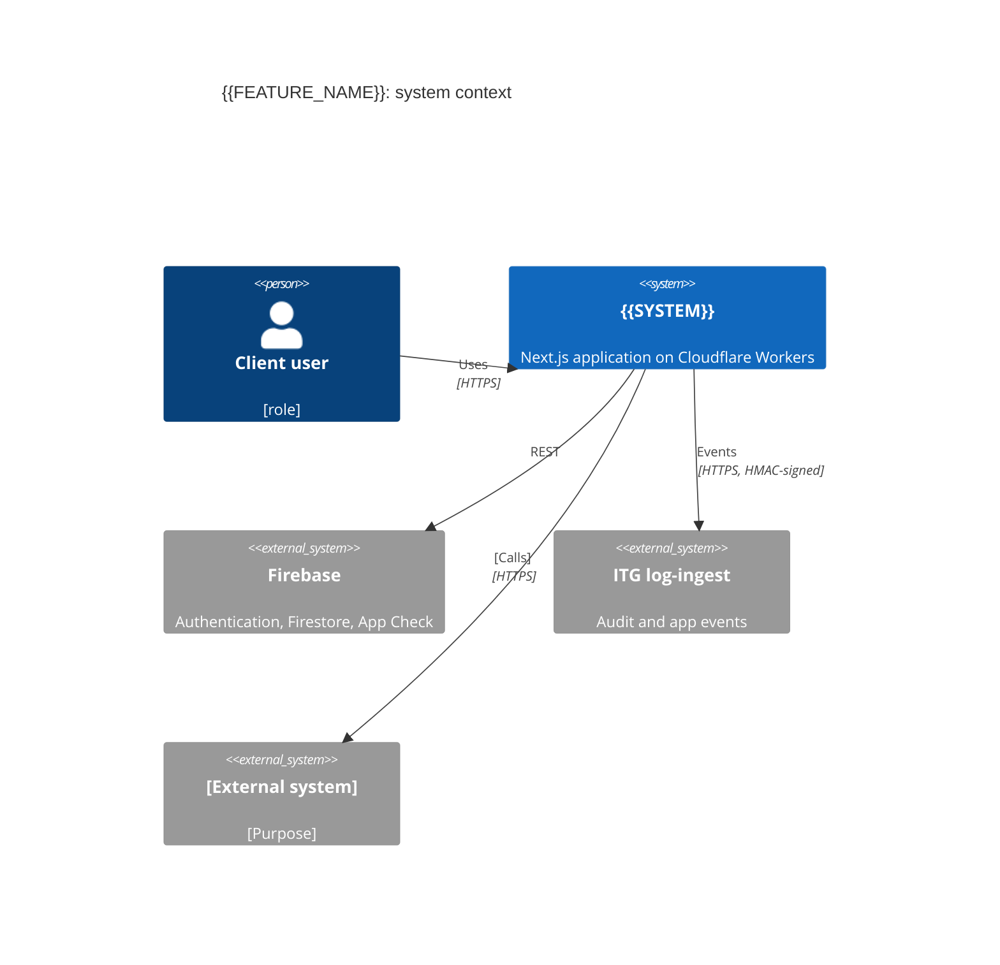
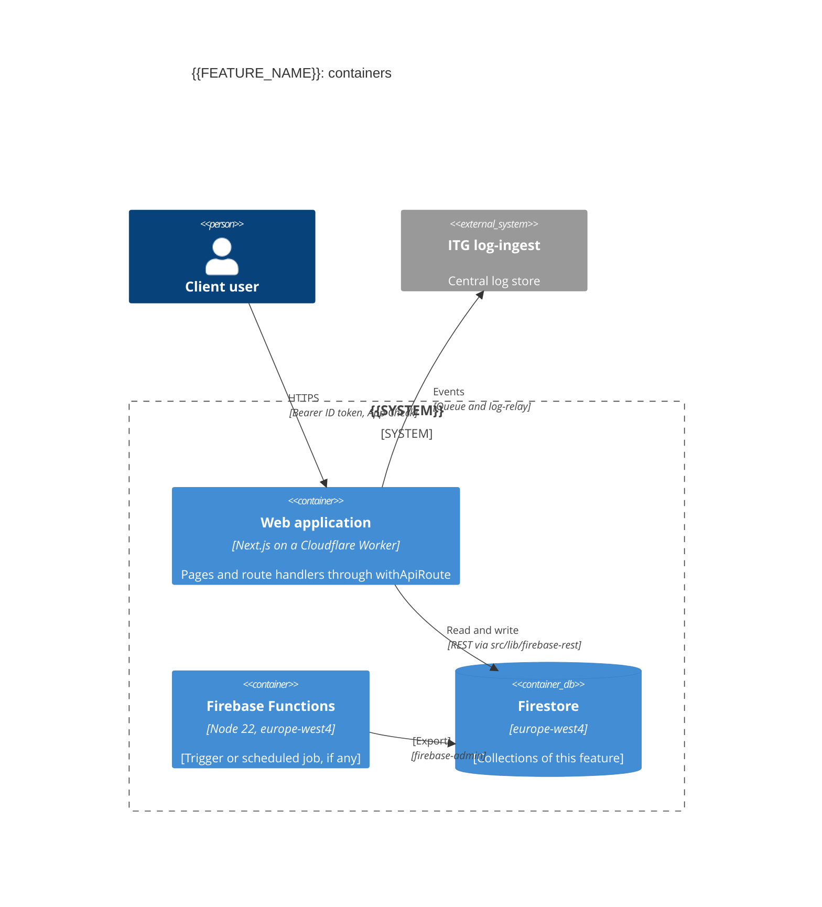
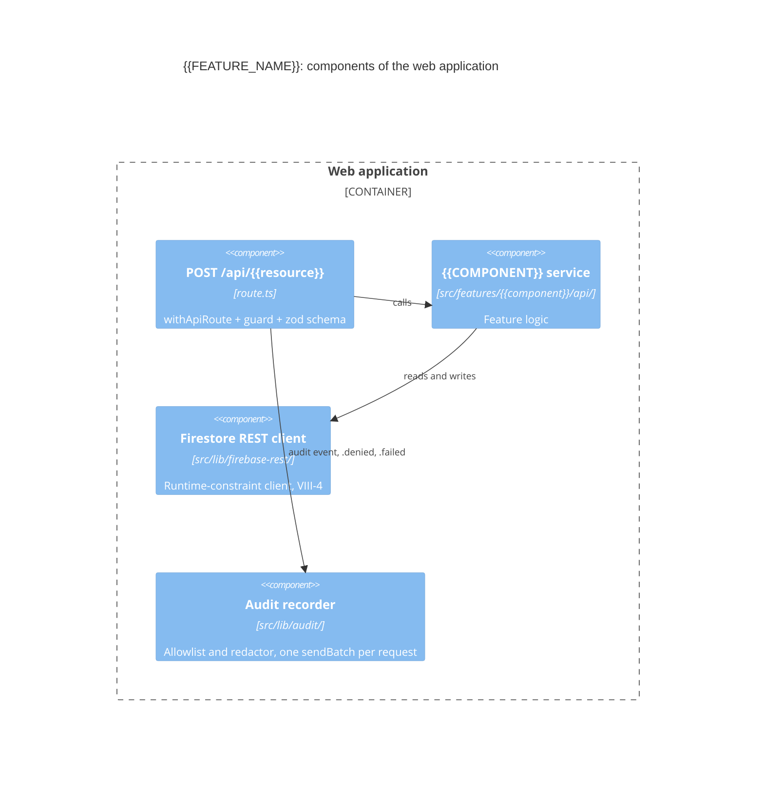
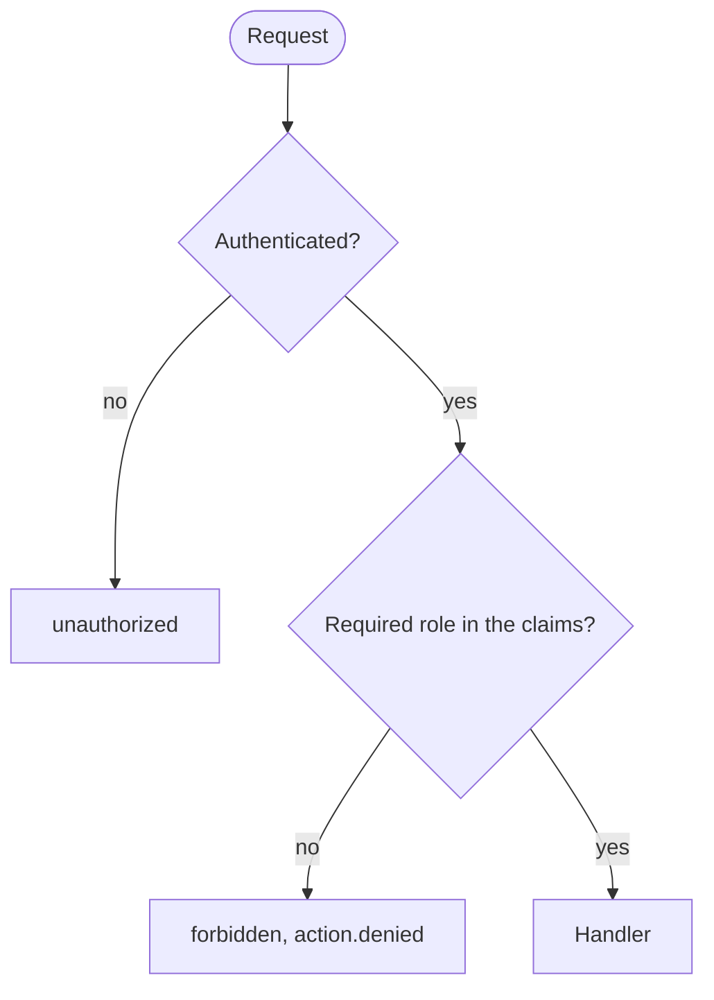
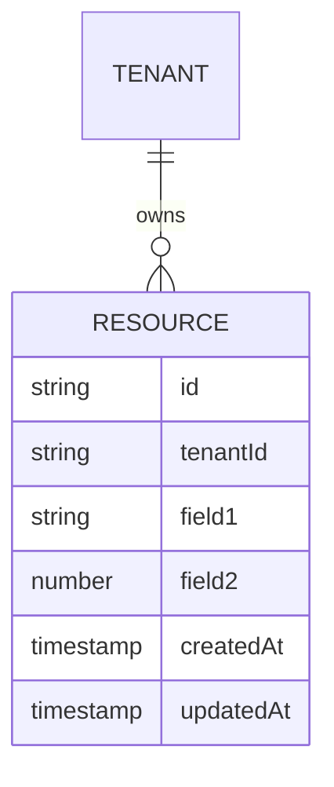

# Technical Design: {{FEATURE_NAME}}

**Project**: {{PROJECT_NAME}}
**Version**: 1.0
**Status**: Draft
**Date**: {{DATE}}
**Author**: {{AUTHOR}}

---

## Document Control

| Version | Date     | Author     | Changes       |
| ------- | -------- | ---------- | ------------- |
| 1.0     | {{DATE}} | {{AUTHOR}} | Initial draft |

---

## Overview

### Purpose

[Describe the technical design for implementing the requirements]

### Scope

This design covers:

- Architecture and component design
- API contracts
- Database schema
- Integration points
- Deployment architecture

### Requirements Reference

This design implements requirements from: [requirements.md](requirements.md)

---

## Steering Context

**IMPORTANT**: This design aligns with project steering context:

- **Architecture Patterns**: [steering/structure.md](../../steering/structure.md)
- **Technology Stack**: [steering/tech.md](../../steering/tech.md)
- **Product Context**: [steering/product.md](../../steering/product.md)
- **ITG Delivery Policies**: [steering/rules/itg/README.md](../../steering/rules/itg/README.md)

**Key Alignments**:

- Architecture pattern: [one Next.js application, feature folders (ITG-GIT-01)]
- Constitution profile: [application] (`constitution.profile` in `steering/project.yml`; `library` when absent)
- Primary language: [TypeScript]
- Framework: [Next.js on Cloudflare Workers via OpenNext (ITG-PLT-13)]
- Database: [Firestore, or PostgreSQL when ITG-DAT-02 applies]

---

## Architecture Design

All diagrams are Mermaid: C4 for architecture, `flowchart` for decision logic (ITG-DEL-12). Start from the views in `steering/tech.md` and keep their element ids.

### C4 Model: Context Diagram



**External Dependencies**:

- [External System 1]: [Purpose] (section in `documentation/INTEGRATIONS.md`, ITG-INT-08)

---

### C4 Model: Container Diagram



**Containers**:

1. **Web Application**: [Technology, purpose]
2. **Firebase Functions**: [Only if the feature has scheduled work (ITG-INT-06)]
3. **Database**: [Firestore collections, or PostgreSQL tables when ITG-DAT-02 applies]

---

### C4 Model: Component Diagram



**Components**:

1. **Route handler**: `src/app/api/{{resource}}/route.ts`, exported through `withApiRoute` (ITG-SEC-13)
2. **{{COMPONENT}} service**: feature logic in `src/features/{{component}}/api/`
3. **Shared modules**: `src/lib/firebase-rest/`, `src/lib/audit/`, `src/lib/email/`

### Decision Logic

Draw every decision tree of the feature (who may do what, which path a request takes) as a Mermaid `flowchart`:



---

## Requirements Mapping

### Architecture → Requirements Matrix

| Component                 | Requirements Implemented                     | Design Rationale             |
| ------------------------- | -------------------------------------------- | ---------------------------- |
| {{COMPONENT}} Service     | REQ-{{COMPONENT}}-NNN, REQ-{{COMPONENT}}-NNN | Business logic encapsulation |
| {{COMPONENT}} Controller  | REQ-{{COMPONENT}}-NNN                        | API exposure                 |
| Database Schema           | REQ-{{COMPONENT}}-NNN                        | Data persistence             |
| Authentication Middleware | REQ-SEC-NNN                                  | Security enforcement         |
| Caching Layer             | REQ-PERF-NNN                                 | Performance optimization     |

**Coverage**:

- ✅ All functional requirements mapped
- ✅ All non-functional requirements addressed
- ✅ 100% requirements coverage (Article V, V-1, V-5)

---

## API Design

Every endpoint is a `src/app/api/**/route.ts` exported through `withApiRoute('<route-id>', guard(handler), { rateLimit, schema })`, with a zod schema, typed `ApiRouteError`s and the response envelope `{ success: true, data }` / `{ success: false, error: { code, message } }` (ITG-SEC-13, ITG-SEC-14).

### RESTful API Endpoints

#### POST /api/{{resource}}

**Purpose**: [Create new resource]

**Maps to Requirements**: REQ-{{COMPONENT}}-NNN

**Request**:

```http
POST /api/{{resource}}
Content-Type: application/json
Authorization: Bearer {token}

{
  "field1": "value1",
  "field2": "value2"
}
```

**Route**: `withApiRoute('api-{{resource}}-create', withRole('[role]', handler), { rateLimit: 'write', schema: create{{COMPONENT}}Schema })`

**Request Schema** (zod):

```typescript
const create{{COMPONENT}}Schema = z.object({
  body: z.object({
    field1: z.string().min(1).max(255),
    field2: z.number().int().positive(),
  }),
});
```

**Response (Success)**:

```http
HTTP/1.1 201 Created
Content-Type: application/json

{
  "success": true,
  "data": {
    "id": "res_123",
    "field1": "value1",
    "field2": 2,
    "createdAt": "2026-10-08T10:00:00Z"
  }
}
```

**Response (Error)**:

```http
HTTP/1.1 400 Bad Request
Content-Type: application/json

{
  "success": false,
  "error": { "code": "VALIDATION_FAILED", "message": "field1 is required" }
}
```

**Status Codes**:

- 201: Resource created successfully
- 400: Invalid request (validation failed)
- 401: Unauthorized (missing/invalid token)
- 409: Conflict (resource already exists)
- 500: Internal server error

**Acceptance Criteria** (from REQ-{{COMPONENT}}-NNN):

- ✅ Validates request schema
- ✅ Emits `{{component}}.{{resource}}.create` (and `.denied` / `.failed`) (ITG-LOG-02)
- ✅ Returns 201 on success
- ✅ Returns resource ID
- ✅ Persists to database

---

#### GET /api/{{resource}}/:id

**Purpose**: [Retrieve resource by ID]

**Maps to Requirements**: REQ-{{COMPONENT}}-NNN

**Request**:

```http
GET /api/{{resource}}/550e8400-e29b-41d4-a716-446655440000
Authorization: Bearer {token}
```

**Response (Success)**:

```http
HTTP/1.1 200 OK
Content-Type: application/json

{
  "id": "550e8400-e29b-41d4-a716-446655440000",
  "field1": "value1",
  "field2": "value2",
  "createdAt": "2025-11-16T10:00:00Z",
  "updatedAt": "2025-11-16T10:00:00Z"
}
```

**Response (Not Found)**:

```http
HTTP/1.1 404 Not Found
Content-Type: application/json

{
  "error": "Resource not found",
  "id": "550e8400-e29b-41d4-a716-446655440000"
}
```

**Status Codes**:

- 200: Resource found
- 401: Unauthorized
- 404: Resource not found
- 500: Internal server error

---

### OpenAPI Specification

See [openapi.yaml](./openapi.yaml) for complete API specification.

**Generation Command**:

```bash
# Generate OpenAPI spec
@api-designer generate openapi for {{FEATURE_NAME}}
```

---

## Data Design

### Database Choice

**Decision**: [Firestore / PostgreSQL] — decided with `steering/rules/itg/data.md` (ITG-DAT-02) and recorded in `steering/tech.md`.

### Data Model

**Maps to Requirements**: REQ-{{COMPONENT}}-NNN



| Field | Type | Reason the product needs it (ITG-DAT-10) | Personal data? (ITG-DAT-12) |
| ----- | ---- | ---------------------------------------- | --------------------------- |
| field1 | string | [reason] | [no / yes: deleted by the erasure endpoint] |

- Every record carries its tenant field when the system is multi-tenant (ITG-SEC-10). Roles live in custom claims; a user document holds at most a role copy written by the claim endpoint (ITG-SEC-06).

### Firestore (default)

- **Collections**: `{{resource}}` ([document id scheme])
- **Indexes**: [composite indexes in `firestore.indexes.json`]
- **Rules**: Firestore denies all client access; reads and writes go through API routes; live updates poll (ITG-SEC-15)

### PostgreSQL (only when ITG-DAT-02 applies)

```sql
-- database/migrations/NNNN_create_{{resource}}.sql
CREATE TABLE IF NOT EXISTS {{resource}} (
  id UUID PRIMARY KEY DEFAULT gen_random_uuid(),
  tenant_id TEXT NOT NULL,
  field1 VARCHAR(255) NOT NULL,
  field2 INTEGER NOT NULL CHECK (field2 > 0),
  created_at TIMESTAMPTZ NOT NULL DEFAULT NOW(),
  updated_at TIMESTAMPTZ NOT NULL DEFAULT NOW()
);
CREATE INDEX IF NOT EXISTS idx_{{resource}}_tenant ON {{resource}}(tenant_id);
ALTER TABLE {{resource}} ENABLE ROW LEVEL SECURITY;
```

### Migration Strategy

**Maps to Requirements**: REQ-MAINT-NNN

- Firestore: rules, indexes and backfills versioned in git, applied to staging first, deployed to both projects in the same change (ITG-DAT-09)
- PostgreSQL: numbered, append-only migrations, applied by the deploy workflow with `scripts/ci/migrate.mjs` on staging and production; a deploy with a migration runs in the deploy window (ITG-DAT-05 to ITG-DAT-08)

---

## Component Design

### {{COMPONENT}} Service

**Maps to Requirements**: REQ-{{COMPONENT}}-NNN, REQ-{{COMPONENT}}-NNN

**Responsibilities**:

- Business logic for {{resource}} operations
- Validation
- Error handling

**Interface**:

```typescript
interface {{COMPONENT}}Service {
  create(data: CreateResourceDTO): Promise<Resource>;
  findById(id: string): Promise<Resource | null>;
  update(id: string, data: UpdateResourceDTO): Promise<Resource>;
  delete(id: string): Promise<void>;
}
```

**Implementation**:

```typescript
// src/features/{{component}}/api/{{component}}-service.ts

export class {{COMPONENT}}Service implements {{COMPONENT}}Service {
  constructor(private repository: {{COMPONENT}}Repository) {}

  async create(data: CreateResourceDTO): Promise<Resource> {
    // REQ-{{COMPONENT}}-NNN: Validate input
    this.validateCreateInput(data);

    // REQ-{{COMPONENT}}-NNN: Check for duplicates
    const existing = await this.repository.findByUserAndField1(
      data.userId,
      data.field1
    );
    if (existing) {
      throw new ConflictError('Resource already exists');
    }

    // REQ-{{COMPONENT}}-NNN: Create resource
    return this.repository.create(data);
  }

  // Additional methods...
}
```

---

### {{COMPONENT}} Repository

**Maps to Requirements**: REQ-{{COMPONENT}}-NNN

**Responsibilities**:

- Data access layer
- Database queries
- Transaction management

**Interface**:

```typescript
interface {{COMPONENT}}Repository {
  create(data: CreateResourceDTO): Promise<Resource>;
  findById(id: string): Promise<Resource | null>;
  findByUserAndField1(userId: string, field1: string): Promise<Resource | null>;
  update(id: string, data: UpdateResourceDTO): Promise<Resource>;
  delete(id: string): Promise<void>;
}
```

---

## Integration Points

### External API Integration

**Service**: [External API Name]
**Purpose**: [Integration purpose]
**Maps to Requirements**: REQ-{{COMPONENT}}-NNN

**Endpoint**: `https://api.external.com/v1/endpoint`
**Authentication**: API key, server-side only (ITG-INT-01); stored as a GitHub Environment Secret
**Rate Limit**: 1000 requests/hour

**Request**:

```http
GET /v1/endpoint
X-API-Key: <secret from runtime-config>
```

**Called from**: `src/features/{{component}}/api/` or `src/lib/<vendor>/`, through the vendor SDK or REST API directly (ITG-INT-02)

**Error Handling** (ITG-INT-09, ITG-INT-10):

- Retry network errors, 5xx and 429 with exponential backoff and jitter; never retry other 4xx
- Idempotency key when the API supports it
- Repeated failures recorded as `integration.<vendor>.<op>.failed`

---

## Security Design

**Maps to Requirements**: REQ-SEC-NNN

Follow `steering/rules/itg/security.md`; run its release checklist when the feature touches auth, data access or integrations.

### Authentication

- **Method**: Firebase Authentication with Identity Platform; the ID token in `Authorization: Bearer` is the only session, no session cookie (ITG-SEC-11); account-state check on every request (ITG-SEC-04)
- **Bot protection**: App Check on every API call and on Storage; reCAPTCHA enforcement on sign-in (ITG-SEC-01)
- **Admins**: TOTP MFA enforced server-side (ITG-SEC-02)

### Authorization

- **Roles**: [roles this feature checks], read only from custom claims (ITG-SEC-05, ITG-SEC-06)
- **Tenant**: `tenantId` from the claim, scoped server-side through the tenant-scoped helper (ITG-SEC-10)
- **Guards**: [withAuth / withRole('<role>') / withTenant] per route (ITG-SEC-13)

### Data Protection

- **Rules**: Firestore denies all client access; Storage uploads tenant-scoped; reads through signed URLs (ITG-SEC-15)
- **Logs**: ids only; no names, emails or bodies (ITG-LOG-03)
- **AI** (if used): Vertex AI in `europe-west4` through REST; prompt-injection review; prompts fingerprinted (ITG-SEC-19, ITG-SEC-20)
- **Feature**: [registry name]; can be switched off with the kill switch (ITG-SEC-23, ITG-SEC-24)

### Input Validation

- **Schemas**: zod for body and query of every route (ITG-PLT-06)
- **Rate Limiting**: [auth / read / write / admin / ai] profile per route (ITG-SEC-14)
- **Webhooks** (if any): outbound webhooks signed (ITG-SEC-17)

---

## Performance Design

**Maps to Requirements**: REQ-PERF-NNN

### Runtime

- **Worker bundle**: no heavy SDKs in the Worker (ITG-PLT-18)
- **Shared state**: Cloudflare KV, Durable Objects or Rate Limiting bindings, never isolate memory (ITG-PLT-17)
- **Client caching**: TanStack Query

### Data

- **Indexes**: see Data Design
- **Pagination**: [limit per page]

### API Performance

- **Response Time Target**: < 200ms (95th percentile)

---

## Deployment

**Maps to Requirements**: REQ-AVAIL-NNN

- **Environments**: local, staging, production (ITG-PLT-21); deployed by `.github/workflows/deploy.yml` (ITG-CI-03)
- **New bindings**: [KV / Durable Objects / Rate Limiting / Hyperdrive] in both environment blocks of `wrangler.jsonc` (ITG-PLT-19)
- **Rules and indexes**: deployed to both Firebase projects in the same change (ITG-PLT-23)

### Configuration

New keys go in `.env.example`, both GitHub Environments and `src/lib/runtime-config.ts` (ITG-PLT-08 to ITG-PLT-10).

| Key | Variable or Secret | Description |
| --- | ------------------ | ----------- |
| [KEY_NAME] | [Secret] | [Description] |

---

## Logging and Observability

**Maps to Requirements**: REQ-AVAIL-NNN

### Events (ITG-LOG-02, ITG-LOG-07)

| Action | Category | When | Metadata (allowlisted, no PII) |
| ------ | -------- | ---- | ------------------------------ |
| `{{component}}.{{resource}}.create` | audit | [when] | [keys] |
| `{{component}}.{{resource}}.create.denied` | audit | guard failed | [reason code] |
| `{{component}}.{{resource}}.create.failed` | audit | exception | [error code] |

Add new actions to `documentation/AUDIT_LOGGING.md`.

### Runtime Logs

- `createLogger('<module-id>')` in every module; no `console.*` under `src/app/api` and `src/lib` (ITG-LOG-14)
- 5xx errors go to `error_events`

---

## ITG Policy Compliance

| Rule | How this design meets it, or the recorded deviation |
| ---- | --------------------------------------------------- |
| ITG-SEC-13 | [Every route through withApiRoute with a guard and a schema] |
| ITG-SEC-05 | [Roles and tenant from claims only] |
| ITG-LOG-02 | [Events listed above] |
| ITG-DAT-02 | [Database decision] |
| ITG-TST-09 | [Required flows covered by the test plan] |

---

## Constitutional Compliance

Read `constitution.profile` from `steering/project.yml` (`library` when absent) and keep the matching variant for Articles I and II.

This design complies with:

### Article I: Testable-Core Principle

| Feature          | Core module (I-1)                                       | Core tests (I-2)                                                       | Delivery paths                                                   |
| ---------------- | ------------------------------------------------------- | ---------------------------------------------------------------------- | ---------------------------------------------------------------- |
| {{FEATURE_NAME}} | [e.g. `lib/{{component}}/` or `src/lib/{{component}}/`] | [e.g. `lib/{{component}}/tests/` or `src/lib/{{component}}/*.test.ts`] | [e.g. `lib/{{component}}/cli.ts` or `src/app/api/{{resource}}/`] |

- ✅ Core module does not import from delivery paths (I-3)
- ✅ Exported functions and classes of the core module get a `/** … */` doc comment (I-5, advisory)

**Variant `library` / `cli`**:

- ✅ {{COMPONENT}} implemented as library: `lib/{{component}}/` (I-L1)
- ✅ Independent test suite: `lib/{{component}}/tests/` (I-L2)
- ✅ CLI interface: `lib/{{component}}/cli.ts` (II-L1)

**Variant `application`**:

- ✅ Core module: `src/lib/{{component}}/` with co-located tests (`*.test.ts`) (I-A1)
- ✅ Delivery: `src/app/api/{{resource}}/route.ts` validates input, calls core and shapes the response (I-A3)
- ✅ No UI-only code (components, React hooks, providers) in core paths (I-A4)

### Article II: Automation Interface Mandate

- ✅ Automation interface (II-1): [CLI | HTTP API]
- ✅ Documented by (II-2): [`--help` | OpenAPI / schema]
- ✅ Machine-readable errors (II-4): [exit codes | HTTP status + error code]

**Variant `library` / `cli`** (CLI, II-L1):

- ✅ CLI commands:
  - `{{component}} create --field1=value --field2=value`
  - `{{component}} get --id=uuid`
  - `{{component}} list --user-id=uuid`

**Variant `application`** (HTTP API, II-A1; no CLI required, II-A3):

- ✅ Endpoints: see [API Design](#api-design)
- ✅ Machine-facing endpoints validate input against a schema and return documented status and error codes (II-A4, II-A5)
- ✅ Operational scripts: [`scripts/<task>.ts`, registered in `package.json`, with `--help`, explicit target environment, `--dry-run`] (II-A6–II-A9)

### Article VI: Project Memory

- ✅ Architecture aligns with `steering/structure.md` (VI-1)
- ✅ Technology stack matches `steering/tech.md` (VI-2)
- ✅ Product context from `steering/product.md` (VI-3)

### Article VII: Simplicity Gate

- ✅ Project count (independently deployable units): [N] (≤ 3, VII-1)
- OR
- ⚠️ More than 3 projects: Phase -1 Gate approval before the additional projects are implemented (VII-2); each additional project justified with business requirements, technical constraints and a team capacity analysis (VII-3): [justification]

**Code-size limits** (VII-4–VII-6; checked on the code at Article VII's level, not a Phase -1 Gate item): the module split keeps source files ≤ [500] lines of code, functions ≤ [50] and imports ≤ [10] per file (defaults; `constitution.overrides.code_limits` in `steering/project.yml` changes them).

### Article VIII: Anti-Abstraction Gate

- ✅ Framework APIs used directly, no custom wrappers (VIII-1)
- OR
- ⚠️ Custom abstraction requires Phase -1 Gate approval (VIII-2); the gate request includes a multi-framework support justification, a team expertise analysis and a migration path (VIII-3): [justification]

**Runtime-constraint clients** (VIII-4, VIII-5): document each project-owned client that exists because a vendor SDK cannot run on the target runtime.

| Service          | Vendor SDK              | Target runtime            | Constraint                     | Project-owned client                 |
| ---------------- | ----------------------- | ------------------------- | ------------------------------ | ------------------------------------ |
| Firestore, Auth  | `firebase-admin`        | Cloudflare Workers        | Needs gRPC and Node-only modules (ITG-PLT-14) | `src/lib/firebase-rest/` |

---

## Architecture Decision Records (ADR)

### ADR-001: [Database choice for {{resource}}]

**Status**: Accepted
**Date**: {{DATE}}

**Context**:
[Volume, query shape and reporting needs of {{resource}} data.]

**Decision**:
[Firestore (ITG-DAT-01), or PostgreSQL on Neon through Hyperdrive because it is a large dataset the app works on (ITG-DAT-02).]

**Consequences**:

- ✅ [Benefit]
- ❌ [Trade-off]

**Alternatives Considered**:

- [Alternative]: [Why rejected]

---

### ADR-002: [Deviation from ITG-XXX-NN, if any]

**Status**: Proposed
**Date**: {{DATE}}

**Context**:
[Why the project's domain justifies departing from the rule.]

**Decision**:
[What the project does instead. Also record it in the Deviations table of `steering/tech.md` or `steering/structure.md`.]

**Consequences**:

- ✅ [Benefit]
- ❌ [Risk, and how it is mitigated]

---

## Risk Assessment

| Risk                             | Probability | Impact   | Mitigation                              |
| -------------------------------- | ----------- | -------- | --------------------------------------- |
| Database performance degradation | Medium      | High     | Indexes, TanStack Query caching, monitoring |
| External API unavailability      | High        | Medium   | Retry policy ITG-INT-10, `.failed` events |
| Security vulnerability           | Low         | Critical | Regular security audits, OWASP Top 10   |

---

## Open Questions

- [ ] [Question 1]
- [ ] [Question 2]

---

## References

- [Requirements Specification](requirements.md)
- [Steering Context](../../steering/)
- [API Documentation](./api-docs.md)
- [Database Migrations](../../database/migrations/)

---

## Validation

**Constitutional Validation**:

```bash
@constitution-enforcer validate design.md
```

**Requirements Coverage Validation**:

```bash
@traceability-auditor validate requirements.md design.md
```

---

**Powered by MUSUBI** - Specification Driven Development
