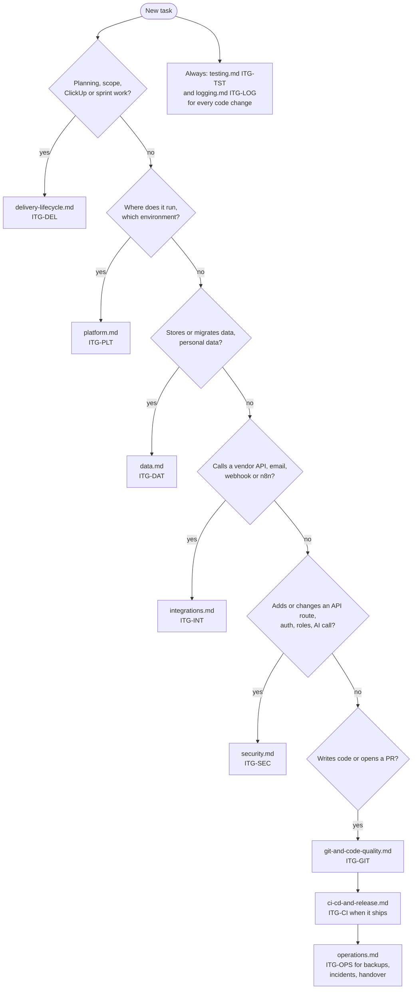

# ITG Delivery Policies

These files turn the **ITG Software Delivery Playbook** into rules that agents apply without being asked. Every ITG project starts from them: `musubi init` installs them in `steering/rules/itg/`.

- **Source of truth:** the playbook (`docs/itg/ITG_Software_Delivery_Playbook.md` in the ITG MUSUBI fork). Each policy file names the playbook version and sections it implements.
- **Rule ids:** every rule has an id (`ITG-SEC-03`). Cite the id in designs, tasks, PR descriptions and review comments when you apply a rule or deviate from it.
- **Diagrams:** decision logic is drawn as Mermaid `flowchart`, architecture as Mermaid C4. When a diagram and the prose disagree, the playbook decides.
- **Precedence:** the constitution (`steering/rules/constitution.md`) governs how MUSUBI works. These policies govern *what* an ITG project builds and how it is delivered. They do not conflict: the playbook relies on Articles III, IV, V, VII, VIII and IX.

## Which policy applies to my task?

## Policy files

| File | Prefix | Playbook | Covers |
|---|---|---|---|
| [delivery-lifecycle.md](delivery-lifecycle.md) | ITG-DEL | §1, §3.1–§3.4, §5, §6 | Lifecycle, documentation homes, Sprint 0, ClickUp, Definition of Ready / Done |
| [platform.md](platform.md) | ITG-PLT | §2.1, §2.2 | Required and Recommended stack, Cloudflare Workers, Firebase over REST, environments, configuration classes, UI library set |
| [data.md](data.md) | ITG-DAT | §2.3, §2.5, §3.5, §13 | Firestore vs PostgreSQL, external API data, migrations, privacy, exports, erasure |
| [integrations.md](integrations.md) | ITG-INT | §2.2.2, §2.4, §12 | Vendor calls, ACS email, background jobs, n8n, retry policy |
| [security.md](security.md) | ITG-SEC | §11 | Identity Platform and App Check, roles in claims, tenant isolation, bearer-only sessions, account-state check, `withApiRoute`, rules, AI security, kill switch |
| [logging.md](logging.md) | ITG-LOG | §9, Appendix B | Central log store, queue and log-relay, action names, required fields, allowlist and redactor, retention, GDPR |
| [testing.md](testing.md) | ITG-TST | §7 | Test-first, test levels, real services, required flows, manual QA |
| [git-and-code-quality.md](git-and-code-quality.md) | ITG-GIT | §4 | Repository layout, branches, commits, PRs, review, code limits |
| [ci-cd-and-release.md](ci-cd-and-release.md) | ITG-CI | §8, §14 | Required CI checks, deploy pipeline, production rules, smoke test, releases |
| [operations.md](operations.md) | ITG-OPS | §10, §15–§19 | Backups, incidents, handover, closeout, minimum standard, checklists |

## Role → policies

Read the policies of your role before you start. When a task touches another area, read that policy too (see the diagram above).

| Role (skill) | Read |
|---|---|
| orchestrator, project-manager, steering | All files |
| requirements-analyst, requirements-reviewer | ITG-DEL, ITG-DAT, ITG-SEC, ITG-TST |
| system-architect, design-reviewer, cloud-architect, api-designer | ITG-PLT, ITG-DAT, ITG-INT, ITG-SEC, ITG-LOG |
| software-developer, bug-hunter, issue-resolver, ai-ml-engineer | ITG-PLT, ITG-GIT, ITG-SEC, ITG-LOG, ITG-TST, plus ITG-INT / ITG-DAT when the task touches them |
| code-reviewer | ITG-GIT, ITG-SEC, ITG-LOG, ITG-TST |
| test-engineer, quality-assurance | ITG-TST, ITG-SEC, ITG-LOG |
| security-auditor | ITG-SEC, ITG-LOG, ITG-DAT, ITG-INT |
| database-schema-designer, database-administrator | ITG-DAT, ITG-LOG, ITG-OPS |
| devops-engineer, release-coordinator, site-reliability-engineer | ITG-CI, ITG-PLT, ITG-OPS, ITG-LOG |
| performance-optimizer, performance-engineer | ITG-PLT, ITG-LOG |
| ui-ux-designer | ITG-PLT (UI library set), ITG-DEL (design handover) |
| technical-writer | ITG-DEL (documentation homes), ITG-OPS (handover) |
| constitution-enforcer, traceability-auditor, change-impact-analyzer | ITG-GIT, ITG-TST, ITG-CI |
| agent-assistant | This index |

## Deviations

The Required rows of the stack (ITG-PLT-01) change only through a playbook change. A project may deviate from a Recommended row or a default rule when its domain justifies it. Silent deviation is not allowed (ITG-DEL-02; playbook, Purpose):

1. Record the deviation in the `## Deviations from the ITG Playbook` table in `steering/tech.md` (stack, platform, data) or `steering/structure.md` (layout, naming). Give the rule id, the decision, the reason and the date.
2. Record the wider rationale in the project's `documentation/` folder. Use `documentation/hardening/` (ITG-DEL-07) when the change is a security or architecture decision.
3. Do not edit the files in `steering/rules/itg/`. They are maintained in the ITG MUSUBI fork. When the playbook changes, copy the new release's files over them (monthly maintenance check, ITG-OPS-09).
