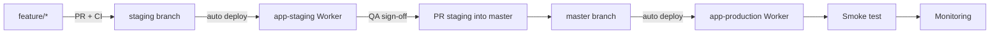
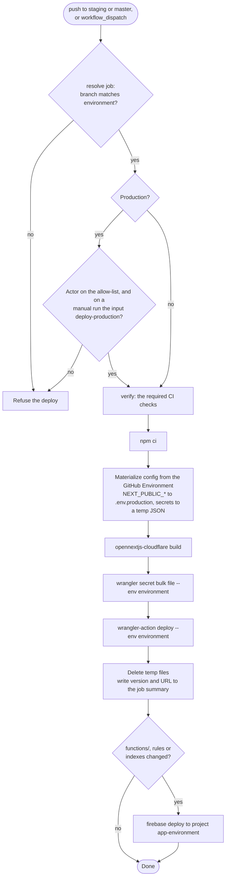

# CI/CD and Release (ITG-CI)

## When this applies

Writing or changing CI workflows, deploying, preparing a release, or merging into `master`.

## Decision diagrams

Deployment flow (§8.2):

The single `deploy.yml` workflow (§8.2.1):

## Rules

### Required checks (§8.1)

- **ITG-CI-01** Every pull request into `staging` or `master` SHALL run these checks, and the merge SHALL be gated on all of them (§8.1):

| Check | Command | Notes |
|---|---|---|
| Install | `npm ci` | Node 22 from `.nvmrc` |
| Typecheck | `tsc --noEmit` | |
| Lint | `eslint .` | `no-console` is an error under `src/app/api` and `src/lib` |
| Security lint | `lint:security` | eslint-plugin-security, `--max-warnings=0` (ITG-SEC-21) |
| Format | `prettier --check .` | |
| Unit + integration tests | `vitest run` | Required |
| Build | `opennextjs-cloudflare build` | Catches Workers-incompatible imports |
| Dependency audit | `npm audit --omit=dev --audit-level=high` | `functions/` audited separately |
| Route guards | `scripts/checks/check-route-guards.mjs` | Every `route.ts` uses `withApiRoute` with a guard or `public: true` |
| Route logging | `scripts/checks/check-route-logging.mjs` | Every `route.ts` emits at least one audit or app event |
| Dead code | `knip` | Unused files, exports, dependencies |
| Constitution | `musubi validate` | Article VII limits, traceability gaps |
| Changelog | `scripts/checks/check-changelog.mjs` | `CHANGELOG.md` changed when `src/` changed |

- **ITG-CI-02** Playwright E2E SHOULD run on every PR and SHALL gate PRs into `master`; a Lighthouse budget is recommended but not gating (§8.1).

### Deploy pipeline (§8.2.1)

- **ITG-CI-03** Deployment SHALL use one workflow, `.github/workflows/deploy.yml`: a push to `staging` deploys staging, a push to `master` deploys production, and `workflow_dispatch` with an `environment` input re-deploys manually (§8.2.1).
- **ITG-CI-04** A resolve job SHALL map the branch to its GitHub Environment and refuse mismatches. For production it SHALL check the actor against an allow-list and, on manual runs, require the literal input `deploy-production`. `concurrency: deploy-<environment>` SHALL prevent overlapping deploys (§8.2.1).
- **ITG-CI-05** WHILE the organization is on a GitHub plan without branch protection for private repositories, the resolve job SHALL be the production guard and SHALL refuse pushes that did not come from a merged PR. WHEN the plan allows it, branch protection on `master` and `staging` and a required reviewer on the `production` environment SHALL be added, keeping the allow-list (§8.2.1, §4.4).
- **ITG-CI-06** The deploy steps SHALL be, in order: `npm ci`; the verify checks; materialize configuration from the GitHub Environment (`NEXT_PUBLIC_*` Variables to `.env.production`, Secrets to a temporary JSON file); `opennextjs-cloudflare build`; `wrangler secret bulk <file> --env <environment>`; `cloudflare/wrangler-action` deploy; delete the temporary files and write the deployed version and URL to the job summary. The names SHALL be the secrets `CLOUDFLARE_API_TOKEN` and `CLOUDFLARE_ACCOUNT_ID` and the variable `DEPLOY_URL` (§8.2.1).
- **ITG-CI-07** WHEN `functions/`, Firestore rules or indexes changed, the same workflow SHALL deploy them to the matching Firebase project (`firebase deploy --only functions --project <app>-<environment>`) (§8.2.1).

### Production rules, smoke test, rollback (§8.3, §8.4)

- **ITG-CI-08** A merge into `master` SHALL require green CI, an approved PR, QA sign-off on staging, the security checklist when the change touches auth, data access or integrations, migrations applied to production (ITG-DAT-08), a rollback plan for risky changes, and release notes for client-facing changes (§8.3).
- **ITG-CI-09** The default rollback SHALL be `wrangler rollback` to the previous Worker version, which is always kept (§8.3).
- **ITG-CI-10** After every production deploy the team SHALL run the smoke test below (§8.4).

### Releases (§14)

- **ITG-CI-11** Releases SHALL be typed Patch (Z: bug fix or small improvement), Minor (Y: feature without breaking change), Major (X: breaking or contractual change) or Hotfix (urgent production fix from `hotfix/*`) (§14.1).
- **ITG-CI-12** Before a release the team SHALL complete the release checklist below (§14.2).
- **ITG-CI-13** Client release notes SHALL be generated from the `CHANGELOG.md` section (Summary, New features, Improvements, Bug fixes, Known issues, Notes for client) and posted in ClickUp (§14.3).

## Checklist

**Smoke test after deploy (§8.4)**

- [ ] App loads · login works · main dashboard loads
- [ ] Main workflow works · external APIs respond · an email is delivered
- [ ] `app.deployed` and the first user events visible in logs-console
- [ ] No errors in Cloudflare observability for the first 15 minutes

**Release checklist (§14.2)**

- [ ] All planned tasks done · QA completed on staging · security checklist where relevant
- [ ] Migrations and rules applied to production
- [ ] `CHANGELOG.md` moved from `Unreleased` to `X.Y.Z`; `package.json` bumped; release commit and tag
- [ ] Backup status checked · rollback plan defined (previous Worker version)
- [ ] Client notified where needed · logs-console checked after release

## Deviation

Record deviations as described in [README.md](README.md#deviations).
