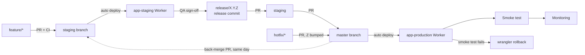
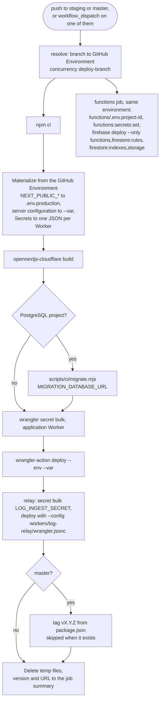

# CI/CD and Release (ITG-CI)

## When this applies

Writing or changing CI workflows, deploying, rotating a credential, preparing a release, or merging into `master`.

## Decision diagrams

Deployment flow (§8.2):

The single `deploy.yml` workflow (§8.2.1). The production guard is the ruleset on `master` and the `production` environment's branch policy, not a check inside the workflow.

## Rules

### Repository plan and protection (§8)

- **ITG-CI-01** Every pull request into `staging` or `master` SHALL run these checks, and the merge SHALL be gated on all of them (§8.1):

| Check | Command | Notes |
|---|---|---|
| Install | `npm ci` | Node 22 or later, pinned in `.nvmrc` |
| Typecheck | `tsc --noEmit` | |
| Lint | `eslint .` | Includes eslint-plugin-security over `src/`, `functions/`, `workers/` (ITG-SEC-21); `no-console` is an error under `src/app/api` and `src/lib` |
| Format | `prettier --check .` | |
| Unit + integration tests | `vitest run` | Required |
| Build | `opennextjs-cloudflare build` | Catches Workers-incompatible imports |
| Dependency audit | `npm audit --omit=dev --audit-level=high` | `functions/` audited separately |
| Route guards | `scripts/checks/check-route-guards.mjs` | Every `route.ts` uses `withApiRoute` with a guard or `public: true` |
| Route logging | `scripts/checks/check-route-logging.mjs` | Every `route.ts` emits at least one audit or app event |
| Function triggers | `scripts/checks/check-function-triggers.mjs` | Fails on any `onRequest` or `onCall` export under `functions/src/` |
| Audit catalogue | `scripts/checks/check-audit-catalogue.mjs` | `documentation/AUDIT_LOGGING.md` matches `src/lib/logs/allowlist.ts` (ITG-LOG-17) |
| Dead code | `knip` | Unused files, exports, dependencies |
| Constitution | `musubi validate` | Article VII limits, traceability gaps |
| Changelog | `scripts/checks/check-changelog.mjs` | `CHANGELOG.md` changed when `src/` changed |
| Feature registry | `scripts/checks/check-feature-registry.mjs` | Every folder under `src/features/` is in the registry (ITG-SEC-23) |
| AI provider | `scripts/checks/check-ai-provider.mjs` | The AI properties of ITG-SEC-20 |
| Rules | `scripts/checks/check-rules.mjs` | When a rules file changed: the branch's rules against the cases of ITG-SEC-16 through the Security Rules API (ITG-TST-14) |

- The scaffold's `.github/workflows/ci.yml` runs one job per check, so each can be a required status check; `deploy.yml` reads the class and readers of every key from the block headers of `.env.example` (`scripts/ci/materialize-config.mjs`) and deploys each Worker with `scripts/ci/deploy-worker.mjs`.

- **ITG-CI-02** Playwright E2E SHALL be a required check on PRs into `master` and SHALL be skipped on `hotfix/*` branches; on PRs into `staging` it is recommended, not gating. A Lighthouse budget is recommended (§8.1).

### Deploy pipeline (§8.2.1)

- **ITG-CI-03** Deployment SHALL use one workflow, `.github/workflows/deploy.yml`: a push to `staging` deploys staging, a push to `master` deploys production, and a manual run (`workflow_dispatch`) deploys the head of the branch it is run on, so that a changed Variable or Secret goes live without a merge. A re-run of an old workflow run SHALL NOT be used for this (§8.2.1).
- **ITG-CI-04** A resolve job SHALL map `staging` → staging and `master` → production, and `concurrency: deploy-${{ github.ref_name }}` SHALL serialize deploys per branch. The workflow SHALL run no checks of its own: the required checks and "branch up to date before merging" guarantee that the merged commit was tested (§8.2.1).
- **ITG-CI-05** The organization SHALL be on GitHub Team or higher. Branch protection or a ruleset on `master` and `staging` SHALL require a pull request with the checks of ITG-CI-01 green and the branch up to date, and SHALL block direct and force pushes; on `master` a project with two or more developers SHALL require one approval, with one named bypass person. The `production` environment SHALL have a deployment branch policy limited to `master`; `staging` stays open to all branches because PR CI reads it. No environment reviewer is used. Without the plan the design does not run; there is no fallback (§8).
- **ITG-CI-06** The deploy job SHALL run, in order: `npm ci`; materialize configuration (public Variables to `.env.production`, server configuration to `--var` arguments, Secrets to one temporary JSON per Worker); `opennextjs-cloudflare build`; `scripts/ci/migrate.mjs` when the project uses PostgreSQL; `wrangler secret bulk` for the application Worker (every credential except `LOG_INGEST_SECRET`); `cloudflare/wrangler-action` deploy with `--var`; the same two steps for the relay with `--config workers/log-relay/wrangler.jsonc`; on `master` the tag `vX.Y.Z` from `package.json`, skipped when it exists (`contents: write`); delete the temporary files and write the version and URL to the job summary. Fixed names: secrets `CLOUDFLARE_API_TOKEN`, `CLOUDFLARE_ACCOUNT_ID`; variable `DEPLOY_URL` (§8.2.1).
- **ITG-CI-07** A separate job in the same workflow and GitHub Environment SHALL write `functions/.env.<project-id>` from the Variables, set the Functions secrets with `firebase functions:secrets:set`, and run `firebase deploy --only functions,firestore:rules,firestore:indexes,storage --project <app>-<environment>`. On a push it SHALL run when `functions/**`, `firestore.rules`, `firestore.indexes.json`, `storage.rules` or `firebase.json` changed; on a manual run it SHALL always run. A project without Firebase Storage leaves `storage` out (§8.2.1).

### Production rules, smoke test, rollback (§8.3, §8.4)

- **ITG-CI-08** A merge into `master` SHALL require green CI, a pull request (approval per ITG-CI-05), QA sign-off on staging (a hotfix is verified by the smoke test instead), the security checklist when the change touches auth, data access or integrations, a rollback plan for risky changes, and release notes for client-facing changes. A deploy with a migration SHALL run in the deploy window of ITG-DAT-08 (§8.3).
- **ITG-CI-09** The default rollback SHALL be `wrangler rollback` to the previous Worker version. After a PostgreSQL schema change it is safe only when the migration was additive; otherwise the fix goes forward. Firestore rules, indexes and Functions changes SHALL be rolled back with a revert PR (§8.3).
- **ITG-CI-10** After every production deploy the team SHALL run the smoke test below; a failing smoke test after a hotfix triggers `wrangler rollback` (§8.4).

### Releases (§14)

- **ITG-CI-11** Releases SHALL be typed Patch (Z: bug fix or small improvement), Minor (Y: feature without breaking change), Major (X: breaking or contractual change) or Hotfix (urgent production fix from `hotfix/*`) (§14.1).
- **ITG-CI-12** Before a release the team SHALL complete the release checklist below (§14.2).
- **ITG-CI-13** Client release notes SHALL be generated from the `CHANGELOG.md` section (Summary, New features, Improvements, Bug fixes, Known issues, Notes for client) and posted in ClickUp (§14.3).

## Checklist

**Smoke test after deploy (§8.4)**

- [ ] App loads · login works · main dashboard loads
- [ ] Main workflow works · external APIs respond · an email is delivered
- [ ] `app.deployed` and the first user events visible in logs-console
- [ ] No errors in Cloudflare observability for the first 15 minutes

**Release checklist (§14.2)**

- [ ] All planned tasks done · QA completed on staging (a hotfix: the smoke test) · security checklist where relevant
- [ ] Migrations applied by the deploy; a deploy with a migration runs in the deploy window and the client is told in advance
- [ ] Release commit on `release/X.Y.Z` merged into `staging`; tag `vX.Y.Z` created by the deploy workflow
- [ ] Backup status checked · rollback plan defined (`wrangler rollback`; after a non-additive migration the fix goes forward)
- [ ] Client notified where needed · logs-console checked after release

## Deviation

Record deviations as described in [README.md](README.md#deviations).
