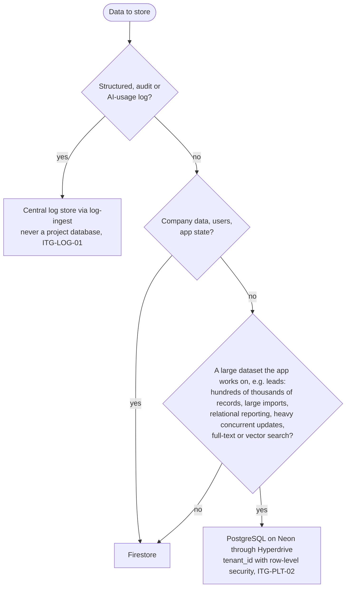
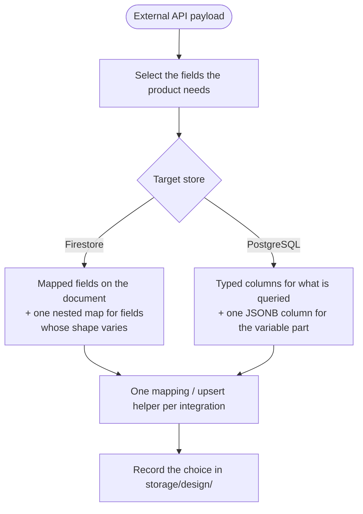
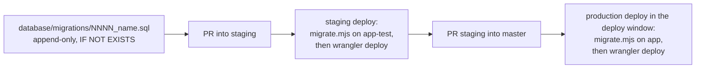

# Data (ITG-DAT)

## When this applies

Choosing where data is stored, designing a schema or collection, writing a migration or backfill, storing data from a vendor API, handling personal data, building an export, answering a DSAR or carrying out an erasure.

## Decision diagrams

Firestore or PostgreSQL (§2.3)? Firestore is the primary database in every project. Record the outcome in `steering/tech.md`.

Shape of data stored from an external API (§2.5). Only the fields the product needs are stored, never the raw payload as a whole.

Migration flow (§3.5):

## Rules

### Database choice and shape

- **ITG-DAT-01** Firestore SHALL be the primary database in every project: company data, users and app state live there; live updates poll an API route (§2.3).
- **ITG-DAT-02** PostgreSQL SHALL be used only for a large dataset the app works on, as the decision diagram above defines, on the setup of ITG-PLT-02; the decision SHALL be recorded in `steering/tech.md` (§2.3, §2.1.1).
- **ITG-DAT-03** Structured, audit and AI-usage logs SHALL NOT be stored in a project database; they go to the central log store (§2.3).
- **ITG-DAT-04** Data from an external API SHALL be stored as the fields the product needs, shaped as in the diagram above, through one mapping / upsert helper per integration, and the choice SHALL be recorded in `storage/design/` (§2.5).

### Migration discipline (§3.5)

- **ITG-DAT-05** PostgreSQL migrations SHALL be numbered files `database/migrations/0001_<name>.sql`, `0002_<name>.sql`, …, append-only forward steps. They SHALL be the only source of the schema: a fresh database is built by applying them in order, and there is no `database/schema.sql` (§3.5).
- **ITG-DAT-06** Each `CREATE` SHALL use `IF NOT EXISTS` (§3.5).
- **ITG-DAT-07** CI SHALL apply migrations: the deploy workflow runs `scripts/ci/migrate.mjs` with the migration user (`MIGRATION_DATABASE_URL`) before `wrangler deploy`, on staging and on production. The script records applied files in a `schema_migrations` table and applies only new ones, each file and its record in one transaction. Known gap: a PR that adds a migration is tested against the previous schema until it is merged into `staging` (§3.5).
- **ITG-DAT-08** A deploy with a migration SHALL run outside working hours where possible, and the client SHALL be told in advance, because it can make the app unavailable for a few minutes (§3.5).
- **ITG-DAT-09** Firestore SHALL change through rules, indexes and data backfills (operator scripts under `scripts/ops/`) that are versioned, reviewed in a PR and deployed to both environments in the same change (§3.5, ITG-PLT-23).

### Data and privacy (§13)

- **ITG-DAT-10** The project SHALL collect and store only the fields the product needs and limit access to them by role (§13.1).
- **ITG-DAT-11** Product data SHALL be kept until the client contract ends, as the privacy notice states. Copies in backups (nightly export, point-in-time recovery) SHALL be deleted when their retention runs out (§13.1, §13.3).
- **ITG-DAT-12** Personal data SHALL never be logged (ITG-LOG-03; the identifiers and the reduced network metadata of ITG-LOG-12 are the only exception), SHALL be deletable (ITG-DAT-15) and SHALL leave the system only through the exports of ITG-DAT-13 (§13.1).
- **ITG-DAT-13** Only authorized roles SHALL export data. Every export SHALL emit `export.requested` and `export.completed` (kept 24 months in `audit_log`); large exports SHALL run as background jobs (Function or n8n); export files SHALL expire; sensitive exports SHALL require extra confirmation (§13.2).
- **ITG-DAT-14** A product-data DSAR SHALL be answered through an admin endpoint in the application; an audit-data DSAR is answered by the ITG operator query (ITG-LOG-15) (§13.3).
- **ITG-DAT-15** An erasure request SHALL be carried out through an admin endpoint across Firebase Auth, Firestore (including the role copy of ITG-SEC-06), Storage, PostgreSQL and the data n8n wrote. Audit logs SHALL NOT be deleted (ITG-LOG-15) (§13.3).

## Checklist

- [ ] Database decision recorded in `steering/tech.md`
- [ ] Each new field is needed by the product and access-limited by role
- [ ] Migration numbered, append-only, `IF NOT EXISTS`; deploy window agreed with the client
- [ ] Rules, indexes and backfills deployed to both Firebase projects in the same change
- [ ] Exports audited, expiring and limited to authorized roles; erasure covers every store

## Deviation

Record deviations as described in [README.md](README.md#deviations).
