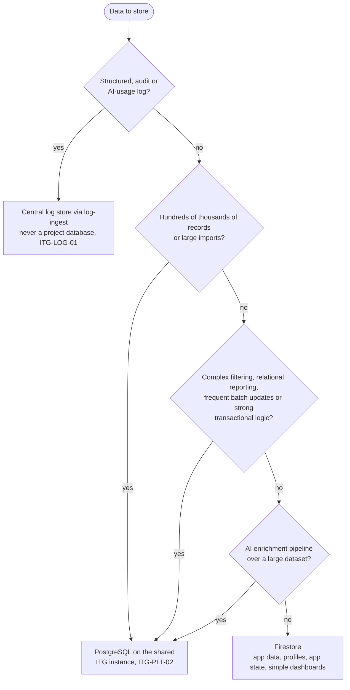
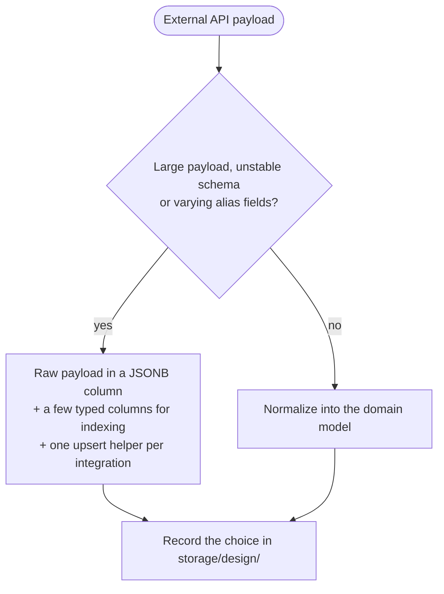
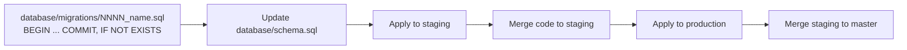

# Data (ITG-DAT)

## When this applies

Choosing where data is stored, designing a schema or collection, writing a migration or backfill, storing data from a vendor API, handling personal data, building an export or answering a DSAR.

## Decision diagrams

Firestore or PostgreSQL (§2.3)? Record the outcome in `steering/tech.md`.

Shape of data mirrored from an external API (§2.5, guidance):

Migration flow (§3.5):

## Rules

### Database choice and shape

- **ITG-DAT-01** Firestore SHALL be the database for product development, user data and app state (§2.3).
- **ITG-DAT-02** PostgreSQL SHALL be used only when the data is large, relational or reporting-heavy as defined by the decision diagram above, and the decision SHALL be recorded in `steering/tech.md` (§2.3, §2.1.1).
- **ITG-DAT-03** Structured, audit and AI-usage logs SHALL NOT be stored in a project database; they go to the central log store (§2.3).
- **ITG-DAT-04** The storage shape of data mirrored from an external API SHALL be decided per project with the diagram above and recorded in `storage/design/` (§2.5).

### Migration discipline

- **ITG-DAT-05** PostgreSQL migrations SHALL be numbered files `database/migrations/0001_<name>.sql`, `0002_<name>.sql`, …, append-only (§3.5).
- **ITG-DAT-06** Each migration SHALL be wrapped in `BEGIN; … COMMIT;` and each `CREATE` SHALL use `IF NOT EXISTS`, so that a re-run is a no-op (§3.5).
- **ITG-DAT-07** `database/schema.sql` SHALL be kept in sync as the canonical source for a fresh database (§3.5).
- **ITG-DAT-08** A migration SHALL be applied to staging before the dependent code is merged to `staging`, and to production before the merge to `master` (§3.5).
- **ITG-DAT-09** Firestore projects SHALL apply the same discipline to rules, indexes and data backfills: versioned in git, reviewed in a PR, applied to staging first and to both projects in the same change (§3.5, ITG-PLT-23).

### Data and privacy

- **ITG-DAT-10** The project SHALL collect and store only data the product needs. Before storing a field, the design SHALL answer: do we need it, for how long, who can access it, can it be deleted, is it sensitive (§13.1)?
- **ITG-DAT-11** Every data object in a design SHALL carry a classification: Public, Internal, Confidential, Sensitive or Highly sensitive (table below) (§13.2).
- **ITG-DAT-12** Personal data SHALL be limited to necessary fields, access-limited by role, never logged (ITG-LOG-12), given a retention period, deletable where required, and exported only through secure exports (§13.3).
- **ITG-DAT-13** Only authorized roles SHALL export data. Every export SHALL emit `export.requested` and `export.completed`; large exports SHALL run as background jobs; export files SHALL expire; sensitive exports SHALL require extra confirmation (§13.4).
- **ITG-DAT-14** The application SHALL provide an admin endpoint for the DSAR export of product data; audit data is exported through logs-console (§13.5, ITG-LOG-15).
- **ITG-DAT-15** Sensitive data from third-party APIs SHALL be stored only when necessary (§2.4).

| Level | Examples |
|---|---|
| Public | Marketing content |
| Internal | Project notes, non-sensitive configuration |
| Confidential | Client data, business records |
| Sensitive | Personal data, financial data |
| Highly sensitive | Secrets, tokens, authentication data |

## Checklist

- [ ] Database decision recorded in `steering/tech.md`
- [ ] Each new field has a reason, a retention period and a classification
- [ ] Migration numbered, idempotent, `schema.sql` updated, applied to staging first
- [ ] Rules and indexes deployed to both Firebase projects in the same change
- [ ] Exports audited, expiring and limited to authorized roles

## Deviation

Record deviations as described in [README.md](README.md#deviations).
