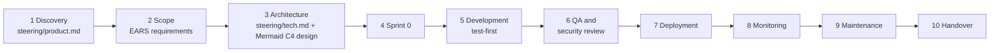
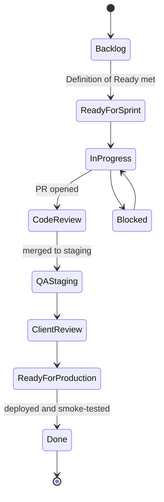
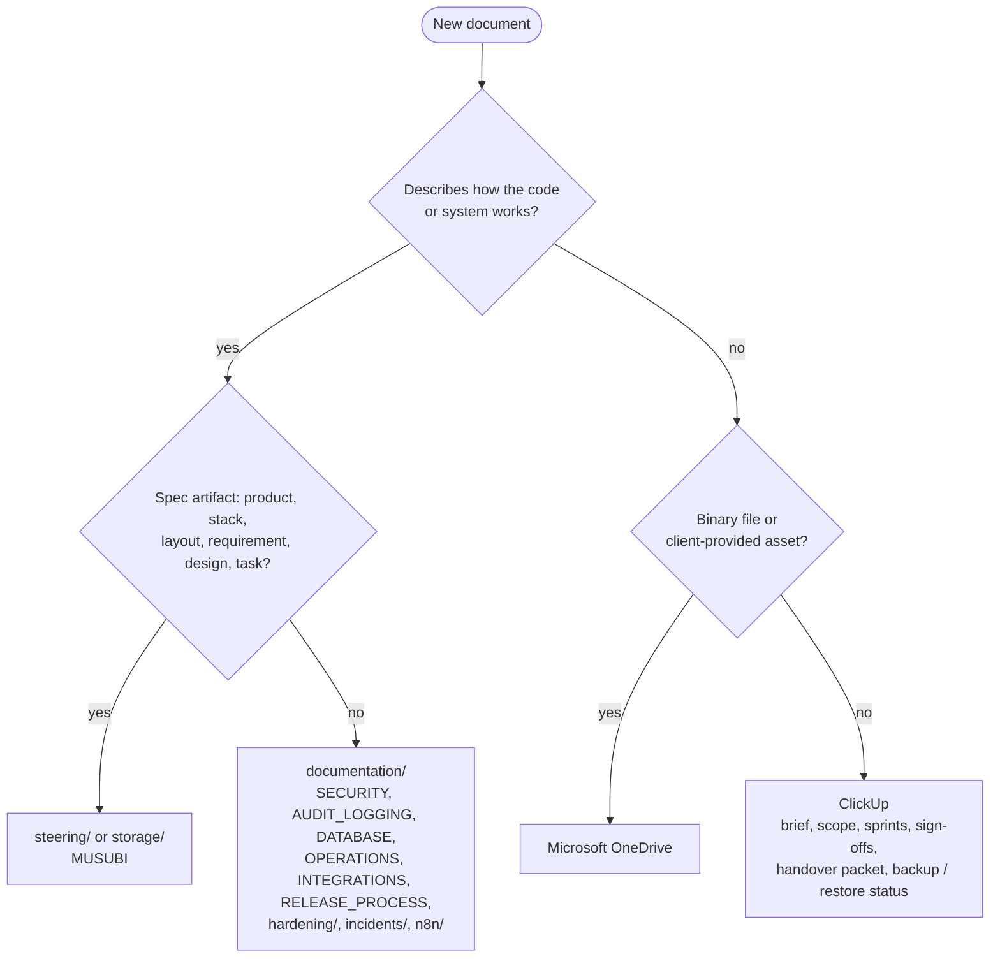

# Delivery Lifecycle (ITG-DEL)

## When this applies

Planning a project or a sprint, writing requirements, creating ClickUp tasks, deciding where a document lives, recording a deviation, and judging whether a task is ready or done.

## Decision diagrams

Every project follows the same ten stages (§1.1). The MUSUBI artifact of each stage is shown in brackets.



ClickUp task statuses (§5.2):



Where does a document live (§1.2)?



## Rules

### Framework, deviations and documentation

- **ITG-DEL-01** Every project SHALL follow the ten stages of the diagram above: discovery, scope definition, architecture via MUSUBI steering, Sprint 0, development, QA and security review, deployment, monitoring, maintenance and handover (§1.1).
- **ITG-DEL-02** The Required rows of the stack (ITG-PLT-01) SHALL change only through a playbook change. A project MAY deviate from a Recommended row or a default rule when its domain justifies it, and SHALL record the deviation in `documentation/` and, when it affects architecture or stack, in the MUSUBI steering files. Silent deviation SHALL NOT be allowed (Purpose).
- **ITG-DEL-03** A new project SHALL install MUSUBI from the ITG fork at its latest `-itg` release tag and run `musubi init` for the Claude Code platform with the ITG profile: constitution profile `application`, the ITG steering templates and these policies (§3.3).
- **ITG-DEL-04** Engineering documents SHALL live in the repository (`steering/`, `storage/`, `documentation/`), delivery documents in ClickUp, and client assets and large binaries in Microsoft OneDrive (§1.2).
- **ITG-DEL-05** IF a client contractually requires all artifacts in one location, THEN the project MAY override ITG-DEL-04, and SHALL record that as a deviation (§1.2).
- **ITG-DEL-06** The repository SHALL contain `documentation/SECURITY.md`, `AUDIT_LOGGING.md`, `OPERATIONS.md`, `INTEGRATIONS.md` and `RELEASE_PROCESS.md`, and `DATABASE.md` when the project has a project database, plus migration READMEs and query runbooks where they apply (§1.2, §18).
- **ITG-DEL-07** WHEN a significant security or architecture decision is made, the team SHALL write `documentation/hardening/<TOPIC>_HARDENING_<YYYY-MM-DD>.md` with what changed, why (rationale, threat model, trade-offs), the validation commands run, the residual risk and the follow-ups, and SHALL add one line for it to `documentation/hardening/README.md` (§1.3).

### Discovery, scope and architecture

- **ITG-DEL-08** Discovery SHALL produce the client business goal, target users, main workflows, key pain points, success metrics, technical constraints, data sensitivity level, integration requirements and, when relevant, an AI-readiness assessment, recorded in `steering/product.md` (§3.1).
- **ITG-DEL-09** Before development starts, the scope SHALL define the MVP, out-of-scope items, key screens, core data objects, external integrations, risks and assumptions, and delivery milestones (§3.2).
- **ITG-DEL-10** User stories SHALL be written as EARS requirements with `REQ-<AREA>-<NNN>` ids (`/sdd-requirements <feature>`), each with acceptance criteria and traceable to design, code and tests (§3.2; constitution Articles IV and V).
- **ITG-DEL-11** Architecture SHALL be recorded in MUSUBI artifacts, not in a separate architecture document: `steering/product.md`, `steering/tech.md`, `steering/structure.md`, `steering/rules/constitution.md`, `storage/specs/<feature>-requirements.md`, `storage/design/<feature>-design.md` (C4 views, ADRs, requirements coverage matrix, runtime-constraint clients), `storage/tasks/<feature>-tasks.md` and `storage/traceability/matrix.md` (`musubi trace matrix --format markdown --output storage/traceability/matrix.md`). The ClickUp architecture index SHALL link to these files (§3.3).
- **ITG-DEL-12** Diagrams in steering and design files SHALL be Mermaid: C4 (`C4Context`, `C4Container`, `C4Component`, `C4Deployment`) for the C4 views and `flowchart` for decision logic (§3.3).
- **ITG-DEL-13** Before Sprint 0 closes, `steering/tech.md` and the design documents together SHALL cover: system overview, authentication and authorization, data model, external integrations, AI services, file storage, logging, backup and recovery, security considerations, deployment flow and open risks (§3.3).
- **ITG-DEL-14** Feature development SHALL NOT start before every item of the Sprint 0 checklist below is complete (§3.4).

### ClickUp, sprints and meetings

- **ITG-DEL-15** ClickUp SHALL be organized as Workspace `ITG` → Space `Client Projects` → Folder `<Client Name>` → List `<Project Name>`, with Epics, Features, Tasks, Bugs and Releases (§5.1).
- **ITG-DEL-16** A task SHALL use one of the types Epic, Feature, Task, Bug, Technical Debt, Research, Security, Infrastructure, Documentation or Release, and the standard task template below (§5.3, §5.4).
- **ITG-DEL-17** A task SHALL enter a sprint only when it meets the Definition of Ready (§5.5).
- **ITG-DEL-18** A task SHALL be moved to Done only when it meets the Definition of Done (§5.6).
- **ITG-DEL-19** The default sprint length SHALL be one week (§6.1).
- **ITG-DEL-20** The project SHALL hold two standard meetings: weekly Sprint Planning (45–60 min: review the last sprint, select the sprint goal, plan and assign tasks, note risks, dependencies and the release target) and the Daily Standup (10–15 min, daily or 3× a week for small teams). Technical design discussions SHALL happen asynchronously in the PR or in `storage/design/`; client demos are scheduled per milestone (§6.2).
- **ITG-DEL-21** Each sprint SHALL define a sprint goal, committed tasks, stretch tasks, risks, dependencies and a release target, and the improvement action from the review SHALL be tracked as a task (§6.3).

## Checklists

**Standard task template (§5.4)**

```markdown
## Requirement
REQ-<AREA>-<NNN> (link to storage/specs/<feature>-requirements.md)
EARS statement, one line.
## Business Goal
## Acceptance Criteria
- [ ] …
## Technical Notes
Design: storage/design/<feature>-design.md
## Data / Security Impact
## Tests
- [ ] Unit (written first)  - [ ] E2E  - [ ] Manual QA on staging
```

**Definition of Ready (§5.5):** EARS requirement and acceptance criteria exist · business value understood · technical approach clear enough · Claude Design output available when needed · dependencies identified · estimate added · owner assigned.

**Definition of Done (§5.6):** requirement traced to code and tests · tests written first and passing · CI green · code reviewed · logs and audit events emitted · old code removed · documentation and `CHANGELOG.md` updated · verified on staging · manual QA done where needed.

**Sprint 0 (§3.4)**

- [ ] GitHub repository in `Improve-To-Grow` (private, GitHub Team or higher), `master` and `staging` under branch protection, README; Dependabot alerts and security updates on
- [ ] MUSUBI installed from the ITG fork at its latest `-itg` tag and `musubi init` run; `steering/*.md` filled; constitution profile `application`
- [ ] PR template, CODEOWNERS, `.nvmrc` (Node 22 or later), Prettier, ESLint with eslint-plugin-security, knip
- [ ] CI pipeline with the required checks gating merges (ITG-CI-01)
- [ ] GitHub Environments `staging` and `production` with Secrets and Variables (ITG-PLT-09); `production` limited to `master`
- [ ] Firebase projects `<app>-staging` and `<app>-production` with Identity Platform (TOTP MFA; reCAPTCHA enforcement `AUDIT` on staging, `ENFORCE` on production; client-side sign-up disabled), Firestore and Storage in `europe-west4`, App Check with reCAPTCHA Enterprise and enforcement on Storage; Firestore point-in-time recovery on in production
- [ ] Firestore rules, indexes and Storage rules deployed to both projects
- [ ] `wrangler.jsonc` with `staging` and `production` (assets, routes, `workers_dev: false`, bindings); first deploy of both Workers
- [ ] Staging custom domain `<app>-staging.improvetogrow.com`; production custom hostname on the client's subdomain via Cloudflare for SaaS when the client domain is known
- [ ] When the product uses AI: Vertex AI API enabled in both projects, used in `europe-west4`; Vertex AI User granted to the Worker's service account and, when a Function calls a model, to the Functions runtime service account
- [ ] ACS email sender configured for staging; production sender domain verification requested from the client
- [ ] Log-ingest credentials per environment; Queue `<app>-logs-<environment>` created and `workers/log-relay/` deployed for both environments; logger, recorders, allowlist and redactor wired; first `app.started` event visible in logs-console; retention policies entered
- [ ] `withApiRoute`, auth guards, account-state check, rate limiting through the Rate Limiting binding with a wrapper default, `ApiRouteError` in place with one example route
- [ ] Feature registry and kill switch: `DISABLED_FEATURES` in both environments, `ops/kill-switch` in both projects, owner-only endpoint; the ITG admin seat in production approved by the client
- [ ] Vitest and Playwright configured; one unit test and one E2E smoke test passing in CI
- [ ] Fixed test users seeded on staging with `scripts/ops/seed-test-users`, their passwords and the App Check debug token as CI-only Secrets; the rules test green; the scheduled `ci-*` cleanup workflow in place
- [ ] Backup Function scheduled for both projects; production password hash parameters stored next to the exports; restore test in `itg-restore` scheduled
- [ ] `documentation/` skeleton and ClickUp project structure created
- [ ] When ITG-DAT-02 requires PostgreSQL: Neon project with `<app>` and `<app>-test`, the migration and runtime users, a Hyperdrive configuration per environment, `MIGRATION_DATABASE_URL` as a CI-only Secret in both environments
- [ ] When n8n is used: its own credentials per project and environment (ITG-INT-07)

## Deviation

Record deviations as described in [README.md](README.md#deviations).
