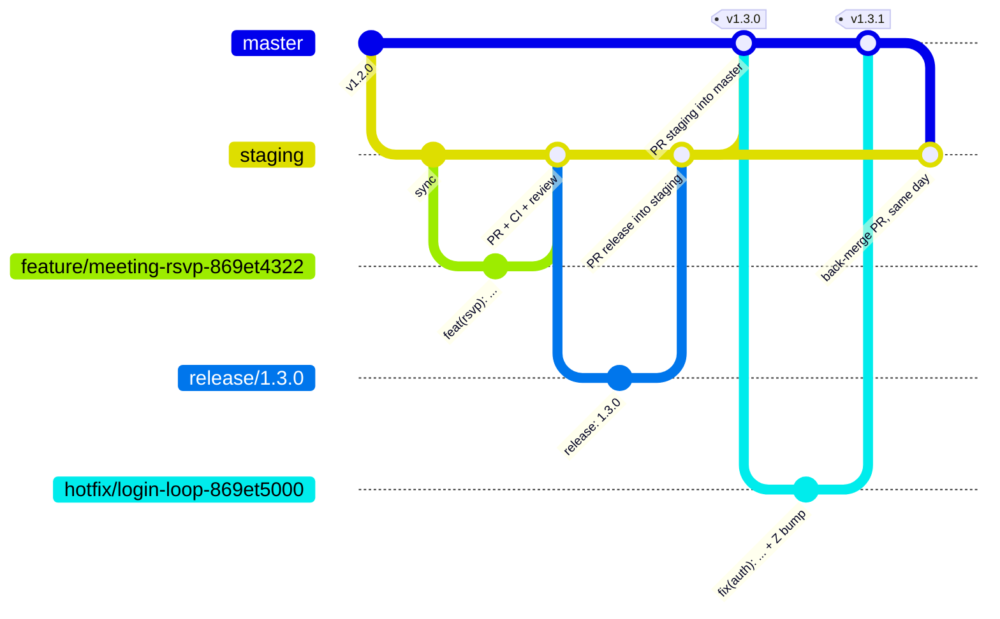
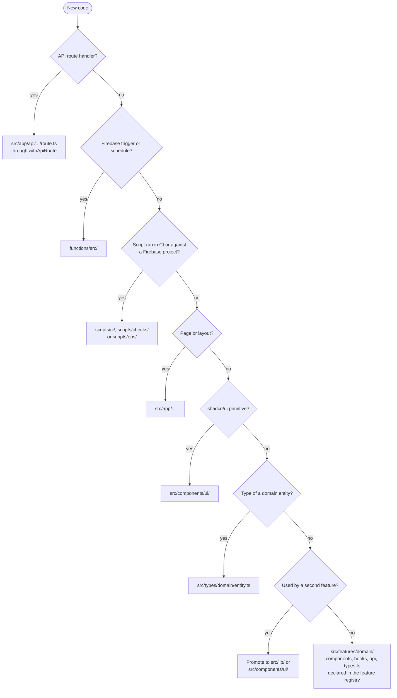

# Git and Code Quality (ITG-GIT)

## When this applies

Creating files and folders, branching, committing, versioning, opening or reviewing a pull request.

## Decision diagrams

Branching (§4.2). `master` is production and `staging` is staging; every merge deploys.



Where does this code go (§4.1)?



## Rules

### Repository structure (§4.1)

- **ITG-GIT-01** A repository SHALL hold one Next.js application organized by feature, with the layout in `steering/structure.md`, including `functions/`, `workers/log-relay/`, `scripts/ci/`, `scripts/checks/` and `scripts/ops/`. A monorepo (`apps/`, `packages/`) SHALL be used only when several deployable applications share packages (§4.1).
- **ITG-GIT-02** A feature folder `src/features/<domain>/` SHALL be self-contained, so that removing the feature removes one folder, and SHALL be declared in the feature registry (ITG-SEC-23). Shared code SHALL be promoted to `src/lib` or `src/components/ui` only when a second feature needs it (§4.1).
- **ITG-GIT-03** Types SHALL be split by domain and entity in `src/types/<domain>/<entity>.ts`, re-exported by a small `src/types/<domain>/index.ts`; there SHALL be no single index file that holds every type (§4.1).
- **ITG-GIT-04** The project SHALL use the path alias `@/*` → `src/*` and TypeScript `strict: true` (§4.1).

### Branches, commits and versions (§4.2, §4.3)

- **ITG-GIT-05** Branches SHALL be `master` (production), `staging` (staging), short-lived `feature/<slug>-<clickup-id>` from `staging`, `release/X.Y.Z` from `staging` for the release commit, and `hotfix/<slug>-<clickup-id>` from `master` (§4.2).
- **ITG-GIT-06** The flow SHALL be: feature branch → PR into `staging` → CI and review → merge (staging deploy) → QA on staging → `release/X.Y.Z` with the release commit → PR into `staging` → PR `staging` into `master` → merge (production deploy) → smoke test. A hotfix SHALL go by PR into `master` with the checks green (E2E skipped) and `Z` bumped in the same PR; the smoke test replaces QA on staging, `wrangler rollback` follows when it fails, and a back-merge PR `master` → `staging` SHALL be opened the same day (§4.2).
- **ITG-GIT-07** Commits SHALL follow Conventional Commits `type(scope): summary` with `feat`, `fix`, `refactor`, `chore`, `docs`, `ci`, `test` or `security`, and SHALL carry the ClickUp id in the scope or body (§4.3).
- **ITG-GIT-08** `CHANGELOG.md` SHALL follow Keep a Changelog; every PR SHALL add an entry under `Unreleased`, and CI SHALL fail a PR that changes `src/` without changing the changelog (§4.3).
- **ITG-GIT-09** The version in `package.json` SHALL be `X.Y.Z` (X breaking or contractual, Y feature, Z fix). The release commit `release: X.Y.Z — <summary>` SHALL move `Unreleased` under the version heading and bump `package.json`, on a `release/X.Y.Z` branch merged into `staging` by PR. After a merge into `master` the deploy workflow creates the tag `vX.Y.Z` (§4.3).

### Pull requests and review (§4.4, §4.5)

- **ITG-GIT-10** Every code change SHALL go through a pull request with the linked ClickUp task, screenshots for UI changes and all required CI checks green. A review SHALL be requested from a second developer when the project has one; in a project with two or more developers a merge into `master` SHALL require one approval (ITG-CI-05). Direct pushes to `staging` and `master` SHALL be blocked by branch protection (§4.4).
- **ITG-GIT-11** The PR description SHALL use the template below (§4.4).
- **ITG-GIT-12** Reviewers SHALL check that the code solves the `REQ-*` it is traced to; duplicates nothing that exists in `src/lib` or `src/components/ui`; reads permissions from claims and checks them in the route wrapper; handles errors with typed `ApiRouteError`s and logs them; came with tests written first; keeps sensitive data out of logs; leaves no dead code, unused exports, stale flags or old migrations; and, in a multilingual product, has every user-facing string in `src/locales/` (§4.5).

### Code quality (§4.6)

- **ITG-GIT-13** A source file SHALL contain at most 500 lines of code (non-blank, non-comment), a function at most 50 lines, and a non-index file at most 10 distinct imported modules (§4.6; constitution VII-4 to VII-6).
- **ITG-GIT-14** A second copy of the same logic SHALL be a review blocker; extract it to `src/lib` or the feature folder (§4.6).
- **ITG-GIT-15** WHEN a behavior changes, the old code path, flag, migration helper, message key and test SHALL be removed in the same PR. A compatibility shim SHALL carry an expiry date in a code comment and a ClickUp task (§4.6).
- **ITG-GIT-16** `knip` SHALL run in CI and fail on unused files, exports and dependencies; Prettier `format:check` SHALL run in CI (§4.6).
- **ITG-GIT-17** `musubi validate` and `musubi gaps` SHALL run in CI, and requirements without tests or code without a requirement SHALL be reported on the PR (§4.6).

## Checklist

Pull request template (§4.4):

```markdown
## Summary
What changed and why. ClickUp: <link>

## Target
- [ ] staging
- [ ] master (production) — requires QA sign-off on staging (a hotfix: the smoke test)

## Checklist
- [ ] CI green (typecheck, lint, tests, build, route checks, knip)
- [ ] Configuration keys added or changed (if any) are in the right class: Variables or Secrets added to both GitHub Environments, `.env.example` updated
- [ ] No secrets committed
- [ ] CHANGELOG.md updated
- [ ] New or changed routes emit audit / app events
- [ ] Old code path removed (no dead code left behind)
- [ ] Firestore rules / migrations updated for both environments (if any)
```

## Deviation

Record deviations as described in [README.md](README.md#deviations).
