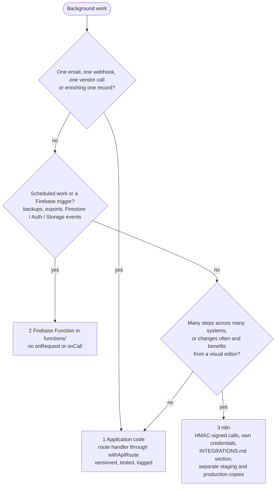
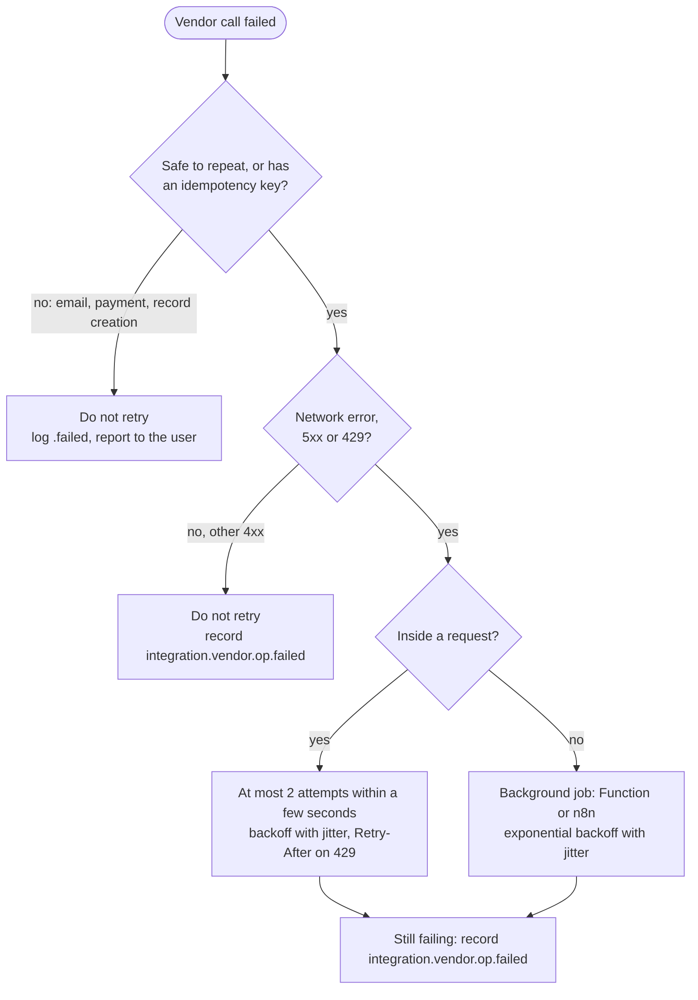
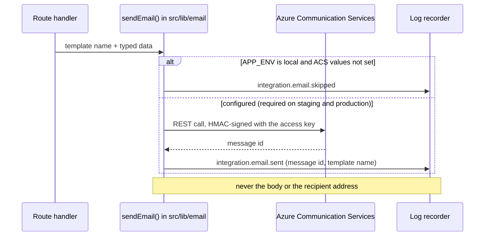

# Integrations (ITG-INT)

## When this applies

Calling a vendor SDK or API, sending email, sending a webhook, adding a background job, or building an n8n workflow.

## Decision diagrams

Where does background work go (§2.2.2)? Prefer the first box that fits.



Retry policy (§12.2):



Sending an email through ACS (§2.4.1):



## Rules

### Vendor calls (§2.4)

- **ITG-INT-01** Every third-party call SHALL go through server-side code; private API keys SHALL NOT reach the frontend (§2.4).
- **ITG-INT-02** Code SHALL call the vendor SDK or REST API directly from a service module in `src/features/<domain>/api/` or `src/lib/<vendor>/`, and SHALL NOT build a generic wrapper layer over the SDK (constitution Article VIII). A project-owned client is allowed only when the SDK cannot run on Workers, documented in the design (VIII-4, VIII-5; ITG-PLT-15) (§2.4).

### Email (§2.4.1)

- **ITG-INT-03** All transactional email (verification, password reset, invitations, notifications, reports) SHALL be sent through Azure Communication Services Email from application code, through `sendEmail()` in `src/lib/email/`: an ACS REST client with WebCrypto HMAC request signing with the access key, and typed templates in `src/lib/email/templates/` (§2.4.1).
- **ITG-INT-04** The sending domain SHALL be verified in ITG's ACS resource; the client adds the ownership TXT record, the two DKIM CNAME records, the ACS `include` in their existing SPF record and, when required, a DMARC record at their provider. ITG SHALL NOT take over client DNS or NS records or use client SMTP credentials (§2.4.1).
- **ITG-INT-05** Firebase's built-in email templates SHALL NOT be used: the application's route SHALL generate the action link with the Identity Toolkit REST API and send it through ACS. The route that sends password-reset and verification links SHALL be protected by App Check, the `auth` rate limit and a per-address limit, and SHALL answer the same whether or not the address exists. WHEN `APP_ENV` is `local` and the ACS values are not set, sending SHALL be skipped and logged as `integration.email.skipped`; on staging and production a missing ACS value SHALL fail the runtime-config check at startup. Every send SHALL be recorded as `integration.email.sent` / `.failed` with the message id and template name only (§2.4.1).

### Background jobs and n8n (§2.2.2, §12.3)

- **ITG-INT-06** Background work SHALL follow the preference order in the diagram above: application code, then Firebase Functions for Firebase triggers and all scheduled work, then n8n only for large or frequently changing workflows. A project without server-side jobs has no `functions/`. A synchronous need for Node is a deviation (§2.2.2).
- **ITG-INT-07** An n8n workflow SHALL have separate staging and production copies, keep secrets in n8n credentials and never in nodes, receive HMAC-signed calls from the application (ITG-SEC-17), and keep its JSON export in `documentation/n8n/`. WHEN n8n writes to the project's database, it SHALL use its own credential per project (a PostgreSQL user limited to the tables it writes, under row-level security; a Firestore service account separate from the application's), write with the `tenantId` the application sent, and emit an `integration.n8n.*` event to log-ingest for every write (§12.3).

### Documentation and resilience (§12)

- **ITG-INT-08** Every integration SHALL have a section in `documentation/INTEGRATIONS.md` following the template below (§2.4, §12.1).
- **ITG-INT-09** Every failed call SHALL be recorded as `integration.<vendor>.<op>.failed` (§2.4, §12.2).
- **ITG-INT-10** Calls SHALL be retried only for network errors, 5xx and 429, with exponential backoff and jitter, respecting `Retry-After` on 429, and with idempotency keys where the API supports them; other 4xx SHALL NOT be retried. A call that is not safe to repeat and has no idempotency key (email, payment, record creation) SHALL NOT be retried: the failure is logged and reported to the user. Inside a request there SHALL be at most 2 attempts within a total budget of a few seconds; longer retrying goes to a background job (§12.2).

## Checklist

**`documentation/INTEGRATIONS.md` section (§12.1)**

```markdown
## Integration: <Service>
Purpose · Owner · Authentication method · Endpoints used
Data sent / received / stored · Rate limits · Error handling · Retry policy
Webhooks (outbound signing) · Cost risks · Security notes
Events emitted (integration.<vendor>.*) · Environment variables (names only)
```

- [ ] Call made server-side, directly through the vendor SDK or REST API
- [ ] Section in `INTEGRATIONS.md`
- [ ] `.failed` events emitted; retries follow ITG-INT-10
- [ ] Outbound webhooks and calls to n8n signed (ITG-SEC-17)

## Deviation

Record deviations as described in [README.md](README.md#deviations).
