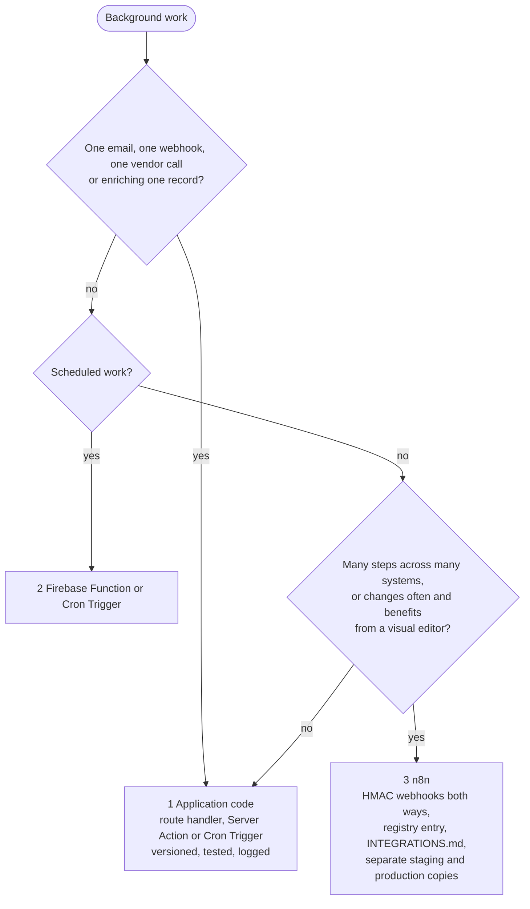
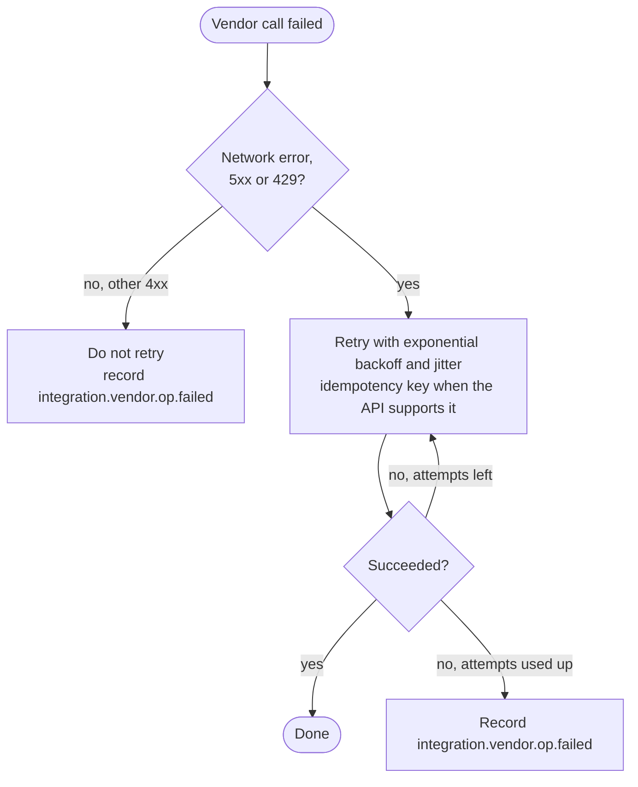
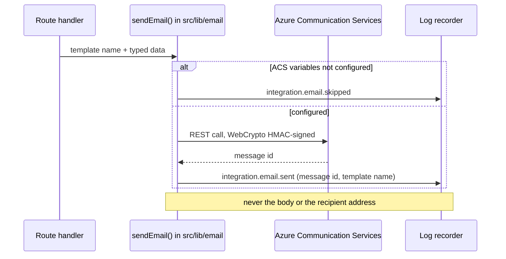

# Integrations (ITG-INT)

## When this applies

Calling a vendor SDK or API, sending email, receiving or sending a webhook, adding a background job, or building an n8n workflow.

## Decision diagrams

Where does background work go (§2.2.2)? Prefer the first box that fits.



Retry policy (§12.2):



Sending an email through ACS (§2.4.1):



## Rules

### Vendor calls

- **ITG-INT-01** Private API keys SHALL NOT reach the frontend; every third-party call SHALL go through server-side code (§2.4).
- **ITG-INT-02** Code SHALL call the vendor SDK or REST API directly from a service module in `src/features/<domain>/api/` or `src/lib/<vendor>/`, and SHALL NOT build a generic wrapper layer over the SDK (constitution Article VIII). A project-owned client is allowed only when the SDK cannot run on Workers, documented in the design (VIII-4, VIII-5; ITG-PLT-15) (§2.4).

### Email

- **ITG-INT-03** All transactional email (verification, password reset, invitations, notifications, reports) SHALL be sent through Azure Communication Services Email from application code, through `sendEmail()` in `src/lib/email/` with typed templates in `src/lib/email/templates/` (§2.4.1).
- **ITG-INT-04** The sending domain SHALL be verified in ITG's ACS resource; the client adds SPF, DKIM and, when required, DMARC records at their provider. ITG SHALL NOT take over client DNS or NS records or use client SMTP credentials (§2.4.1).
- **ITG-INT-05** Firebase's built-in email templates SHALL NOT be used. Auth flows SHALL generate the action link with the Identity Toolkit REST API and send it through ACS. Missing ACS configuration SHALL skip the send and log `integration.email.skipped`, never throw (§2.4.1).

### Background jobs and n8n

- **ITG-INT-06** Background work SHALL follow the preference order in the diagram above: application code, then Firebase Functions or Cron Triggers, then n8n only for large or frequently changing workflows (§2.2.2).
- **ITG-INT-07** An n8n workflow SHALL have separate staging and production copies, keep secrets in n8n credentials and never in nodes, sign every webhook in both directions with HMAC (ITG-SEC-17), and keep its JSON export in `documentation/n8n/` (§12.3).

### Documentation and resilience

- **ITG-INT-08** Every integration SHALL have a section in `documentation/INTEGRATIONS.md` following the template below and an entry in the ClickUp integration registry (§2.4, §12.1).
- **ITG-INT-09** Every failed call SHALL be recorded as `integration.<vendor>.<op>.failed` (§2.4, §12.2).
- **ITG-INT-10** Calls SHALL be retried only for network errors, 5xx and 429, with exponential backoff and jitter, and with idempotency keys where the API supports them; other 4xx SHALL NOT be retried (§12.2).

## Checklist

**`documentation/INTEGRATIONS.md` section (§12.1)**

```markdown
## Integration: <Service>
Purpose · Owner · Authentication method · Endpoints used
Data sent / received / stored · Rate limits · Error handling · Retry policy
Webhooks (inbound verification, outbound signing) · Cost risks · Security notes
Events emitted (integration.<vendor>.*) · Environment variables (names only)
```

- [ ] Call made server-side, directly through the vendor SDK or REST API
- [ ] Section in `INTEGRATIONS.md` and ClickUp registry entry
- [ ] `.failed` events emitted; retries follow ITG-INT-10
- [ ] Webhooks signed and verified (ITG-SEC-17, ITG-SEC-18)

## Deviation

Record deviations as described in [README.md](README.md#deviations).
