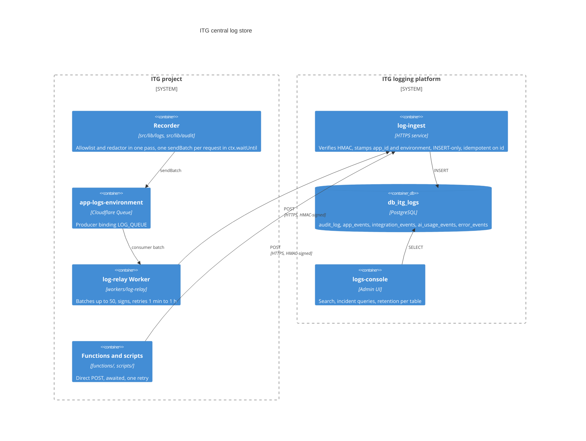
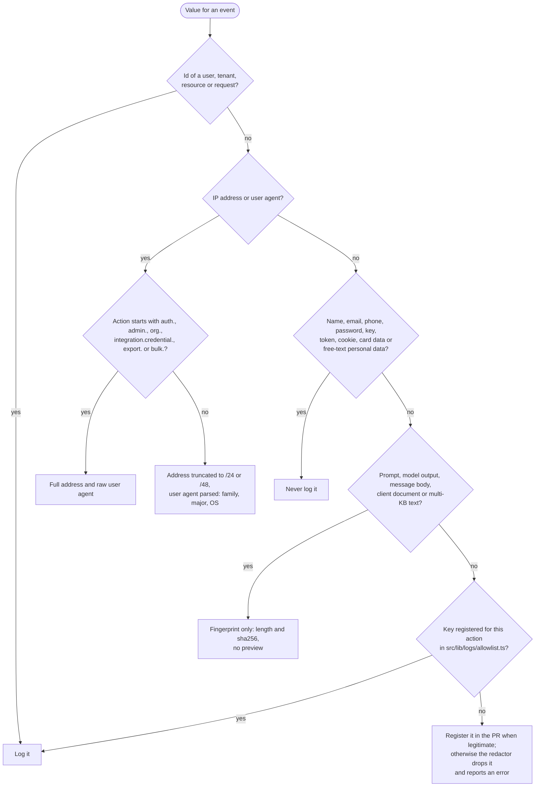

# Logging (ITG-LOG)

## When this applies

Every code change that adds or changes an API route, a privileged action, an integration call, an AI call, a background job or an export. Logging is part of the feature, not an afterthought.

## Decision diagrams

The central log store and its two delivery paths (§9.3). Applications never hold a database connection to it.

May this value be logged (§9.1, §9.5, §9.6)?

## Rules

### Principles and delivery (§9.1, §9.3)

- **ITG-LOG-01** Audit, app, integration, AI-usage and error events SHALL reach the ITG log-ingest service on two paths. The application Worker SHALL send a request's events in one `sendBatch` to the Cloudflare Queue `<app>-logs-<environment>` (binding `LOG_QUEUE`), consumed by `workers/log-relay/`, which signs batches of up to 50 rows / 256 KB, POSTs them, acknowledges on `2xx` and otherwise retries with a delay doubling from one minute to one hour, up to 100 attempts. Functions and operator scripts SHALL POST directly, HMAC-signed, awaited before the handler returns, with one retry. The recorder SHALL choose by what is bound: `LOG_QUEUE`, else `LOG_INGEST_URL` and `LOG_INGEST_SECRET`, else print to the console (`next dev`, unit tests). The application Worker SHALL hold no `LOG_INGEST_*` value, and no application SHALL connect to the logs database (§9.3).
- **ITG-LOG-02** Every API route SHALL emit at least one event through the route wrapper: an audit event for privileged or data-changing actions, an app event otherwise, and `.denied` / `.failed` variants on failure; CI enforces this (ITG-CI-01). The wrapper's automatic event counts for `check-route-logging` when the route id is registered in the event catalogue `src/lib/logs/route-events.ts` (the ITG MUSUBI scaffold's convention); otherwise the route calls `recordAuditEvent` or `recordAppEvent` itself. Background jobs, imports and exports, payments, deployments and AI calls (counts and cost) SHALL emit events too (§9.1).
- **ITG-LOG-03** Log rows SHALL carry user, tenant and resource ids, never names, email addresses, phone numbers, free-text personal data, client documents, raw prompts or model outputs, or message bodies. The redactor is the last line of defense, not the first (§9.1).
- **ITG-LOG-04** Application code SHALL NOT update or delete log rows; retention pruning is a platform job (§9.1).
- **ITG-LOG-05** A log write SHALL NOT fail the caller or delay the response: in the Worker the batch is sent inside `ctx.waitUntil`; in Functions and scripts the flush is awaited but its result is ignored. A failed delivery SHALL be retried once, then written to the runtime log and swallowed; it SHALL NOT become an `error_events` row (§9.1, §9.3).
- **ITG-LOG-06** Events SHALL use the categories below; database-side concerns (schema, constraints, partitioning, pooling, pruning) belong to the platform, not to the project repository (§9.2, §9.3).

| Category | Where | Purpose |
|---|---|---|
| Runtime logs | Cloudflare observability, Firebase / Functions logs | Technical debugging, request traces, log-delivery failures |
| `audit_log` | Central log store | Who did what, when, to which resource |
| `app_events` | Central log store | Important product and business events |
| `integration_events` | Central log store | Third-party and n8n calls, n8n writes, email sends, failures |
| `ai_usage_events` | Central log store | Model, tokens, cost estimate, result status, never prompts or outputs |
| `error_events` | Central log store | Caught 5xx errors, uncaught exceptions and redactions |

### Event shape (§9.4, §9.5, §9.6)

- **ITG-LOG-07** Action names SHALL be lowercase dotted `<domain>.<resource>.<verb>` matching `^[a-z0-9]+(\.[a-z0-9_]+)+$`. Every privileged action SHALL emit the lifecycle variants `<action>`, `<action>.denied` and `<action>.failed`. Standard prefixes: `auth.*`, `admin.*`, `org.*`, `integration.<vendor>.*`, `integration.email.*`, `integration.n8n.*`, `ai.*`, `export.*`, `app.*` (`app.started`, `app.deployed`), plus domain prefixes (§9.4).
- **ITG-LOG-08** Every event SHALL carry `id`, `occurred_at`, `app_id`, `environment`, `action`, `actor_user_id` (nullable for system events), `actor_tenant_id` (nullable), `resource_type`, `resource_id` (nullable), `ip_address`, `user_agent`, `request_id` and `metadata` (JSON, allowlisted and redacted). There SHALL be no `actor_email`, `actor_name` or similar column. The recorder SHALL set `id` (a UUID) and `occurred_at` before any transport, so a redelivered message is recognised (§9.5).
- **ITG-LOG-09** Metadata keys SHALL be registered per action or action prefix in `src/lib/logs/allowlist.ts` (`registerMetadataAllowlist('integration.email.sent', ['messageId', 'templateName', 'provider'])`, nested keys as dotted paths), resolved by exact action first, then the longest prefix. `auth.*`, `admin.*` and `integration.credential.*` SHALL be registered before their first event ships. An unregistered action is not pruned (passive mode); a switch to strict mode SHALL be recorded in `steering/tech.md` (§9.6).
- **ITG-LOG-10** Prompts, generated AI content, message bodies and any multi-KB text SHALL be stored only as `{ length, sha256 }` from the shared fingerprint helper, with no preview; a preview for content that cannot contain personal data SHALL be recorded in `steering/tech.md`. Update events SHALL record before/after for changed typed fields only; for large JSON blobs, only the changed key names, at most 30, with a `truncated` flag (§9.6).
- **ITG-LOG-11** The allowlist and the redactor SHALL run as one pass on every event, applying in order: (1) a key not registered for a registered action is dropped; (2) a key containing a sensitive term (password, secret, token, apikey, authorization, cookie, credential, bearer, email, name, displayname, firstname, lastname, fullname, phonenumber, messagebody and the rest of the playbook's list) and not registered for this action is dropped; (3) values shaped like vendor tokens, JWTs, long base64 or hex strings, phone numbers or email addresses are scrubbed, registered or not; (4) strings are cut at 1024 characters, depth at 6, objects at 32 keys. Every redaction SHALL be reported through `logger.error` (action, key path, rule, request id, never the value), which forwards to `error_events`; under `NODE_ENV=test` the redactor SHALL throw. The key list and value patterns SHALL NOT be edited per project (§9.6).
- **ITG-LOG-12** The route wrapper SHALL stamp `ip_address` and `user_agent`, and the recorder SHALL reduce them before the event leaves the application: security events (action prefix `auth.`, `admin.`, `org.`, `integration.credential.`, `export.`, `bulk.`) keep the full address and the raw user agent; every other event carries the address truncated to `/24` (IPv4) or `/48` (IPv6) and the parsed user agent (browser family, major version, OS) (§9.5).

### Retention, catalogue and access (§9.6–§9.10)

- **ITG-LOG-13** Retention SHALL be set per app and table in logs-console and entered in Sprint 0, because a table without a policy is kept indefinitely: `audit_log` 24 months, `ai_usage_events` 12 months, `app_events`, `integration_events` and `error_events` 6 months (§9.7).
- **ITG-LOG-14** Every module SHALL use `createLogger('<module-id>')` from `src/lib/logger.ts` (module ids `api-<path>` for routes, `<name>-service` for services); `console.*` SHALL be a lint error under `src/app/api` and `src/lib`. Caught errors that return a 5xx SHALL call `logger.error`, which forwards to `error_events`; uncaught errors SHALL be captured in `instrumentation.ts` (`onRequestError`). Server configuration SHALL be read in `src/lib/runtime-config.ts` and validated with zod at startup. Levels: `debug` (local only), `info`, `warn`, `error`, `critical` (§9.9).
- **ITG-LOG-15** Audit records SHALL NOT be deleted on an erasure request (GDPR Article 17 legal-obligation carve-out). An audit-data DSAR SHALL be answered by the ITG operator query documented in the log-ingest repository (Article 15). Security events keep the full address and raw user agent for the window of their table. Every project's privacy notice SHALL state this position and that window (§9.8).
- **ITG-LOG-16** Events that exist only in the browser SDK SHALL go through one endpoint with a small enum of allowed event types, sent with `fetch({ keepalive: true })`, the App Check token and, after login, the ID token in `Authorization: Bearer`. The server SHALL stamp actor id, IP and user agent (reduced as in ITG-LOG-12), validate reason codes against a strict character class and rate-limit per IP (§9.10).
- **ITG-LOG-17** `documentation/AUDIT_LOGGING.md` SHALL list every action with the metadata keys it may carry. Its action table SHALL be generated from `src/lib/logs/allowlist.ts` by `npm run audit:catalogue` between fixed markers, and `check-audit-catalogue` SHALL fail a PR whose committed table differs (ITG-CI-01) (§9.4, §9.6).

## Checklist

- [ ] New or changed route emits its audit or app event, with `.denied` and `.failed`
- [ ] New metadata keys registered in `src/lib/logs/allowlist.ts`; `npm run audit:catalogue` run
- [ ] No names, emails or bodies in metadata; prompts and outputs fingerprinted
- [ ] Network metadata reduced outside the security prefixes
- [ ] Tests pass with the redactor throwing; no redaction errors in `error_events` on staging
- [ ] Events visible in logs-console on staging; the queue has no backlog

## Deviation

Record deviations as described in [README.md](README.md#deviations).
