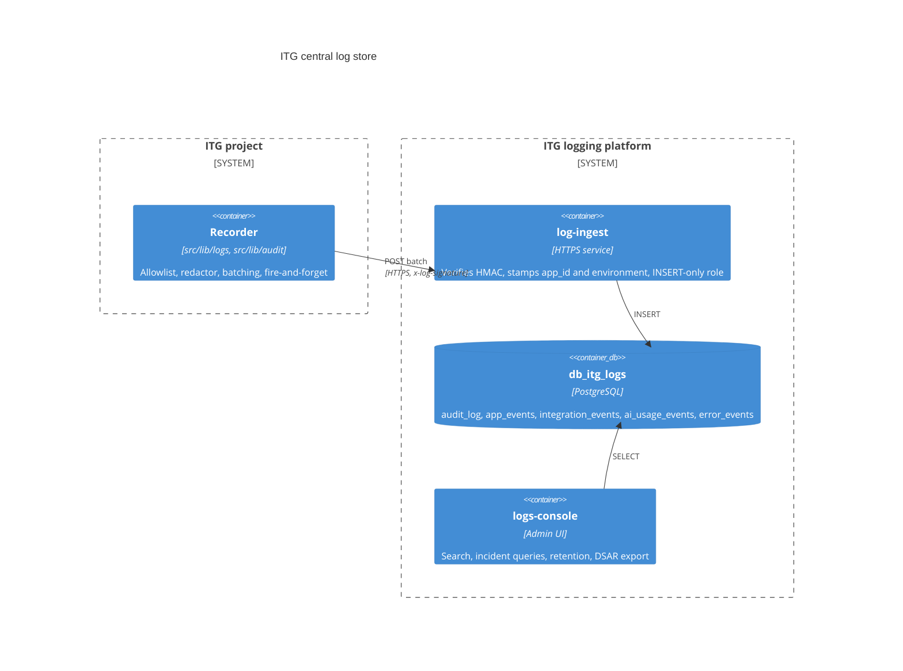
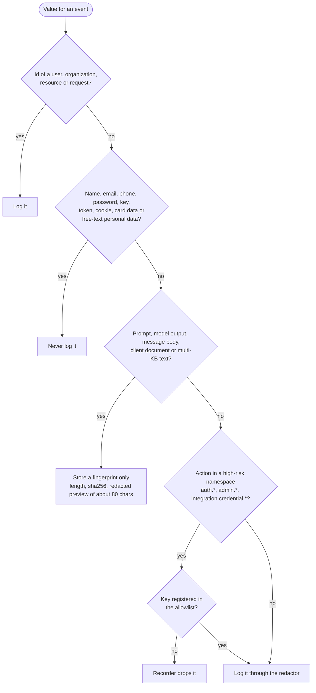

# Logging (ITG-LOG)

## When this applies

Every code change that adds or changes an API route, a privileged action, an integration call, an AI call, a background job or an export. Logging is part of the feature, not an afterthought.

## Decision diagrams

The central log store (§9.3). Applications never hold a database connection to it.

May this value be logged (§9.6, §9.10)?

## Rules

### Principles and store

- **ITG-LOG-01** Structured, audit, integration, AI-usage and error events SHALL be sent to the ITG log-ingest service with a per-environment `LOG_INGEST_URL` and `LOG_INGEST_SECRET`, HMAC-signed, batched (at most 50 rows or 256 KB) and at-most-once. The application SHALL NOT connect to the logs database. WHEN the ingest variables are not set (local), the recorder SHALL print to the console instead (§9.3).
- **ITG-LOG-02** Every API route SHALL emit at least one event through the route wrapper: an audit event for privileged or data-changing actions, an app event otherwise, and `.denied` / `.failed` variants on failure. CI enforces this (ITG-CI-01) (§9.1).
- **ITG-LOG-03** Log rows SHALL carry user, organization and resource ids, never names, email addresses, phone numbers or message bodies. The redactor is the last line of defense, not the first (§9.1).
- **ITG-LOG-04** Application code SHALL NOT update or delete log rows; pruning is a platform job (§9.1).
- **ITG-LOG-05** A log write SHALL NOT block or fail a user request: writes are scheduled with `ctx.waitUntil`, and failures go to the runtime logger and are swallowed (§9.1).
- **ITG-LOG-06** Events SHALL use the categories below; database-side concerns (schema, constraints, partitioning, pruning) belong to the platform, not to the project repository (§9.2, §9.3, Appendix B).

| Category | Where | Purpose |
|---|---|---|
| Runtime logs | Cloudflare observability, Firebase / Functions logs | Technical debugging, request traces |
| `audit_log` | Central log store | Who did what, when, to which resource |
| `app_events` | Central log store | Important product and business events |
| `integration_events` | Central log store | Third-party and n8n calls, email sends, webhook receipts, failures |
| `ai_usage_events` | Central log store | Model, tokens, cost estimate, result status, never prompts or outputs |
| `error_events` | Central log store (+ Sentry when enabled) | Caught 5xx errors and uncaught exceptions |

### Event shape

- **ITG-LOG-07** Action names SHALL be lowercase dotted `<domain>.<resource>.<verb>` matching `^[a-z0-9]+(\.[a-z0-9_]+)+$`. Every privileged action SHALL emit the lifecycle variants `<action>`, `<action>.denied` and `<action>.failed`. Standard prefixes: `auth.*`, `admin.*`, `org.*`, `integration.<vendor>.*`, `integration.email.*`, `integration.webhook.*`, `ai.*`, `export.*`, `app.*` (`app.started`, `app.deployed`), plus domain prefixes. The project's action catalogue SHALL be kept in `documentation/AUDIT_LOGGING.md` (§9.4).
- **ITG-LOG-08** Every event SHALL carry `id`, `occurred_at`, `app_id`, `environment`, `action`, `actor_user_id` (nullable for system events), `actor_org_id` (nullable), `resource_type`, `resource_id` (nullable), `ip_address`, `user_agent`, `request_id` and `metadata` (JSON, allowlisted and redacted). There SHALL be no `actor_email`, `actor_name` or similar column (§9.5).
- **ITG-LOG-09** High-risk namespaces (`auth.*`, `admin.*`, `integration.credential.*`) SHALL register the metadata keys they may carry; the recorder SHALL drop any other key (§9.6).
- **ITG-LOG-10** Prompts, generated AI content, message bodies and any multi-KB text SHALL be stored only as a fingerprint `{ length, sha256, preview }`, with a redacted preview of about 80 characters. Update events SHALL record before/after for changed typed fields only; for large JSON blobs, only the changed key names, at most 30, with a truncated flag (§9.6).
- **ITG-LOG-11** The redactor SHALL run on every event. It SHALL drop values whose key contains a sensitive term (password, passcode, pin, secret, token, apikey, api_key, privatekey, authorization, cookie, credential, mfasecret, totpsecret, refreshtoken, accesstoken, idtoken, sessiontoken, bearer, emailbody, messagebody, htmlbody, rawbody, phonenumber, mobilephone, ssn, tax_id, email, name, displayname, firstname, lastname, fullname); scrub values shaped like vendor tokens, JWTs, long base64 or hex strings, phone numbers and email addresses; limit strings to 1024 characters, depth to 6 and objects to 32 keys; and never throw (§9.6).

### What, how long, and who sees it

- **ITG-LOG-12** The project SHALL log authentication events, permission failures, business actions, integration calls and failures, email sends, AI calls (counts and cost), background job status, import and export status, payment events, security-relevant actions and deployments. It SHALL NOT log passwords, keys, tokens, cookies, card data, names, email addresses, phone numbers, free-text personal data, client documents, raw prompts or model outputs, raw email or message bodies, or webhook bodies containing PII (§9.10).
- **ITG-LOG-13** Retention SHALL be configured per action-prefix bucket in logs-console, with these defaults: `auth.*`, `admin.*`, `org.*`, `integration.credential.*` 24 months; domain data actions and `export.*` 12 months; `ai.*`, `prompt.*` 12 months; `integration.sync.*`, `integration.outbound.*`, `integration.webhook.*`, `integration.email.*` 6 months; `error_events`, `app_events` 6 months (§9.7).
- **ITG-LOG-14** Every module SHALL use `createLogger('<module-id>')` from `src/lib/logger.ts` (module ids `api-<path>` for routes, `<name>-service` for services); `console.*` SHALL be a lint error under `src/app/api` and `src/lib`. Caught errors that return a 5xx SHALL call `logger.error`, which forwards to `error_events`; uncaught errors SHALL be captured in `instrumentation.ts` (`onRequestError`). Environment variables SHALL be parsed once with zod in `src/lib/runtime-config.ts`; feature code SHALL NOT read `process.env`. Levels: `debug` (local only), `info`, `warn`, `error`, `critical` (§9.9).
- **ITG-LOG-15** Audit records SHALL NOT be deleted on an erasure request (GDPR Article 17 legal-obligation carve-out). The data subject SHALL get a copy of their audit footprint through the DSAR export in logs-console (Article 15), which is itself audited as `admin.dsar.export`. Every project's privacy notice SHALL state this position (§9.8).
- **ITG-LOG-16** Events that exist only in the browser SDK SHALL go through one beacon endpoint with a small enum of allowed event types. Post-login events SHALL require a verified session; pre-auth events SHALL require the login-guard cookie issued after Turnstile. The server SHALL stamp actor id, IP and user agent, validate reason codes against a strict character class and rate-limit per IP; the client SHALL use `navigator.sendBeacon` with a `fetch({ keepalive: true })` fallback (§9.11).

## Checklist

- [ ] New or changed route emits its audit or app event, with `.denied` and `.failed`
- [ ] New action names added to `documentation/AUDIT_LOGGING.md`
- [ ] No names, emails or bodies in metadata; high-risk keys allowlisted
- [ ] Prompts and outputs fingerprinted, never stored
- [ ] Events visible in logs-console on staging

## Deviation

Record deviations as described in [README.md](README.md#deviations).
