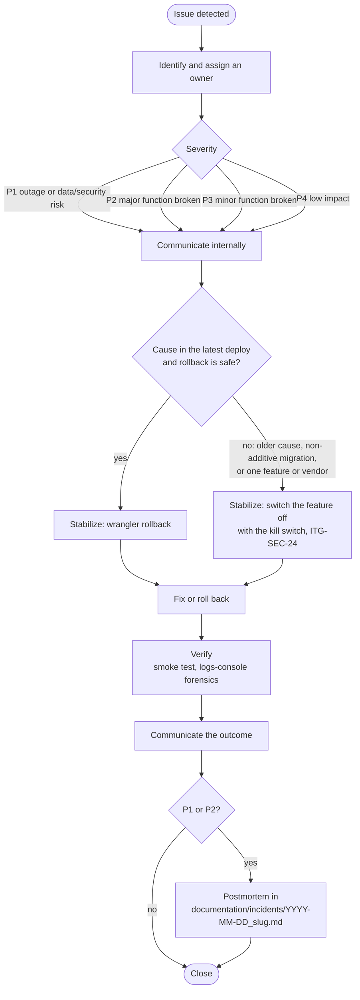
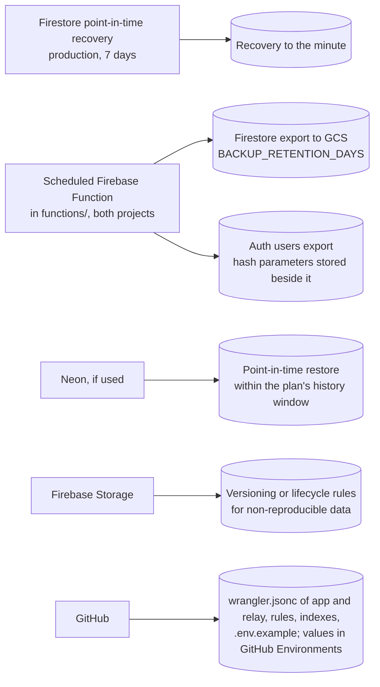

# Operations (ITG-OPS)

## When this applies

Setting up or checking backups, running a restore test, handling an incident, monthly maintenance, handing a project to the client, closing a project, or deciding whether a project is production-ready.

## Decision diagrams

Incident response (§15.2):

What is backed up, and how (§10.2):

## Rules

### Backup and recovery (§10)

- **ITG-OPS-01** Every production project SHALL document in `documentation/OPERATIONS.md` what is backed up, the frequency, retention, storage location, recovery process, responsible owner and restore-test frequency (§10.1).
- **ITG-OPS-02** Backups SHALL follow the policy in the diagram above: Firestore point-in-time recovery on in production; a nightly managed Firestore export and Auth users export (hashed credentials included) by a scheduled Function in both Firebase projects to a GCS bucket in the same project, with `BACKUP_RETENTION_DAYS`; the production password hash parameters kept next to the exports under the same access; Neon point-in-time restore when PostgreSQL is used; Storage versioning or lifecycle rules for non-reproducible data; configuration in git and the GitHub Environments (§10.2).
- **ITG-OPS-03** Each project SHALL define its RPO and RTO; the defaults are RPO 24 hours (Firestore in production: minutes, through point-in-time recovery) and RTO 4 hours (§10.3).
- **ITG-OPS-04** A restore test SHALL run at least monthly for critical projects and quarterly otherwise: restore the latest production export (Firestore and Auth users, imported with the production hash parameters) into the shared ITG recovery project `itg-restore`, verify the restored collections and users against the export, record the result in ClickUp, and empty `itg-restore` the same day. A restore SHALL start only in an empty `itg-restore`. Access to `itg-restore` and the production backup bucket SHALL be held by the ITG restore operators named in `OPERATIONS.md`. The privacy notice SHALL state that backups are tested in an isolated ITG recovery project and deleted the same day (§10.4).

### Incidents (§15)

- **ITG-OPS-05** An incident is any issue that impacts user access, data integrity, security, core workflows, integrations, AI cost or availability, or production availability. Each incident SHALL get a severity: P1 critical outage or data / security risk, P2 major functionality broken, P3 minor functionality broken, P4 low impact (§15.1).
- **ITG-OPS-06** Incident response SHALL follow the diagram above: `wrangler rollback` is the first stabilization option within the limits of ITG-CI-09; when the cause is older than the previous version, cannot be rolled back, or sits in one feature or one vendor, the feature SHALL be switched off with the kill switch (§15.2).
- **ITG-OPS-07** Every P1 and P2 SHALL get a postmortem in `documentation/incidents/<YYYY-MM-DD>_<slug>.md` with: summary, timeline (started, detected, resolved), impact, root cause, resolution, what went well, what did not, and action items with owner and due date (§15.3).
- **ITG-OPS-08** During a P1 or P2, logs-console SHALL be the first stop: the last actor on the affected resource, the action sequence by `request_id`, `.denied` attempts that suggest probing, the full address and user agent on security events to tell the account holder from an attacker, automated processes at the time (`audit.pruned`, integration syncs), `admin.feature.*` for who switched a feature off or on, and `error_events` grouped by route (§15.4).

### Maintenance, handover and closeout (§16–§19)

- **ITG-OPS-09** Every production project SHALL run the monthly maintenance checklist below, including keeping MUSUBI on the latest `-itg` tag of the ITG fork and checking the steering files against the current playbook version (§19.4).
- **ITG-OPS-10** The client handover (ClickUp or a client-approved format) SHALL contain: product overview, user guide, admin guide, login and access instructions, the ITG admin seat in production (who holds it, what it is for), known limitations, support process, maintenance plan, backup and recovery summary, external integration overview, release notes, the privacy notice (audit-log retention position, restore test in an isolated ITG recovery project, product data kept until the contract ends, backup copies deleted when their retention runs out), and the DNS records the client owns (CNAME for the SaaS hostname, the ACS records) (§16.1).
- **ITG-OPS-11** The technical handover SHALL be the repository: `steering/` and `storage/`, `documentation/` (`SECURITY.md`, `AUDIT_LOGGING.md`, `DATABASE.md`, `OPERATIONS.md` with environments, deploy and restore runbooks, `INTEGRATIONS.md`, `RELEASE_PROCESS.md`, `hardening/`, `incidents/`), `database/migrations/` if used, and `CHANGELOG.md` (§16.2).
- **ITG-OPS-12** A project SHALL be closed only when the closeout checklist below is complete (§17).
- **ITG-OPS-13** A project that does not meet the minimum standard below SHALL NOT be called production-ready (§18).

## Checklists

**Backup (§10.5)**

- [ ] Firestore point-in-time recovery on in production · backup Function deployed to both Firebase projects · retention set · bucket lifecycle set
- [ ] Auth export included · production password hash parameters stored next to the exports · Neon point-in-time restore window known (if PostgreSQL) · Storage versioning considered
- [ ] Restore process in `OPERATIONS.md` · restore test in `itg-restore` scheduled · owner assigned
- [ ] Privacy notice states that backups are tested in an isolated ITG recovery project · ITG restore operators named in `OPERATIONS.md`

**Minimum standard for every production project (§18)**

- [ ] GitHub repository (private, GitHub Team or higher) with `master` / `staging` under branch protection, PR template, README, CHANGELOG; Dependabot on
- [ ] MUSUBI initialized with the ITG profile; steering files current; `musubi-validate project` and `musubi-trace ci-check` in CI
- [ ] ClickUp project with an architecture index linking to the repository
- [ ] Two Firebase projects (`-staging`, `-production`) in `europe-west4` and two Workers, both deployed from Sprint 0
- [ ] Configuration in GitHub Environments in the three classes of ITG-PLT-09; the deploy workflow writes it; `production` limited to `master`
- [ ] CI gates of ITG-CI-01; E2E on PRs into `master`
- [ ] Deploy workflow of ITG-CI-03 to ITG-CI-07, triggered by merges into `staging` and `master` and by manual runs
- [ ] Identity Platform: admin MFA, reCAPTCHA enforcement, App Check (wrapper and Storage), client-side sign-up disabled, account-state check
- [ ] Firestore rules deny all client access; Storage uploads tenant-scoped, client reads denied; signed URLs; rules tested against staging, no emulator
- [ ] Authorization from custom claims (role and tenant)
- [ ] Every API route through `withApiRoute`, guarded, rate-limited, validated, logged; Functions for Firebase triggers and schedules only
- [ ] Feature registry and kill switch: `DISABLED_FEATURES` per environment, `ops/kill-switch` in both projects, owner-only endpoint, 404 on page and API
- [ ] Events flowing to log-ingest (Worker through the queue and `workers/log-relay/`, Functions directly); retention entered; redactor active; network metadata reduced; no redaction errors
- [ ] Transactional email through ACS
- [ ] Customer domain on a subdomain of the client's domain via Cloudflare for SaaS
- [ ] Firestore point-in-time recovery in production; backup Function on both projects; restore test in `itg-restore` scheduled
- [ ] `documentation/` with SECURITY, AUDIT_LOGGING, OPERATIONS, INTEGRATIONS, RELEASE_PROCESS
- [ ] Security checklist (ITG-SEC), QA checklist (ITG-TST-11), smoke test (ITG-CI-10), handover (ITG-OPS-10)

**New project (§19.1)**

- [ ] Discovery completed → `steering/product.md`
- [ ] Scope defined; first EARS requirements written
- [ ] Architecture drafted in `steering/tech.md` and `storage/design/`
- [ ] Integrations identified; `documentation/INTEGRATIONS.md` started
- [ ] ClickUp project and GitHub repository created; Sprint 0 planned

**Production readiness (§19.3)**

- [ ] CI green on `master` · QA completed on staging · security checklist completed
- [ ] Backups enabled and restore test passed
- [ ] Events verified in logs-console on staging with production-shaped data; redactor verified; no redaction errors in `error_events`
- [ ] Custom hostname active; email sender domain verified
- [ ] Smoke test completed · rollback plan ready · client notified where needed

**Monthly maintenance (§19.4)**

- [ ] Dependencies reviewed; security updates applied; Dependabot alerts reviewed
- [ ] Restore test (critical projects)
- [ ] Cloudflare observability, the log queue's backlog and the relay's errors, and `error_events` reviewed
- [ ] Audit log queried for anomalies; `audit.pruned` present
- [ ] External API and AI usage and cost reviewed
- [ ] Access permissions and claims reviewed; stale accounts disabled
- [ ] MUSUBI on the latest `-itg` tag; `musubi upgrade` applied and `steering/rules/itg/` refreshed when the playbook changed

**Closeout (§17)**

- [ ] All agreed scope delivered · production release completed · client approval received
- [ ] Documentation complete (repository and ClickUp) · handover completed
- [ ] Events visible in logs-console · backups active · restore test passed
- [ ] Open issues documented · maintenance plan agreed · final review in the last Sprint Planning

## Deviation

Record deviations as described in [README.md](README.md#deviations).
