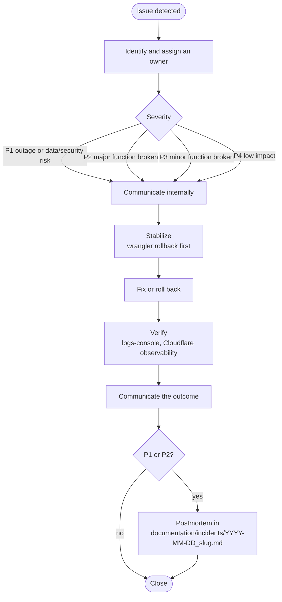
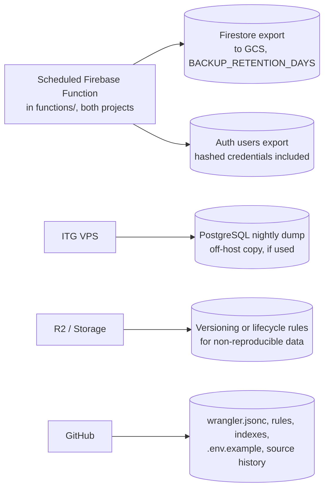

# Operations (ITG-OPS)

## When this applies

Setting up or checking backups, handling an incident, monthly maintenance, handing a project to the client, closing a project, or deciding whether a project is production-ready.

## Decision diagrams

Incident response (§15.2):

What is backed up, and how (§10.2):

## Rules

### Backup and recovery (§10)

- **ITG-OPS-01** Every production project SHALL document in `documentation/OPERATIONS.md` what is backed up, the frequency, retention, storage location, recovery process, responsible owner and restore-test frequency (§10.1).
- **ITG-OPS-02** Backups SHALL follow the policy in the diagram above: a nightly managed Firestore export and Auth users export by a scheduled Function in both Firebase projects, a nightly off-host PostgreSQL dump when PostgreSQL is used, R2 or Storage versioning or lifecycle rules for non-reproducible data, configuration in git and GitHub Environments (§10.2).
- **ITG-OPS-03** Each project SHALL define its RPO and RTO; the defaults are RPO 24 hours and RTO 4 hours (§10.3).
- **ITG-OPS-04** A restore test SHALL run at least monthly for critical projects and quarterly otherwise: restore the latest export into the staging Firebase project, verify the application reads the restored data and core workflows work, and record the result in ClickUp (§10.4).

### Incidents (§15)

- **ITG-OPS-05** An incident is any issue that impacts user access, data integrity, security, core workflows, integrations, AI cost or availability, or production availability. Each incident SHALL get a severity: P1 critical outage or data / security risk, P2 major functionality broken, P3 minor functionality broken, P4 low impact (§15.1).
- **ITG-OPS-06** Incident response SHALL follow the diagram above, with `wrangler rollback` as the first stabilization option (§15.2).
- **ITG-OPS-07** Every P1 and P2 SHALL get a postmortem in `documentation/incidents/<YYYY-MM-DD>_<slug>.md` with: summary, timeline (started, detected, resolved), impact, root cause, resolution, what went well, what did not, and action items with owner and due date (§15.3).
- **ITG-OPS-08** During a P1 or P2, logs-console SHALL be the first stop: the last actor on the affected resource, the action sequence by `request_id`, `.denied` attempts that suggest probing, automated processes at the time (`audit.pruned`, integration syncs) and `error_events` grouped by route (§15.4).

### Maintenance, handover and closeout (§16–§19)

- **ITG-OPS-09** Every production project SHALL run the monthly maintenance checklist below, including the check of the ITG MUSUBI fork version (§19.4).
- **ITG-OPS-10** The client handover (ClickUp or a client-approved format) SHALL contain: product overview, user guide, admin guide, login and access instructions, known limitations, support process, maintenance plan, backup and recovery summary, external integration overview, release notes, the privacy notice with the audit-log retention position (ITG-LOG-15), and the DNS records the client owns (CNAME for the SaaS hostname, SPF and DKIM for email) (§16.1).
- **ITG-OPS-11** The technical handover SHALL be the repository: `steering/` and `storage/`, `documentation/` (`SECURITY.md`, `AUDIT_LOGGING.md`, `DATABASE.md`, `OPERATIONS.md` with environments, deploy and restore runbooks, `INTEGRATIONS.md`, `RELEASE_PROCESS.md`, `hardening/`, `incidents/`), `database/schema.sql` and migrations if used, and `CHANGELOG.md` (§16.2).
- **ITG-OPS-12** A project SHALL be closed only when the closeout checklist below is complete (§17).
- **ITG-OPS-13** A project that does not meet the minimum standard below SHALL NOT be called production-ready (§18).

## Checklists

**Backup (§10.5)**

- [ ] Backup Function deployed to both Firebase projects · retention set · bucket lifecycle set
- [ ] Auth export included · PostgreSQL dump enabled (if used) · Storage versioning considered
- [ ] Restore process in `OPERATIONS.md` · restore test scheduled · owner assigned

**Minimum standard for every production project (§18)**

- [ ] GitHub repository with `master` / `staging`, PR template, README, CHANGELOG
- [ ] MUSUBI initialized from the ITG fork; steering files current; `musubi validate` in CI
- [ ] ClickUp project with an architecture index linking to the repository
- [ ] Two Firebase projects and two Workers, both deployed from Sprint 0
- [ ] GitHub Environments `staging` and `production` as the only configuration source
- [ ] CI gates of ITG-CI-01; deploy workflow with production guard (ITG-CI-04)
- [ ] Admin MFA, Turnstile, App Check; roles in custom claims only
- [ ] Every API route through `withApiRoute`, guarded, validated, logged
- [ ] Events in logs-console; redactor active; no names or emails
- [ ] Transactional email through ACS; customer domain via Cloudflare for SaaS
- [ ] Backup Function on both projects; restore test scheduled
- [ ] `documentation/` with SECURITY, AUDIT_LOGGING, OPERATIONS, INTEGRATIONS, RELEASE_PROCESS
- [ ] Security checklist (ITG-SEC), QA checklist (ITG-TST-11), smoke test (ITG-CI-10), handover (ITG-OPS-10)

**New project (§19.1)**

- [ ] Discovery completed → `steering/product.md`
- [ ] Scope defined; first EARS requirements written
- [ ] Architecture drafted in `steering/tech.md` and `storage/design/`
- [ ] Integrations identified; ClickUp registry started
- [ ] ClickUp project and GitHub repository created; Sprint 0 planned

**Production readiness (§19.3)**

- [ ] CI green on `master` · QA completed on staging · security checklist completed
- [ ] Backups enabled and restore test passed
- [ ] Events verified in logs-console on staging with production-shaped data; redactor verified
- [ ] Custom hostname active; email sender domain verified
- [ ] Smoke test completed · rollback plan ready · client notified where needed

**Monthly maintenance (§19.4)**

- [ ] Dependencies reviewed; security updates applied; weekly audit report reviewed
- [ ] Restore test (critical projects)
- [ ] Cloudflare observability and `error_events` reviewed
- [ ] Audit log queried for anomalies; `audit.pruned` present
- [ ] External API and AI usage and cost reviewed
- [ ] Access permissions and claims reviewed; stale accounts disabled
- [ ] MUSUBI fork version checked; `musubi upgrade` applied and `steering/rules/itg/` refreshed if the playbook changed

**Closeout (§17)**

- [ ] All agreed scope delivered · production release completed · client approval received
- [ ] Documentation complete (repository and ClickUp) · handover completed
- [ ] Events visible in logs-console · backups active · restore test passed
- [ ] Open issues documented · maintenance plan agreed · final review in the last Sprint Planning

## Deviation

Record deviations as described in [README.md](README.md#deviations).
