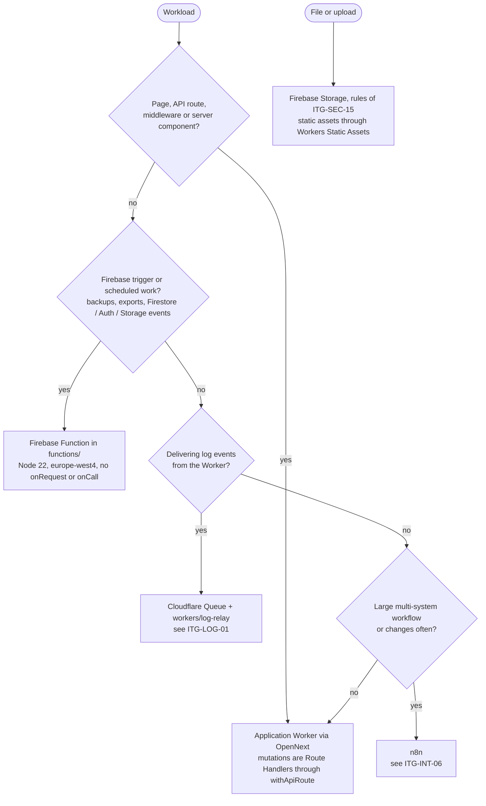
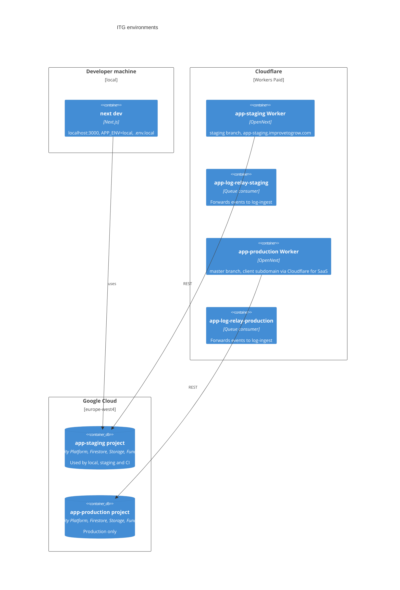

# Platform (ITG-PLT)

## When this applies

Choosing a technology or library, deciding where code runs, adding a binding or configuration key, configuring an environment or a domain.

## Decision diagrams

Where does this workload run (§2.2, §2.2.2)?



Environments (§2.2.4). There are exactly three; there is no shared development environment.



| | local | staging | production |
|---|---|---|---|
| Git branch | `feature/*`, `hotfix/*` | `staging` | `master` |
| GitHub Environment | — | `staging` | `production` |
| Firebase project | the staging project | `<app>-staging` | `<app>-production` |
| Worker name | — | `<app>-staging`; relay `<app>-log-relay-staging` | `<app>-production`; relay `<app>-log-relay-production` |
| `APP_ENV` | `local` | `staging` | `production` |
| Hostname | `localhost:3000` | `<app>-staging.improvetogrow.com` | subdomain of the client's domain (Cloudflare for SaaS) |
| Local env file | `.env.local` | `.env.development.local` | `.env.production.local` |

## Rules

### Default stack

- **ITG-PLT-01** The project SHALL use the Required rows below without exception; they change only through a playbook change. It SHALL use the Recommended rows unless a deviation is recorded, and another tool SHALL keep the same properties (§2.1, Purpose).

**Required**

| Layer | Technology |
|---|---|
| Frontend | Next.js (App Router), React, TypeScript |
| Server logic | Route Handlers in `src/app/api/**/route.ts` through `withApiRoute`; every server mutation is a Route Handler, no Server Actions |
| Hosting | Cloudflare Workers via OpenNext (`@opennextjs/cloudflare`) |
| Authentication | Firebase Authentication with Identity Platform, roles in custom claims (ITG-SEC-05) |
| Bot protection | Firebase App Check with reCAPTCHA Enterprise; Identity Platform reCAPTCHA enforcement on email / password sign-in (ITG-SEC-01) |
| Rate limiting | Cloudflare Rate Limiting binding in the route wrapper; WAF rule on `/api/*` as the second gate (ITG-SEC-14) |
| Primary database | Firestore (ITG-DAT-01) |
| File storage | Firebase Storage; static assets through Workers Static Assets |
| Region | `europe-west4` for every Google service: Firestore, Storage, Functions, Vertex AI |
| Node-side and scheduled work | Firebase Functions in `functions/`, Firebase triggers and schedules only (ITG-INT-06) |
| Logs | ITG log-ingest + logs-console, through a Cloudflare Queue and the project's log-relay Worker (ITG-LOG-01) |
| Error tracking | Cloudflare observability + `error_events` |
| Configuration | GitHub Environments: Variables for public values and server configuration, Secrets for credentials (ITG-PLT-08) |
| CI/CD | GitHub Actions + Wrangler + Firebase CLI |
| Testing / validation | Vitest + Playwright / zod |
| Source control / PM / spec | GitHub `Improve-To-Grow` on GitHub Team with rulesets and Dependabot / ClickUp / MUSUBI ITG fork |

**Recommended**

| Layer | Technology |
|---|---|
| Large relational data | PostgreSQL on Neon through Hyperdrive, when ITG-DAT-02 requires it (ITG-PLT-02) |
| Workflow automation | n8n, for large or frequently changing workflows |
| AI | Gemini through Vertex AI in `europe-west4`, called through REST (ITG-SEC-20) |
| Email | Azure Communication Services from application code (ITG-INT-03) |
| Design | Claude Design (ITG-PLT-04) |
| UI libraries | The set of ITG-PLT-05 |

- **ITG-PLT-02** IF the project needs PostgreSQL, THEN it SHALL use one Neon project per client project in an EU region, reached by the Worker through a Hyperdrive binding; two databases, `<app>` for production and `<app>-test` (its own Neon branch with fictitious data) for staging and CI; `tenant_id` with row-level security on every tenant table; and two users, a migration user for DDL used by CI only and a DML-only runtime user used through Hyperdrive. Applications SHALL NOT connect to the central log store (§2.1.1).
- **ITG-PLT-03** A tool marked **(new)** in the playbook has not run in an ITG production project yet. The first project that sets it up SHALL record what it learns in `documentation/hardening/` (ITG-DEL-07) and report it for a playbook change. Marked today: Neon + Hyperdrive, Cloudflare Queues + log-relay, the Rate Limiting binding, the WAF rule, the nonce-based CSP, TanStack Query and Table, Prettier, knip, eslint-plugin-security, Dependabot, GitHub rulesets (§2.1).
- **ITG-PLT-04** Designs SHALL come from Claude Design as component-level specifications and SHALL be implemented with the shadcn/ui + Tailwind component language; design files and client brand material SHALL live in Microsoft OneDrive (§2.1.2).
- **ITG-PLT-05** The UI SHALL use this library set unless a deviation is recorded: shadcn/ui in `src/components/ui`; Tailwind with CSS-variable theming in `globals.css`; lucide-react and sonner; react-hook-form; TanStack Query for server state; React Context for auth and app-wide state (no Redux); TanStack Table and Recharts (§2.1.4).
- **ITG-PLT-06** Every route input and every form SHALL be validated with a zod schema; this row is Required (§2.1.4).
- **ITG-PLT-07** WHERE the product is multilingual, the project SHALL use next-intl with a `[locale]` segment and messages in `src/locales/<locale>/<page>.json`, one file per page. WHERE the product has one language, it SHALL have no `[locale]` segment and no message files (§2.1.4).

### Secrets and configuration (§2.1.3)

- **ITG-PLT-08** The GitHub Environments `staging` and `production` SHALL be the single source of deployed configuration, each with its own Variables and Secrets, and `wrangler.jsonc` SHALL have a matching `env` block for each (§2.1.3).
- **ITG-PLT-09** Every key SHALL belong to exactly one class, and when in doubt a value is a credential (§2.1.3):

| Class | What | Lives in | Reaches the deployables |
|---|---|---|---|
| Public | `NEXT_PUBLIC_*` values the browser needs | Variables | inlined into the client bundle at build time |
| Server configuration | values that grant no access: `APP_ENV`, `ALLOWED_ORIGINS`, `LOG_LEVEL`, `FORCE_ADMIN_MFA`, `SESSION_ABSOLUTE_HOURS`, `DISABLED_FEATURES`, project ids, endpoints | Variables | `wrangler deploy --var` for the Workers; `functions/.env.<project-id>` for Functions |
| Credentials | keys, tokens, passwords, signing secrets, service-account JSON | Secrets | `wrangler secret bulk` for the Workers; Firebase Functions secrets for Functions |

- **ITG-PLT-10** No value SHALL appear in source code, `wrangler.jsonc` or a committed env file. `wrangler.jsonc` SHALL hold bindings, routes and names only. `.env.example` SHALL be committed with key names, the class of every block, the reader when it is not the application Worker, and defaults only (§2.1.3).
- **ITG-PLT-11** Only the deploy workflow SHALL write configuration to Cloudflare and Firebase (ITG-CI-06). The application Worker SHALL hold no `LOG_INGEST_*` value. CI-only credentials (test user passwords, the App Check debug token, `MIGRATION_DATABASE_URL`) SHALL reach no deployable. Database and log-ingest credentials SHALL be separate per project. A rotation SHALL be a Secret change followed by a manual run of the deploy workflow, recorded in `CHANGELOG.md` under _Security_ without the value (§2.1.3).
- **ITG-PLT-12** Server configuration SHALL be read in `src/lib/runtime-config.ts` and validated with zod at startup in every environment. A value changed during an incident without a deploy is operational state: it SHALL live in Firestore behind an audited admin endpoint; the kill switch (ITG-SEC-23) is the one such value. Another secret manager SHALL be used only when credentials are shared outside GitHub Actions, Cloudflare and Firebase, or compliance requires automated rotation (§2.1.3).

### Cloudflare Workers runtime (§2.2, §2.2.1)

- **ITG-PLT-13** Every Next.js application SHALL be deployed to Cloudflare Workers through OpenNext; there SHALL be no VPS, Vercel, Netlify or Firebase Hosting deployment of application code (§2.2).
- **ITG-PLT-14** Server code (route handlers, middleware, server components) SHALL reach Firebase through the project-owned REST client in `src/lib/firebase-rest/`: `verify-id-token.ts`, `auth-admin.ts` (claims, user lookup, creation and deletion, the account-state check, refresh-token revocation), `firestore.ts`, `storage.ts` (signed URLs) and `service-account.ts` (access tokens, cached per isolate and scope set). `firebase-admin` SHALL run only in `functions/` and in the operator scripts under `scripts/`, as a root devDependency; an ESLint `no-restricted-imports` rule SHALL keep it out of `src/` and `workers/` (§2.2.1).
- **ITG-PLT-15** The Firebase REST client and the Vertex AI REST client are runtime-constraint clients (constitution VIII-4). Each design that adds or extends one SHALL document the constraint in `storage/design/<feature>-design.md` (VIII-5) (§2.2.1).
- **ITG-PLT-16** Worker code SHALL NOT use libraries that need `fs`, `net` or `child_process`; PDF parsing SHALL use `unpdf`, not `pdf-parse`; no Google AI SDK SHALL be installed; `postinstall` SHALL run the jose patch script required by the Cloudflare build (§2.2.1).
- **ITG-PLT-17** Rate limits SHALL be counted by the Cloudflare Rate Limiting binding; any other state that must be consistent across requests SHALL use Firestore or a Cloudflare binding (KV, Durable Objects), never isolate memory (§2.2.1).
- **ITG-PLT-18** Heavy SDKs SHALL stay out of the Worker so the bundle stays under the ITG limit of 10 MiB (§2.2.1).
- **ITG-PLT-19** `wrangler.jsonc` SHALL follow the contract below. Bindings are not inherited: each environment block SHALL list its own queue producer, rate limits and, when used, Hyperdrive (§2.2.1).

```jsonc
{
  "name": "<app>",
  "main": ".open-next/worker.js",
  "compatibility_date": "<date>",
  "compatibility_flags": ["nodejs_compat", "global_fetch_strictly_public"],
  "assets": { "directory": ".open-next/assets", "binding": "ASSETS" },
  "observability": { "enabled": true },
  "env": {
    "staging": {
      "name": "<app>-staging",
      "workers_dev": false,
      "routes": [{ "pattern": "<app>-staging.improvetogrow.com", "custom_domain": true }],
      "queues": { "producers": [{ "binding": "LOG_QUEUE", "queue": "<app>-logs-staging" }] },
      "ratelimits": ["…"]
    },
    "production": {
      "name": "<app>-production",
      "workers_dev": false,
      "routes": [{ "pattern": "<subdomain>.<client-domain>/*", "zone_name": "improvetogrow.com" }],
      "queues": { "producers": [{ "binding": "LOG_QUEUE", "queue": "<app>-logs-production" }] },
      "ratelimits": ["…"]
    }
  }
}
```

### Domains and environments (§2.2.3, §2.2.4)

- **ITG-PLT-20** Staging SHALL be served on `<app>-staging.improvetogrow.com`, a Workers custom domain in the staging block. Production SHALL be served on a subdomain of the client's domain as a Cloudflare for SaaS custom hostname in the `improvetogrow.com` zone, routed in the production block; the client keeps its DNS provider and adds one CNAME and the verification TXT record. The custom hostname SHALL be recorded in `documentation/OPERATIONS.md` (§2.2.3).
- **ITG-PLT-21** The project SHALL have exactly the environments local, staging and production, named as in the table above; both deployed environments SHALL be created in Sprint 0, and every Google service of both Firebase projects SHALL run in `europe-west4` (§2.2.4).
- **ITG-PLT-22** Production SHALL contain no test users, sample data or developer accounts beyond the one ITG admin seat the client approves: an `owner` account with MFA for the operator named in `OPERATIONS.md`, used only for incident operations (the kill switch, investigation checks), audited, and listed in the handover (§2.2.4).
- **ITG-PLT-23** Firestore rules, indexes, Storage rules and migrations SHALL be deployed to both environments in the same change (§2.2.4).
- **ITG-PLT-24** Local development SHALL use the staging Firebase project. Developers SHALL NOT hold production credentials locally except during a documented production operation. Staging is also the test sandbox and holds fictitious data only; there is no separate test project and no emulator (§2.2.4).

## Checklist

- [ ] Required rows unchanged; any Recommended deviation is in the Deviations table of `steering/tech.md`
- [ ] No Node-only library or Google AI SDK in Worker code; `firebase-admin` only in `functions/` and `scripts/`
- [ ] New configuration key in the right class, added to both GitHub Environments, `.env.example` and `src/lib/runtime-config.ts`
- [ ] New binding listed in both environment blocks of `wrangler.jsonc`
- [ ] Rules, indexes and migrations deployed to staging and production together

## Deviation

Record deviations as described in [README.md](README.md#deviations).
