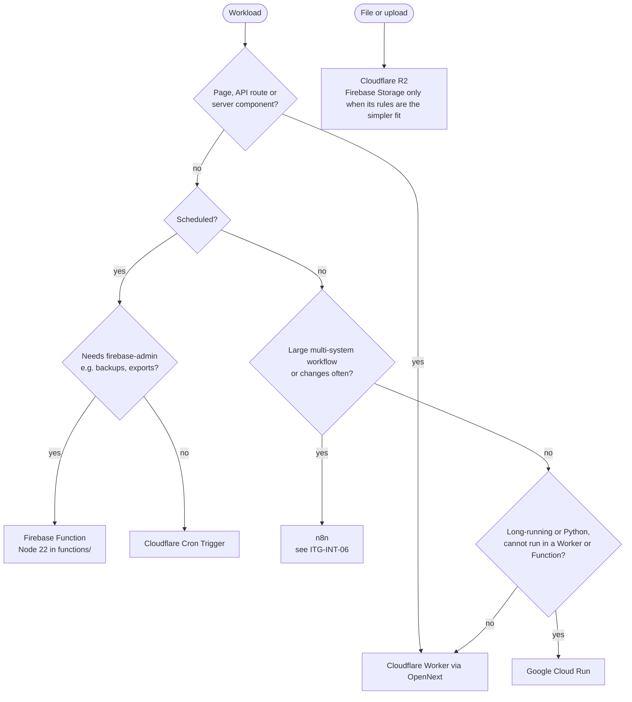
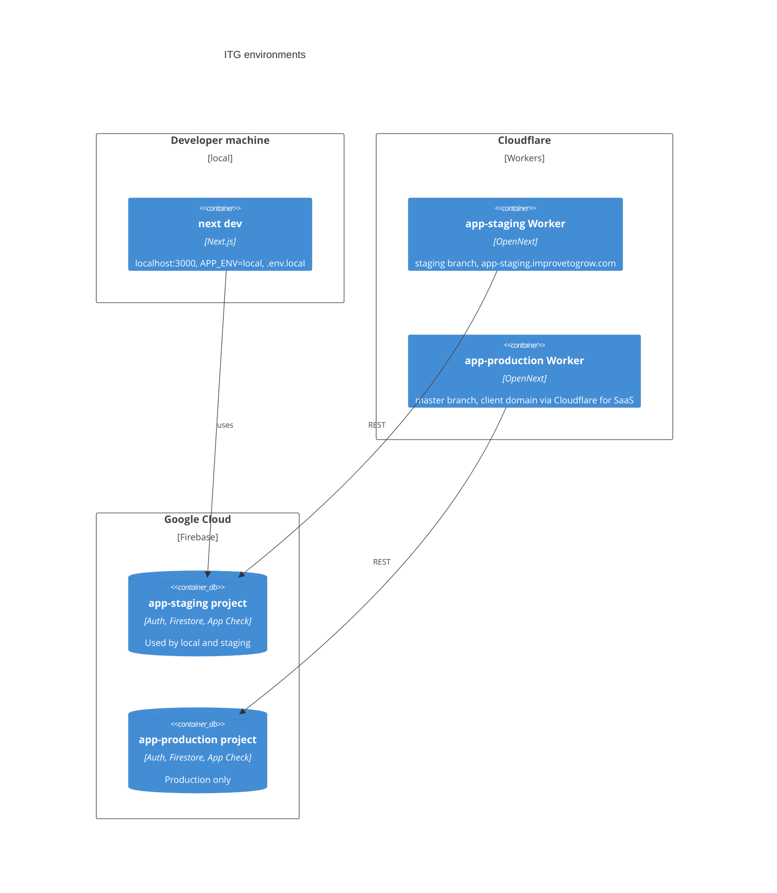

# Platform (ITG-PLT)

## When this applies

Choosing a technology or library, deciding where code runs, adding a binding or environment variable, configuring an environment or a domain.

## Decision diagrams

Where does this workload run (§2.2, §2.2.2)?



Environments (§2.2.4). There are exactly three; there is no shared development environment.



| | local | staging | production |
|---|---|---|---|
| Git branch | `feature/*`, `hotfix/*` | `staging` | `master` |
| GitHub Environment | — | `staging` | `production` |
| Firebase project | the staging project | `<app>-staging` | `<app>-production` |
| Worker name | — | `<app>-staging` | `<app>-production` |
| `APP_ENV` | `local` | `staging` | `production` |
| Hostname | `localhost:3000` | `<app>-staging.improvetogrow.com` | client domain (Cloudflare for SaaS) |
| Local env file | `.env.local` | `.env.development.local` | `.env.production.local` |

## Rules

### Default stack

- **ITG-PLT-01** The project SHALL use the default stack below unless a deviation is recorded (§2.1).

| Layer | Default |
|---|---|
| Frontend | Next.js (App Router), React, TypeScript |
| Server logic | Route Handlers in `src/app/api/**/route.ts`; Server Actions only for form mutations never called outside the UI |
| Hosting | Cloudflare Workers via OpenNext (`@opennextjs/cloudflare`) |
| Authentication | Firebase Authentication, roles in custom claims (ITG-SEC-05) |
| Database | Firestore; PostgreSQL only when ITG-DAT-02 requires it |
| Logs | ITG log-ingest + logs-console (ITG-LOG-01) |
| Files | Cloudflare R2, or Firebase Storage when its rules are the simpler fit |
| Email | Azure Communication Services from application code (ITG-INT-03) |
| AI | Gemini through Vertex AI only (ITG-SEC-20) |
| Scheduled jobs | Firebase Functions for backups and nightly jobs; Cloudflare Cron Triggers for Worker-side jobs |
| Workflows | n8n only for large or frequently changing workflows |
| Errors | Runtime logs + `error_events`; Sentry optional |
| CI/CD | GitHub Actions + Wrangler |
| Source control / PM / spec | GitHub `Improve-To-Grow` / ClickUp / MUSUBI ITG fork |
| Design | Claude Design, implemented with shadcn/ui |
| Configuration | GitHub Environments `staging` and `production` → Wrangler secrets |

- **ITG-PLT-02** IF the project needs PostgreSQL, THEN it SHALL use one database and one least-privilege database user on the shared ITG PostgreSQL instance of the VPS, and SHALL NOT create a PostgreSQL server per project. Applications SHALL NOT connect to the central logs database (§2.1.1).
- **ITG-PLT-03** Sentry SHALL be added only when the platform is business-critical, errors must be grouped and prioritized automatically, or frontend runtime errors must be visible after release (§2.1.2).
- **ITG-PLT-04** Designs SHALL come from Claude Design as component-level specifications and SHALL be implemented with the shadcn/ui + Tailwind component language; design files and client brand material SHALL live in Microsoft OneDrive (§2.1.3).
- **ITG-PLT-05** The UI SHALL use this library set and no alternatives: shadcn/ui on Radix in `src/components/ui`; Tailwind with CSS-variable theming in `globals.css`; lucide-react and sonner; react-hook-form with zod resolvers; TanStack Query for server state; React Context for auth and app-wide state (no Redux); TanStack Table and Recharts (§2.1.5).
- **ITG-PLT-06** Every route input and every form SHALL be validated with a zod schema (§2.1.5).
- **ITG-PLT-07** WHERE the product is multilingual, the project SHALL use next-intl with a `[locale]` segment and messages in `src/locales/<locale>/<page>.json`, one file per page. WHERE the product has one language, it SHALL have no `[locale]` segment and no message files (§2.1.5).

### Secrets and configuration

- **ITG-PLT-08** GitHub Environments `staging` and `production` SHALL be the single source of configuration for deployed environments, each with its own Secrets and Variables (§2.1.4).
- **ITG-PLT-09** `NEXT_PUBLIC_*` keys SHALL be Variables; every other key SHALL be a Secret. Server-side secrets SHALL NOT reach the frontend (§2.1.4).
- **ITG-PLT-10** Secrets SHALL NOT appear in source code, `wrangler.jsonc` or committed env files. `.env.example` SHALL be committed with key names and defaults only (§2.1.4).
- **ITG-PLT-11** Only CI SHALL write secrets to Cloudflare, with `wrangler secret bulk` (ITG-CI-06). Database and log-ingest credentials SHALL be separate per project, and secrets SHALL be rotated when team members leave or vendors change (§2.1.4).
- **ITG-PLT-12** An external secret manager SHALL be used only when secrets are shared with systems outside GitHub Actions and Cloudflare, or compliance requires automated rotation (§2.1.4).

### Cloudflare Workers runtime

- **ITG-PLT-13** Every Next.js application SHALL be deployed to Cloudflare Workers through OpenNext; there SHALL be no VPS, Vercel, Netlify or Firebase Hosting deployment of application code (§2.2).
- **ITG-PLT-14** Server code (route handlers, middleware, server components) SHALL reach Firebase through the project-owned REST client in `src/lib/firebase-rest/` (`verify-id-token.ts`, `auth-admin.ts`, `firestore.ts`, `storage.ts`). `firebase-admin` SHALL be used only in `functions/` (§2.2.1).
- **ITG-PLT-15** The Firebase REST client is a runtime-constraint client (constitution VIII-4). Each design that adds or extends one SHALL document the constraint in `storage/design/<feature>-design.md` (VIII-5).
- **ITG-PLT-16** Worker code SHALL NOT use libraries that need `fs`, `net` or `child_process`; PDF parsing SHALL use `unpdf`, not `pdf-parse`; `postinstall` SHALL run the jose patch script required by the Cloudflare build (§2.2.1).
- **ITG-PLT-17** State that must be consistent across requests (rate limits, caches, counters) SHALL use Cloudflare bindings (KV, Durable Objects, Rate Limiting) or Firestore, never isolate memory (§2.2.1).
- **ITG-PLT-18** Heavy SDKs SHALL stay out of the Worker so the bundle fits the plan limit (3 MiB compressed free, 10 MiB paid) (§2.2.1).
- **ITG-PLT-19** `wrangler.jsonc` SHALL follow the contract below, with bindings per environment and no secrets (§2.2.1).

```jsonc
{
  "name": "<app>",
  "main": ".open-next/worker.js",
  "compatibility_date": "<date>",
  "compatibility_flags": ["nodejs_compat", "global_fetch_strictly_public"],
  "observability": { "enabled": true },
  "vars": { "APP_ENV": "staging" },
  "env": {
    "staging":    { "name": "<app>-staging",    "vars": { "APP_ENV": "staging" } },
    "production": { "name": "<app>-production", "vars": { "APP_ENV": "production" } }
  }
}
```

### Domains and environments

- **ITG-PLT-20** Staging SHALL be served on `<app>-staging.improvetogrow.com`. Production SHALL be served on the client's domain as a Cloudflare for SaaS custom hostname in the ITG zone; the client keeps its DNS provider and adds one CNAME and the verification TXT record. The hostname and fallback origin SHALL be recorded in `documentation/OPERATIONS.md` (§2.2.3).
- **ITG-PLT-21** The project SHALL have exactly the environments local, staging and production, named as in the table above; both deployed environments SHALL be created in Sprint 0 (§2.2.4).
- **ITG-PLT-22** Production SHALL contain no test users, sample data or developer accounts beyond the admin seat the client approves (§2.2.4).
- **ITG-PLT-23** Firestore rules, indexes, Storage rules and migrations SHALL be deployed to both environments in the same change (§2.2.4).
- **ITG-PLT-24** Local development SHALL use the staging Firebase project. Developers SHALL NOT hold production credentials locally except during a documented production operation (§2.2.4).

## Checklist

- [ ] Stack matches ITG-PLT-01, or the difference is in the Deviations table of `steering/tech.md`
- [ ] No Node-only library in Worker code; `firebase-admin` only in `functions/`
- [ ] New configuration key added to `.env.example`, the GitHub Environment and `src/lib/runtime-config.ts`
- [ ] Rules, indexes and migrations deployed to staging and production together

## Deviation

Record deviations as described in [README.md](README.md#deviations).
