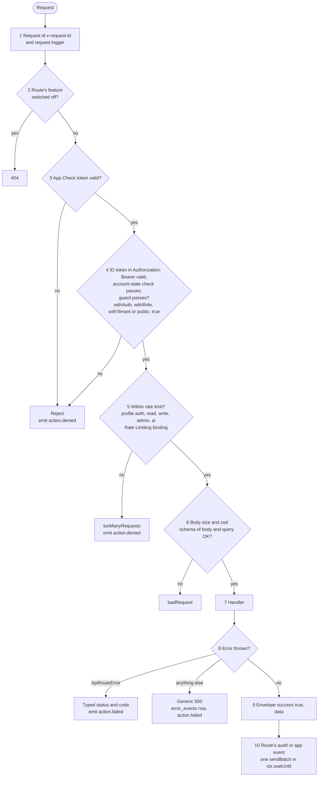
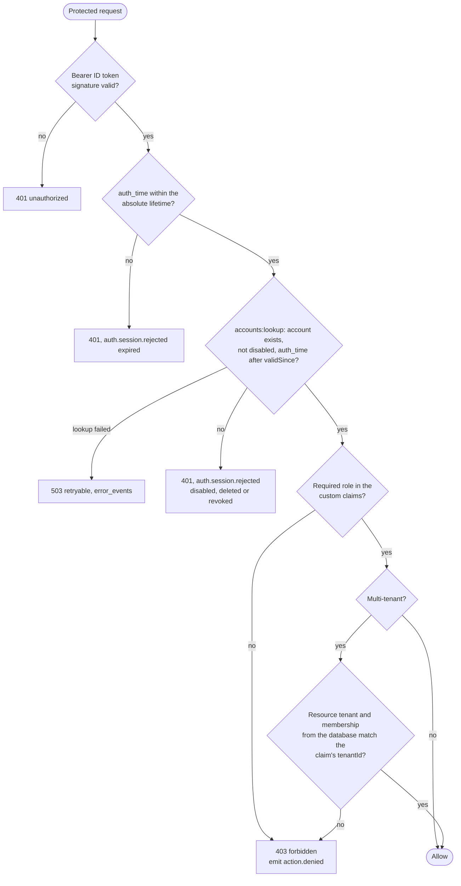
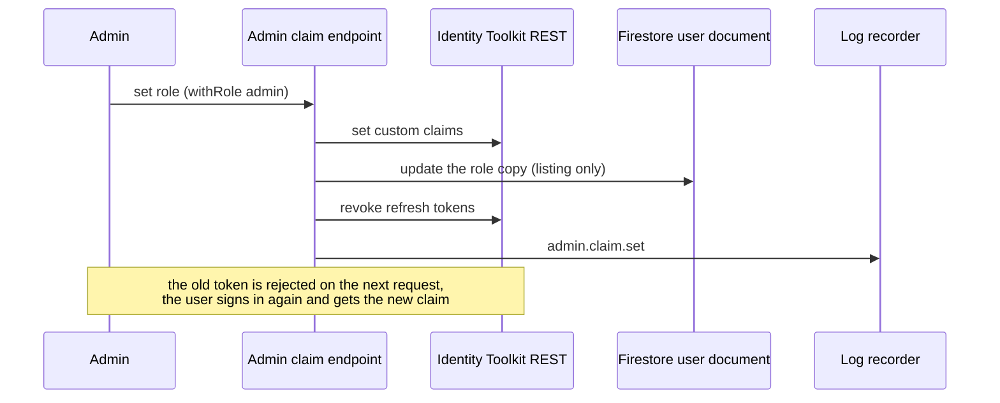

# Security (ITG-SEC)

## When this applies

Adding or changing an API route, authentication, roles, sessions, tenant data, Firebase rules, webhooks, AI calls, headers, diagnostic endpoints or features. Every release that touches auth, data access or integrations runs the checklist at the end.

## Decision diagrams

Every `src/app/api/**/route.ts` goes through `withApiRoute` (§11.5). The wrapper runs these steps in order:



Authentication and authorization of a protected request (§11.2, §11.3, §11.4):



Changing a user's role (§11.2):



## Rules

### Authentication (§11.1)

- **ITG-SEC-01** Firebase App Check with reCAPTCHA Enterprise SHALL be verified in the route wrapper on every API call and enforced on Firebase Storage, in staging and production. Identity Platform's reCAPTCHA enforcement SHALL protect email / password sign-in, loaded with `initializeRecaptchaConfig` before sign-in, in `AUDIT` mode on staging and `ENFORCE` on production. Sign-up and password reset SHALL go through the application's routes, protected by App Check, the `auth` rate limit and a per-address limit (§11.1).
- **ITG-SEC-02** TOTP MFA SHALL be mandatory for admin roles and enforced server-side (`FORCE_ADMIN_MFA`), not only offered (§11.1).
- **ITG-SEC-03** Client-side sign-up SHALL be disabled in the Firebase project; the server creates accounts (admin invite or the project's sign-up route). Self-registered accounts SHALL verify their email address. The password policy SHALL be set in the Firebase project and enforced by Firebase Authentication; there is no password history. Auth email SHALL be sent through ACS by the application's route (ITG-INT-05) (§11.1).
- **ITG-SEC-04** WHEN a user is disabled or deleted, or their refresh tokens are revoked, the next request SHALL be rejected. The route wrapper SHALL check the account state after signature verification on every authenticated request, with Identity Toolkit `accounts:lookup` (`disabled`, `validSince`) and no cache; it SHALL reject with `401` and `auth.session.rejected` (`disabled`, `deleted`, `revoked`), and a failed lookup SHALL reject with a retryable `503` and an `error_events` row, never fall through (§11.1, §11.4).

### Authorization: roles in custom claims (§11.2)

- **ITG-SEC-05** Roles and the tenant (`tenantId`) SHALL be stored as Firebase custom claims and every authorization decision SHALL read them from the verified ID token. Resource-level membership and ownership (projects, teams) SHALL live in the database and be checked against the tenant in the claim (§11.2).
- **ITG-SEC-06** Firestore MAY keep a copy of the role on the user document for admin lists and search. The claim endpoint SHALL be its only writer, authorization SHALL NOT read it, and claims SHALL NOT be rebuilt from it at sign-in. Request bodies, query strings and headers SHALL NOT be a source of identity or role (§11.2).
- **ITG-SEC-07** Role changes SHALL go through one admin endpoint that sets the claim and the copy, emits `admin.claim.set` and revokes the user's refresh tokens (§11.2).
- **ITG-SEC-08** IF the application has one kind of user, THEN it SHALL NOT have a role system. Otherwise it SHALL define the roles its domain needs (typically `owner`, `admin`, `manager`, `member`, `viewer`) (§11.2).
- **ITG-SEC-09** Every protected action SHALL check that the user is authenticated, has the required role and, in a multi-tenant system, that the resource is in the user's tenant and, where it has members, that the user is one of them (§11.2).

### Tenants and sessions (§11.3, §11.4)

- **ITG-SEC-10** WHERE the system is multi-tenant, every record SHALL carry its tenant: `tenantId` in Firestore and the claim, `tenant_id` in PostgreSQL ("organization" is a domain term only). The scope SHALL come from the claim and be enforced server-side in every store: one tenant-scoped helper for every Firestore tenant query, Storage rules for uploads, row-level security in PostgreSQL. The tenant isolation test SHALL cover every collection with a user of a second tenant (§11.3).
- **ITG-SEC-11** The session SHALL be the Firebase ID token in `Authorization: Bearer`, verified per request by the wrapper; there SHALL be no session cookie. Protected pages SHALL be client-rendered shells that hold no data until an API call returns. Server components and the middleware SHALL NOT identify the user. A protected resource reached without a header SHALL be served through a short-lived signed URL from an API route; `getDownloadURL` links SHALL NOT be used (§11.4).
- **ITG-SEC-12** Each project SHALL set an absolute lifetime, enforced in the wrapper from `auth_time` (defaults 12 hours for admin apps, 14 days for consumer apps; `401`, reason `expired`), and a client-side idle sign-out (defaults 30 minutes for admin apps, none for consumer apps). Logout SHALL call the logout endpoint, which emits `auth.logout` and revokes the refresh tokens, and SHALL sign out of the Firebase SDK even when the endpoint fails (§11.4).

### API route contract (§11.5)

- **ITG-SEC-13** Every `src/app/api/**/route.ts` SHALL export its handlers only through `withApiRoute('<route-id>', guard(handler), { rateLimit, schema, feature })`, with route ids `api-<path>-<verb>`; nothing else in the Worker SHALL export a handler, and Firebase Functions SHALL export triggers and schedules only (§11.5).
- **ITG-SEC-14** The wrapper SHALL run the ten steps of the diagram above. Every route SHALL declare a rate-limit profile (`auth`, `read`, `write`, `admin`, `ai`) or get the wrapper default, counted by the Cloudflare Rate Limiting binding; the WAF rule on the `improvetogrow.com` zone (`/api/*`, 100 requests per 10 seconds per IP, Block for 10 seconds) is the second gate, set once for all projects. Errors SHALL be typed `ApiRouteError` helpers (`badRequest`, `unauthorized`, `forbidden`, `notFound`, `conflict`, `tooManyRequests`); status codes SHALL NOT be derived from message text. Responses SHALL use the envelope `{ success: true, data }` or `{ success: false, error: { code, message } }` (§11.5).

```ts
export const POST = withApiRoute('api-admin-users-create', withRole('admin', handler), {
  rateLimit: 'write',
  schema: createUserSchema, // zod, body + query
  feature: 'users', // registry name; omitted for routes that belong to no feature
});
```

### Firebase rules (§11.6)

- **ITG-SEC-15** Firestore rules SHALL deny all client reads and writes; every read and write goes through an API route, so every request passes the account-state check, and live updates poll an API route. Storage rules SHALL allow client uploads only into the user's own tenant path (`request.auth.token.tenantId`, or the `uid` in a single-tenant app) with a content-type allowlist and a size limit per path, and SHALL deny client reads and every other path. Every file read SHALL go through an API route that returns a signed URL valid for 10–15 minutes, one per item. A project that needs client reads SHALL record a deviation naming the readable collections (§11.6).
- **ITG-SEC-16** Rules SHALL be tested in CI against the staging project with the fixed test users and real objects, never in an emulator, with the cases below; a project with a client-read deviation SHALL add an allowed and a denied case per readable collection, role and tenant. A PR that changes a rules file SHALL also pass `check-rules` (ITG-CI-01). Rules SHALL be deployed to both projects in the same change (§11.6).

| Rules | Case | Expected |
|---|---|---|
| Firestore | Authenticated client reads a document of its own tenant | denied |
| Firestore | Authenticated client writes a document of its own tenant | denied |
| Storage | Upload into the own tenant path, allowed type and size | allowed |
| Storage | Upload into another tenant's path | denied |
| Storage | Upload with a content type outside the allowlist | denied |
| Storage | Upload one byte over the size limit | denied |
| Storage | Client read of any object, own tenant included | denied |

### Webhooks (§11.7)

- **ITG-SEC-17** Every outbound webhook SHALL carry `X-<App>-Webhook-Signature: v1,sha256=<hex>`, an HMAC-SHA256 over `<timestamp>.<rawBody>`, and `X-<App>-Webhook-Timestamp`, with a secret per route; receivers SHALL reject timestamps older than about 5 minutes (§11.7).

### AI security (§11.8)

- **ITG-SEC-19** Every feature that sends user content to a model SHALL have a prompt-injection review, minimize personal data at the prompt boundary, validate output that drives a privileged action, and enforce per-tenant cost and usage limits and abuse detection. Prompts and outputs SHALL NOT be stored in logs, only their length and hash (ITG-LOG-10); content the user has the AI produce is product data (§11.8).
- **ITG-SEC-20** Gemini models SHALL be called through Vertex AI at the regional endpoint of `europe-west4` (`VERTEX_AI_LOCATION`) with a project service account, through REST in every runtime: the Worker from `src/lib/vertex-ai/` with a token from the service-account helper (ITG-PLT-14), a Function with a token for its runtime service account. The `global` endpoint, the public Gemini API (`generativelanguage.googleapis.com`) and Vertex AI express mode SHALL NOT be used, and no Gemini client package (`@google/genai`, `@google/generative-ai`, `@ai-sdk/google`) SHALL be a dependency anywhere; `check-ai-provider` enforces this (ITG-CI-01). Another provider is a deviation that keeps the same properties (§11.8).

### Code, headers and features (§11.9–§11.11)

- **ITG-SEC-21** eslint-plugin-security SHALL be part of the normal ESLint config over `src/`, `functions/` and `workers/`, with `detect-object-injection` off and the other rules as errors. The `eval` / `new Function` / `javascript:` family SHALL be banned globally. `npm audit` SHALL run on every PR, and Dependabot alerts and security updates SHALL be on (§11.9).
- **ITG-SEC-22** The middleware SHALL create a nonce per request and set the CSP with `script-src 'nonce-<nonce>' 'strict-dynamic'`, without `'unsafe-inline'`; adding a script, font or connect target is a middleware change reviewed in a PR. `img-src` and `media-src` SHALL allow the Firebase Storage host; the reCAPTCHA Enterprise hosts SHALL be allowed. The middleware SHALL set HSTS, `X-Frame-Options: DENY`, nosniff, COOP, CORP and a restrictive Permissions-Policy. API responses SHALL use `default-src 'none'`. CORS SHALL use an explicit `ALLOWED_ORIGINS` list (§11.10).
- **ITG-SEC-23** Every folder under `src/features/` SHALL be declared once in `src/lib/features/registry.ts` with its name and the page paths it owns, and a route SHALL name its feature in the wrapper options. A switched-off feature SHALL be invisible and closed: navigation hidden, pages and routes answer `404`, never `401` or `403`. Diagnostic routes SHALL be an ordinary feature listed in `DISABLED_FEATURES` of both environments, so they are off by default; when on they SHALL be owner-only, rate-limited and audited (§11.11).
- **ITG-SEC-24** The effective set of switched-off features SHALL be the union of `DISABLED_FEATURES` (a GitHub Variable per environment) and the Firestore document `ops/kill-switch`, changed during an incident through one owner-only admin endpoint (`admin` profile, zod body `{ feature, disabled, reason }`) that emits `admin.feature.disabled` / `.enabled`. One loader, `src/lib/features/kill-switch.ts`, SHALL serve the wrapper, the middleware and the root layout; it SHALL cache the document per isolate for `KILL_SWITCH_TTL_SECONDS` (default 30) with one shared in-flight read, keep the last value on a failed refresh with an `error_events` row, and reject with a retryable `503` when a cold isolate's first read fails (§11.11).

## Checklist

Security release checklist (§11.12):

- [ ] Auth, authorization and (if multi-tenant) tenant isolation checked
- [ ] Authorization from claims; the role copy written by the claim endpoint and used for listing only
- [ ] Admin MFA enforced · App Check verified in the wrapper and enforced on Storage · reCAPTCHA enforcement `ENFORCE` on production · client-side sign-up disabled
- [ ] Account-state check active: disabled user and revoked session rejected on the next request (verified on staging)
- [ ] Sessions bearer-only: no session cookie, client shells, absolute lifetime in the wrapper, idle sign-out, logout revokes refresh tokens
- [ ] Firestore rules deny all client access; Storage uploads tenant-scoped with type and size limits, client reads denied; file reads through signed URLs; rules test green on staging; deployed to both projects
- [ ] Every route through `withApiRoute` with a guard, a rate limit and a zod schema (CI green)
- [ ] Functions export Firebase triggers and schedules only (`check-function-triggers` green)
- [ ] Credentials in GitHub Environment Secrets, configuration in Variables, no values in `wrangler.jsonc`; `.env.example` current
- [ ] Outbound webhooks signed
- [ ] Kill switch verified on staging: a switched-off feature answers 404 on page and API within the TTL, switched back on, both `admin.feature.*` events in logs-console
- [ ] CSP with a per-request nonce and `'strict-dynamic'`, no `'unsafe-inline'`; all security headers in middleware
- [ ] ESLint (with eslint-plugin-security) and `npm audit` green; Dependabot alerts reviewed
- [ ] Redactor active; no names or emails in events; full address and raw user agent only on security events; no redaction errors in `error_events` on staging
- [ ] AI calls server-side, in the EU region, through REST; no Gemini API key or client package (`check-ai-provider` green)
- [ ] Privacy notice states the audit-log retention position and the restore test in an isolated ITG recovery project (ITG-LOG-15, ITG-OPS-04)

## Deviation

Record deviations as described in [README.md](README.md#deviations).
