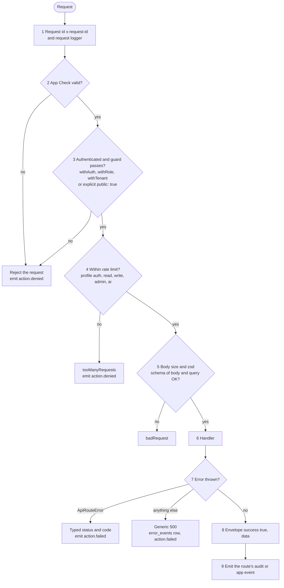
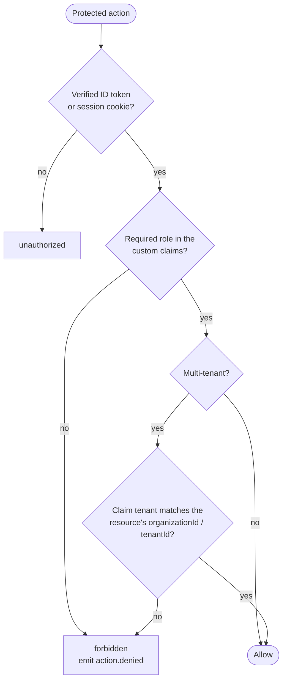
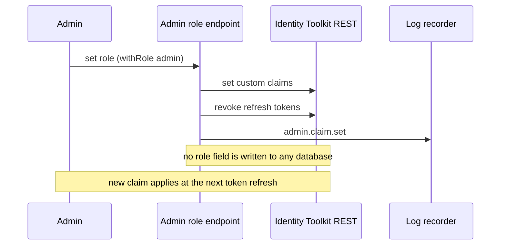

# Security (ITG-SEC)

## When this applies

Adding or changing an API route, authentication, roles, sessions, tenant data, Firebase rules, webhooks, AI calls, headers or diagnostic endpoints. Every release that touches auth, data access or integrations runs the checklist at the end.

## Decision diagrams

Every `src/app/api/**/route.ts` goes through `withApiRoute` (§11.6). The wrapper runs these steps in order:



Authorization check for a protected action (§11.3, §11.4):



Changing a user's role (§11.3):



## Rules

### Authentication (§11.2)

- **ITG-SEC-01** Every public auth form (login, signup, password reset, invitation accept) SHALL be protected by Cloudflare Turnstile, and every API call SHALL carry Firebase App Check (§11.2, §11.8).
- **ITG-SEC-02** TOTP MFA SHALL be mandatory for admin roles and enforced server-side (`FORCE_ADMIN_MFA`), not only offered (§11.2).
- **ITG-SEC-03** Self-registered accounts SHALL verify their email address. The password policy (length, character classes) and password history (no reuse of the last N) SHALL be enforced server-side. All auth email SHALL go through ACS (ITG-INT-05) (§11.2).
- **ITG-SEC-04** WHEN a user is disabled or deleted, the next request with that user's session SHALL be rejected, not only at expiry (§11.2).

### Authorization: roles in custom claims (§11.3)

- **ITG-SEC-05** Roles and every other access-gating value (admin flag, organization id, team id, seat id) SHALL be stored only as Firebase custom claims and read only from the verified ID token or session cookie (§11.3).
- **ITG-SEC-06** No database SHALL hold a role field (no `users/{uid}.role`, no mirror, no cache). Server code SHALL NOT look up a role in Firestore or PostgreSQL, SHALL NOT re-sync claims from a document per request, and SHALL NOT take identity or role from a request body, query string or header (§11.3).
- **ITG-SEC-07** Role changes SHALL go through one admin endpoint that sets the claim, emits `admin.claim.set` and revokes the user's refresh tokens (§11.3).
- **ITG-SEC-08** IF the application has one kind of user, THEN it SHALL NOT have a role system. Otherwise it SHALL define the roles its domain needs (typically `owner`, `admin`, `manager`, `member`, `viewer`) (§11.3).
- **ITG-SEC-09** Every protected action SHALL check that the user is authenticated, has the required role and, in a multi-tenant system, belongs to the tenant that owns the resource (§11.3).

### Tenants and sessions (§11.4, §11.5)

- **ITG-SEC-10** WHERE the system is multi-tenant, every record SHALL carry `organizationId` or `tenantId`; the tenant scope SHALL come from the claim; queries SHALL be scoped server-side; and Firestore rules SHALL enforce the same scope (§11.4).
- **ITG-SEC-11** APIs SHALL be called with the Firebase ID token in `Authorization: Bearer`, verified per request. Server-rendered routes SHALL be gated by a server-signed Firebase session cookie (`HttpOnly`, `Secure`, `SameSite=Lax`) that is minted after ID-token verification, verified in middleware on every navigation and cleared on logout after verification. A cookie that only contains JSON is not a session (§11.5).
- **ITG-SEC-12** Each project SHALL set an idle timeout and an absolute session lifetime; defaults: 30 minutes idle and 12 hours absolute for admin apps, 14 days for consumer apps (§11.5).

### API route contract (§11.6)

- **ITG-SEC-13** Every `src/app/api/**/route.ts` SHALL export its handlers only through `withApiRoute('<route-id>', guard(handler), { rateLimit, schema })`, with route ids `api-<path>-<verb>`; nothing else SHALL export a handler (§11.6).
- **ITG-SEC-14** The wrapper SHALL run the nine steps of the diagram above. Rate limiting SHALL use a Cloudflare Rate Limiting binding or a persistent store (in-memory only as an extra layer). Errors SHALL be typed `ApiRouteError` helpers (`badRequest`, `unauthorized`, `forbidden`, `notFound`, `conflict`, `tooManyRequests`); status codes SHALL NOT be derived from message text. Responses SHALL use the envelope `{ success: true, data }` or `{ success: false, error: { code, message } }` (§11.6).

```ts
export const POST = withApiRoute('api-admin-users-create', withRole('admin', handler), {
  rateLimit: 'write',
  schema: createUserSchema, // zod, body + query
});
```

### Firebase rules, App Check, Turnstile (§11.7, §11.8)

- **ITG-SEC-15** Firestore and Storage rules SHALL be deny-by-default and server-write-only: clients read what the rules scope to them, and every write goes through an API route. Rules SHALL enforce authentication, the tenant scope from the claim, role checks and file type and size limits, SHALL be tested against the staging project in CI, and SHALL be deployed to both projects in the same change (§11.7).
- **ITG-SEC-16** App Check SHALL be enabled in production and verified server-side in the route wrapper. Turnstile tokens SHALL be bound to an action name and verified server-side against the expected hostname list (§11.8).

### Webhooks (§11.9)

- **ITG-SEC-17** Every outbound webhook SHALL carry `X-<App>-Webhook-Signature: v1,sha256=<hex>`, an HMAC-SHA256 over `<timestamp>.<rawBody>`, and `X-<App>-Webhook-Timestamp`, with a secret per route; receivers SHALL reject timestamps older than about 5 minutes (§11.9).
- **ITG-SEC-18** Every inbound webhook SHALL verify the provider's signature before reading the body, reject failures with a generic 4xx, and log `integration.webhook.received` or `.received.failed` with a reason code and resource id only (§11.9).

### AI security (§11.10)

- **ITG-SEC-19** Every feature that sends user content to a model SHALL have a prompt-injection review, minimize personal data at the prompt boundary, validate output that drives a privileged action, enforce per-tenant cost and usage limits and abuse detection, and fingerprint prompts and outputs instead of storing them (ITG-LOG-10) (§11.10).
- **ITG-SEC-20** Gemini models SHALL be called only through Vertex AI with a project service account. The public Gemini API (API-key based, `generativelanguage.googleapis.com`) SHALL NOT be used in any environment, because its terms allow prompts to be used for training. CI SHALL fail on an import of `@google/generative-ai` or a `GEMINI_API_KEY` variable (§11.10).

### Code, headers and switches (§11.11–§11.13)

- **ITG-SEC-21** `lint:security` SHALL run eslint-plugin-security with `--max-warnings=0` over `src/app/api`, `src/lib`, `src/middleware` and `functions/` as a separate CI step. The `eval` / `new Function` / `javascript:` family SHALL be banned globally. The dependency audit SHALL run on every PR and weekly in full (§11.11).
- **ITG-SEC-22** The production CSP SHALL be built at compile time in `next.config.ts`; adding a script, font or connect target SHALL require a code change and PR review. Middleware SHALL set HSTS, `X-Frame-Options: DENY`, nosniff, COOP, CORP and a restrictive Permissions-Policy in production. API responses SHALL use `default-src 'none'`. CORS SHALL use an explicit `ALLOWED_ORIGINS` list (§11.12).
- **ITG-SEC-23** Diagnostic routes SHALL be disabled by default and return 404 (not 401/403) when disabled; when enabled they SHALL be owner-only, rate-limited and audited. `NEXT_PUBLIC_DISABLED_FEATURES` SHALL hide a feature per environment: its navigation item is hidden and its page and API return 404 (§11.13).

## Checklist

Security release checklist (§11.14):

- [ ] Auth, authorization and (if multi-tenant) tenant isolation checked
- [ ] Roles read from claims only; no role field in any database
- [ ] Admin MFA enforced · Turnstile on public auth forms · App Check verified
- [ ] Firestore and Storage rules reviewed, server-write-only, deployed to both projects
- [ ] Every route through `withApiRoute` with a guard and a zod schema (CI green)
- [ ] Secrets only in GitHub Environments; `.env.example` current
- [ ] Outbound webhooks signed; inbound webhooks verified
- [ ] CSP built at compile time; HSTS in middleware
- [ ] `lint:security` and dependency audit green
- [ ] Redactor active; no names or emails in events (checked in logs-console on staging)
- [ ] AI calls through Vertex AI only; no Gemini API key anywhere
- [ ] Privacy notice states the audit-log retention position (ITG-LOG-15)

## Deviation

Record deviations as described in [README.md](README.md#deviations).
