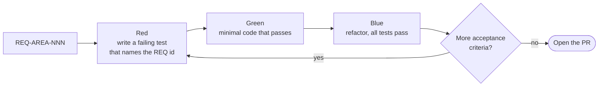
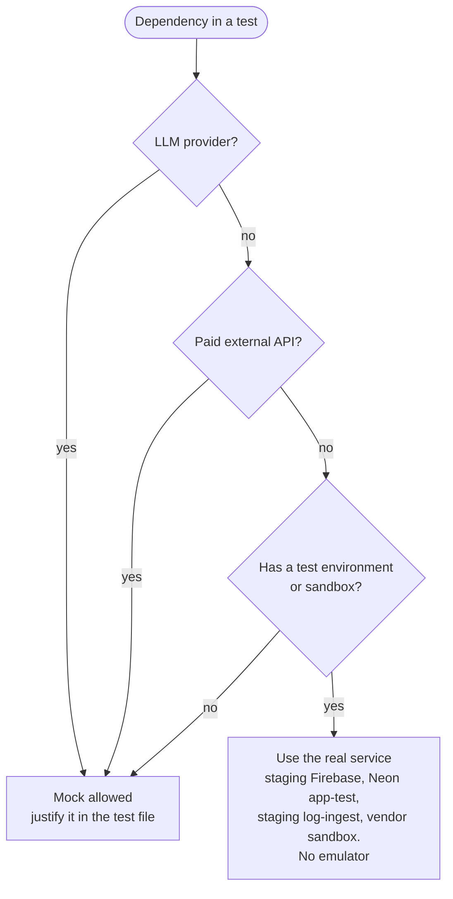
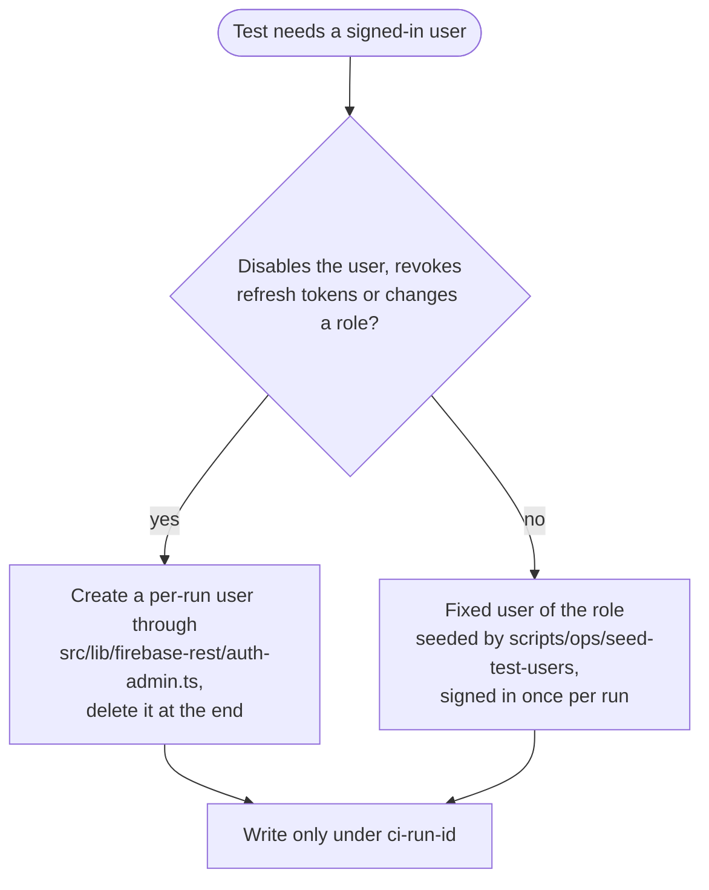

# Testing (ITG-TST)

## When this applies

Every code change. Tests come first (constitution Article III) and run against real services (Article IX).

## Decision diagrams

Test-first loop for one EARS requirement (§7.1):

May I mock this dependency (§7.3)?

Which user does this test sign in as (§7.3)?

## Rules

- **ITG-TST-01** Tests SHALL be written before the code: a failing test (Red), the minimal code that passes (Green), then a refactor with all tests passing (Blue) (§7.1; constitution Article III).
- **ITG-TST-02** Every EARS requirement SHALL map to at least one test that references its `REQ-*` id (§7.1).
- **ITG-TST-03** Coverage thresholds SHALL come from `steering/rules/constitution-levels.yml` for the `application` profile and SHALL be set as `test.coverage.thresholds` in `vitest.config.ts`, so that the test run fails below them; `musubi-validate project` checks that the configuration exists (§7.1).
- **ITG-TST-04** The project SHALL use these test levels and tools (§7.2):

| Level | Tool | Purpose |
|---|---|---|
| Static checks | TypeScript, ESLint (+ eslint-plugin-security), Prettier, knip | Code quality, security lint, dead code |
| Unit | Vitest | Functions, services, route handlers, feature logic |
| Component (optional) | Vitest + React Testing Library | Complex reusable components |
| Integration | Vitest against the real staging Firebase project | Auth, Firestore rules, REST client, email, log-ingest |
| E2E | Playwright | Critical user journeys against a local or staging build |
| Security | `npm audit`, Dependabot alerts + security checklist (ITG-SEC) | Security risks |
| Manual QA | ClickUp checklist on staging | Final human verification |

- **ITG-TST-05** Playwright SHALL be the priority for business-critical flows; React Testing Library is optional (§7.2).
- **ITG-TST-06** Integration tests SHALL run against real services: the staging Firebase project, the Neon test database `<app>-test` when the project uses PostgreSQL, the staging log-ingest endpoint and vendor sandboxes. The Firebase Emulator SHALL NOT be used, and there SHALL be no third Firebase project for tests. In Vitest the recorder uses the direct transport against the staging endpoint; the queue path is exercised by the `app.started` event of every staging deploy (§7.3; constitution Article IX).
- **ITG-TST-07** Mocks SHALL be used only for LLM providers, paid external APIs and services without a test environment, and each mock SHALL be justified in the test file (§7.3).
- **ITG-TST-08** Staging is the test sandbox. Everything a run writes SHALL live under the prefix `ci-<run-id>` (tenant, collection prefix or field; Storage paths and the Neon test tenant carry it too) and SHALL be deleted at the end of the run; the scheduled `ci-cleanup` workflow SHALL delete `ci-*` data older than 24 hours. Tests SHALL NOT read or change data outside their prefix. Production SHALL NOT be a test target. CI SHALL use the `staging` GitHub Environment for integration and E2E runs (§7.3).
- **ITG-TST-09** Every production project SHALL test: login and logout, role-based access and permission-denied states, tenant isolation where multi-tenant (every collection read and written by a user of a second tenant), main CRUD flows, file upload and download through signed URLs including the rules cases of ITG-SEC-16, external API integrations, AI calls, the payment flow if any, error and empty states, and the email sending path (§7.4).
- **ITG-TST-10** The E2E suite SHALL cover at least: a user signs in; a user creates, updates and imports records; an AI feature produces a result; an admin changes a user's role; an unauthorized user is blocked; a disabled user and a revoked session are rejected on the next request; after logout the old ID token is rejected. The kill switch SHALL be covered by a unit test of the wrapper with a mocked loader (a route of a switched-off feature answers 404) (§7.4).
- **ITG-TST-11** Before production, manual QA on staging SHALL complete the checklist below (§7.5).
- **ITG-TST-12** The idempotent operator script `scripts/ops/seed-test-users` SHALL create one staging user per role, plus one user in a second tenant when the application is multi-tenant, with real custom claims; their passwords SHALL be CI-only Secrets of the `staging` Environment. A run SHALL sign each fixed user in once and reuse the ID tokens, refreshed when older than 50 minutes. A test that disables a user, revokes refresh tokens or changes a role SHALL create and delete its own user (§7.3).
- **ITG-TST-13** CI requests on staging SHALL pass App Check with a debug token (CI-only Secret `APPCHECK_DEBUG_TOKEN_CI`), and staging SHALL keep Identity Platform's reCAPTCHA enforcement in `AUDIT` mode so CI and E2E sign-ins are not blocked (§7.3).
- **ITG-TST-14** The rules test SHALL exercise the deployed rules on staging with the fixed users and the Firebase client SDK, uploading real objects under the run's prefix, for the cases of ITG-SEC-16. For a PR that changes `firestore.rules` or `storage.rules`, `check-rules` SHALL evaluate the branch's rules with the Firebase Security Rules API test method and a mocked `request.auth`, without deploying and without an emulator (§7.3).

## Checklist

Manual QA on staging (§7.5):

- [ ] Main user flows · auth · permissions
- [ ] Responsive layout · empty and error states · form validation
- [ ] External integrations and email delivery
- [ ] AI outputs checked where relevant
- [ ] No visible console errors
- [ ] Expected events visible in logs-console

## Deviation

Record deviations as described in [README.md](README.md#deviations).
