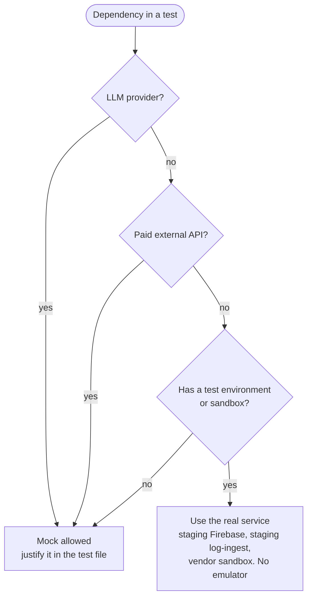

# Testing (ITG-TST)

## When this applies

Every code change. Tests come first (constitution Article III) and run against real services (Article IX).

## Decision diagrams

Test-first loop for one EARS requirement (§7.1):

May I mock this dependency (§7.3)?

## Rules

- **ITG-TST-01** Tests SHALL be written before the code: a failing test (Red), the minimal code that passes (Green), then a refactor with all tests passing (Blue) (§7.1; constitution Article III).
- **ITG-TST-02** Every EARS requirement SHALL map to at least one test that references its `REQ-*` id (§7.1).
- **ITG-TST-03** Coverage thresholds SHALL come from `steering/rules/constitution-levels.yml` for the `application` profile and SHALL be enforced by `musubi validate` in CI (§7.1).
- **ITG-TST-04** The project SHALL use these test levels and tools (§7.2):

| Level | Tool | Purpose |
|---|---|---|
| Static checks | TypeScript, ESLint (+ eslint-plugin-security), Prettier, knip | Code quality, security lint, dead code |
| Unit | Vitest | Functions, services, route handlers, feature logic |
| Component (optional) | Vitest + React Testing Library | Complex reusable components |
| Integration | Vitest against the real staging Firebase project | Auth, Firestore rules, REST client, email, log-ingest |
| E2E | Playwright | Critical user journeys against a local or staging build |
| Security | Dependency audit + security checklist (ITG-SEC) | Security risks |
| Manual QA | ClickUp checklist on staging | Final human verification |

- **ITG-TST-05** Playwright SHALL be the priority for business-critical flows; React Testing Library is optional (§7.2).
- **ITG-TST-06** Integration tests SHALL run against real services: the staging Firebase project, the staging log-ingest endpoint and vendor sandboxes. The Firebase Emulator SHALL NOT be used (§7.3; constitution Article IX).
- **ITG-TST-07** Mocks SHALL be used only for LLM providers, paid external APIs and services without a test environment, and each mock SHALL be justified in the test file (§7.3).
- **ITG-TST-08** Test data SHALL live in the staging project under a test tenant or prefix and SHALL be cleaned up by the test run. Production SHALL NOT be a test target. CI SHALL use the `staging` GitHub Environment for integration and E2E runs (§7.3).
- **ITG-TST-09** Every production project SHALL test: login and logout, role-based access and permission-denied states, tenant isolation where multi-tenant, main CRUD flows, file upload and download, external API integrations, AI calls, the payment flow if any, error and empty states, and the email sending path (§7.4).
- **ITG-TST-10** The E2E suite SHALL cover at least: a user signs in; a user creates, updates and imports records; an AI feature produces a result; an admin changes a user's role; an unauthorized user is blocked (§7.4).
- **ITG-TST-11** Before production, manual QA on staging SHALL complete the checklist below (§7.5).

## Checklist

Manual QA on staging (§7.5):

- [ ] Main user flows · auth · permissions
- [ ] Responsive layout · empty and error states · form validation
- [ ] External integrations and email delivery
- [ ] AI outputs checked where relevant
- [ ] No visible console errors
- [ ] Expected events visible in logs-console

## Deviation

Record deviations as described in [README.md](README.md#deviations).
