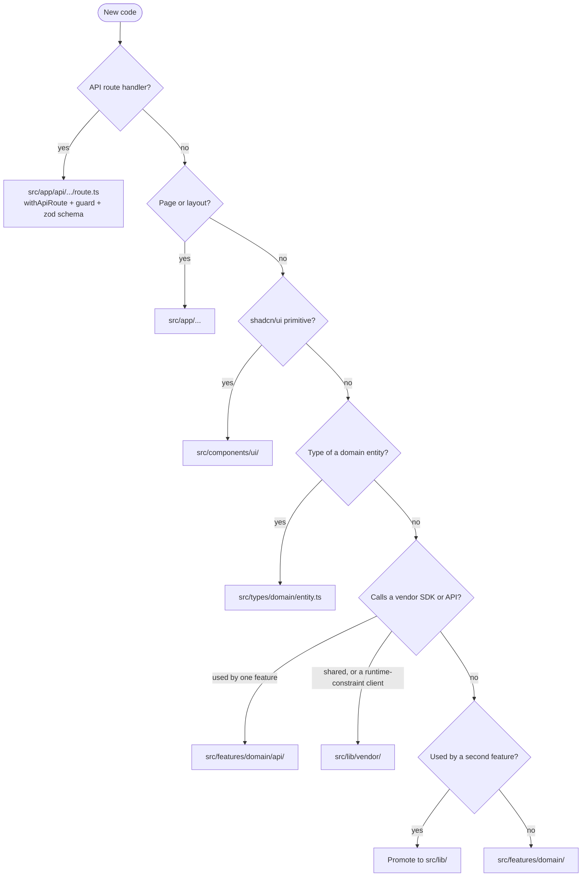

# Project Structure

**Project**: {{PROJECT_NAME}}
**Last Updated**: {{DATE}}
**Version**: 1.0
**Standard**: ITG Software Delivery Playbook v2.1 (`steering/rules/itg/git-and-code-quality.md`)

---

## Architecture Pattern

**Primary Pattern**: one Next.js application per repository, organized by feature, deployed as one Cloudflare Worker per environment (ITG-GIT-01, ITG-PLT-13).

A monorepo (`apps/`, `packages/`) is used only when several deployable applications share packages. If this project is one, record it under [Deviations](#deviations-from-the-itg-playbook).

---

## Directory Organization

```
src/app/…                          pages and layouts (src/app/[locale]/… only in multilingual products)
src/app/api/**/route.ts            API route handlers, always through withApiRoute
src/components/ui/                 shadcn/ui primitives
src/components/layout/             shells, navigation
src/features/<domain>/             one folder per feature:
  components/  hooks/  api/  types.ts  (and *.test.ts next to the code)
src/lib/auth/                      session, claims, guards
src/lib/audit/  src/lib/logs/      recorders, redactor, allowlist
src/lib/firebase-rest/             Firebase REST client (runtime-constraint client, VIII-4)
src/lib/email/                     ACS client and templates
src/lib/runtime-config.ts          the only place that reads process.env
src/lib/logger.ts                  createLogger('<module-id>')
src/lib/utils/
src/middleware/                    withAuth, withRole, withTenant, withApiRoute, api-errors
src/types/<domain>/<entity>.ts     one file per entity, grouped by domain
src/locales/<locale>/<page>.json   next-intl messages, one file per page (multilingual products only)
functions/                         Firebase Functions (scheduled jobs, backups)
scripts/ci/                        CI helpers (env materialization, deploy helpers)
scripts/checks/                    CI gate scripts (route guards, route logging, changelog)
database/                          schema.sql, migrations/ (only if PostgreSQL)
steering/  storage/                MUSUBI
documentation/                     engineering docs, hardening/, incidents/, n8n/
tests/e2e/                         Playwright specs
```

### Where does this code go?



### Rules

- A feature folder is self-contained: removing the feature removes one folder (ITG-GIT-02).
- Shared code moves to `src/lib` or `src/components/ui` only when a second feature needs it (ITG-GIT-02). A second copy of the same logic is a review blocker (ITG-GIT-14).
- Types are split per entity in `src/types/<domain>/<entity>.ts`, re-exported by a small `src/types/<domain>/index.ts`; there is no global types file (ITG-GIT-03).
- Path alias `@/*` → `src/*`; TypeScript `strict: true` (ITG-GIT-04).
- Only `src/lib/runtime-config.ts` reads `process.env` (ITG-LOG-14).
- Only `functions/` imports `firebase-admin` (ITG-PLT-14).

---

## Testable-Core Pattern (Article I)

ITG projects use the `application` profile (constitution "Project Profiles"). `musubi init` declares these values in `steering/project.yml`:

| Setting | Value | Holds |
|---|---|---|
| Profile | `application` | A web application deployed as one unit (P-1) |
| Core paths | `src/lib` | Shared logic, tested without starting the app (I-1, I-2) |
| Delivery paths | `src/app`, `src/components`, `src/features`, `src/middleware` | Pages, route handlers, UI, feature folders, route wrappers |
| Adapter paths | `src/lib/auth` | Request-context code (session cookies, `next/headers`) that core logic depends on |

How the ITG layout maps to Article I:

- `src/lib` is the core: shared modules (`firebase-rest`, `email`, `logs`, `audit`, `utils`) have no UI and are unit-tested without the app (I-2, ITG-TST-04).
- A feature folder owns its UI, hooks and API calls, so in Article I terms it is delivery code. A feature's logic still has unit tests next to the code, written first (ITG-TST-01).
- A core module SHALL NOT import from a delivery path (I-3). `src/lib` therefore never imports from `src/features` or `src/app`.
- `src/lib` has no components, React hooks or providers (I-A4). Request-context APIs (`next/headers`, `next/server`) stay in delivery or adapter paths (I-A5).
- The HTTP API (route handlers) is the automation interface; operational scripts in `scripts/` have `--help` and `--dry-run` (Article II, II-A1, II-A6).

---

## Naming Conventions

| Item | Convention | Example | Rule |
|---|---|---|---|
| Route id | `api-<path>-<verb>` | `api-admin-users-create` | ITG-SEC-13 |
| Logger module id | `api-<path>` for routes, `<name>-service` for services | `createLogger('lead-service')` | ITG-LOG-14 |
| Action name | `<domain>.<resource>.<verb>`, lowercase dotted, `.denied` / `.failed` variants | `admin.claim.set.denied` | ITG-LOG-07 |
| Requirement id | `REQ-<AREA>-<NNN>` | `REQ-AUTH-001` | ITG-DEL-10 |
| Feature branch | `feature/<slug>-<clickup-id>` | `feature/meeting-rsvp-869et4322` | ITG-GIT-05 |
| Hotfix branch | `hotfix/<slug>-<clickup-id>` | `hotfix/login-loop-869et5000` | ITG-GIT-05 |
| Commit | `type(scope): summary` (Conventional Commits) | `feat(rsvp): add reminder email` | ITG-GIT-07 |
| Migration | `database/migrations/NNNN_<name>.sql` | `0003_add_lead_index.sql` | ITG-DAT-05 |
| Hardening doc | `documentation/hardening/<TOPIC>_HARDENING_<YYYY-MM-DD>.md` | `SESSION_HARDENING_2026-10-08.md` | ITG-DEL-07 |
| Postmortem | `documentation/incidents/<YYYY-MM-DD>_<slug>.md` | `2026-11-02_login-outage.md` | ITG-OPS-07 |
| Firebase project / Worker | `<app>-staging`, `<app>-production` | `{{PROJECT_NAME}}-staging` | ITG-PLT-21 |

---

## Code Limits (Article VII)

| Limit | Value | Rule |
|---|---|---|
| Lines of code per file (non-blank, non-comment) | ≤ 500 | VII-4, ITG-GIT-13 |
| Lines per function | ≤ 50 | VII-5, ITG-GIT-13 |
| Distinct imported modules per non-index file | ≤ 10 | VII-6, ITG-GIT-13 |
| Unused files, exports and dependencies | none (`knip` in CI) | ITG-GIT-16 |

When a behavior changes, the old code path, flag, migration helper, message key and test go in the same PR (ITG-GIT-15).

---

## Documentation Organization

| Home | Content | Rule |
|---|---|---|
| `steering/`, `storage/` | Product, stack, structure, ITG policies, EARS requirements, Mermaid C4 designs, tasks, traceability | ITG-DEL-11 |
| `documentation/` | `SECURITY.md`, `AUDIT_LOGGING.md`, `DATABASE.md`, `OPERATIONS.md`, `INTEGRATIONS.md`, `RELEASE_PROCESS.md`, `hardening/`, `incidents/`, `n8n/` | ITG-DEL-06 |
| ClickUp | Brief, scope, sprints, sign-off checklists, handover packet, integration registry | ITG-DEL-04 |
| Microsoft OneDrive | Client assets, design files, large binaries | ITG-DEL-04 |

### SDD Artifacts

```
storage/
├── specs/<feature>-requirements.md     # EARS requirements (REQ-<AREA>-<NNN>)
├── design/<feature>-design.md          # Mermaid C4 views, ADRs, coverage matrix, runtime-constraint clients
├── tasks/<feature>-tasks.md            # Task breakdown mapped to requirements
├── changes/                            # Delta specifications (brownfield changes)
└── traceability/matrix.md              # musubi trace matrix --format markdown
```

---

## Constitutional Compliance

This structure enforces:

- **Article I**: Testable core in `src/lib`, feature folders as delivery code
- **Article II**: The HTTP API is the automation interface
- **Article III**: Tests next to the code, written first (ITG-TST-01)
- **Article VI**: Steering files and `steering/rules/itg/` are the project memory
- **Article VII**: Code-size limits above
- **Article VIII**: Vendor SDKs called directly; the Firebase REST client is the accepted runtime-constraint client (VIII-4)
- **Article IX**: Integration tests against the staging Firebase project, no emulator (ITG-TST-06)

---

## Deviations from the ITG Playbook

Record every departure from `steering/rules/itg/` that affects layout or naming.

| Rule | Decision | Reason | Date | Approved by |
|---|---|---|---|---|
| — | No deviations yet | — | {{DATE}} | — |

---

## Release Notes

Release history is kept in [CHANGELOG.md](../CHANGELOG.md) and is not repeated here.

---

_Generated by MUSUBI SDD (ITG fork). Update with `/sdd-steering`._
