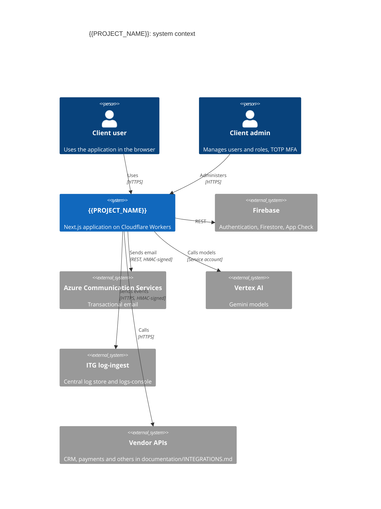
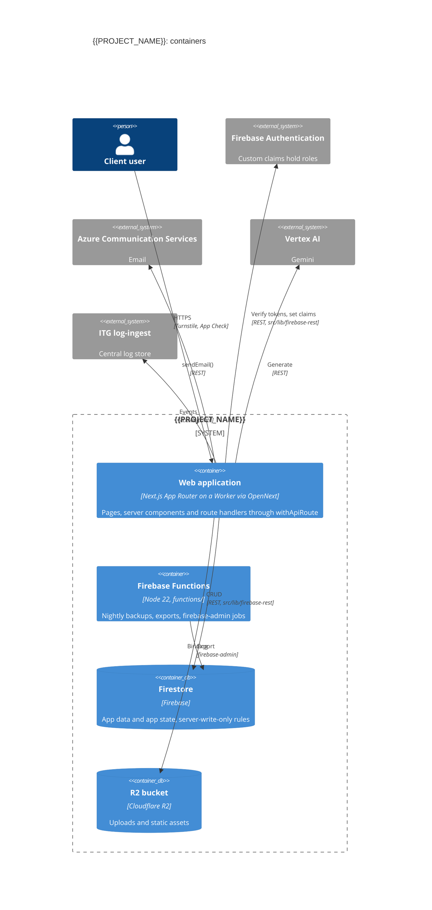

# Technology Stack

**Project**: {{PROJECT_NAME}}
**Last Updated**: {{DATE}}
**Version**: 1.0
**Standard**: ITG Software Delivery Playbook v2.1 (`steering/rules/itg/`)

---

## Overview

This document records the technology stack of {{PROJECT_NAME}} (constitution Article VI). It starts from the ITG default stack (ITG-PLT-01): Next.js on Cloudflare Workers, Firebase over REST, Firestore, Azure Communication Services email, Gemini through Vertex AI, and the ITG log-ingest platform. Development SHALL use these technologies.

- Keep the defaults. Record every project-specific choice in [Deviations from the ITG Playbook](#deviations-from-the-itg-playbook), with the rule id it departs from.
- A change to this stack SHALL be approved by stakeholders before it is applied (VI-6).
- A custom abstraction layer over a framework SHALL NOT be built without Phase -1 Gate approval (VIII-2). The exception is the runtime-constraint clients (VIII-4), such as the Firebase REST client.

Before Sprint 0 closes, this file and the design documents together cover the topics listed in ITG-DEL-13.

---

## System Context

Fill in the client-specific systems. Remove a box only when the project records a deviation for it.



## Containers



If the project uses PostgreSQL (ITG-DAT-02), add `ContainerDb(pg, "PostgreSQL", "Shared ITG instance", "...")`. If it uses n8n (ITG-INT-06), add `System_Ext(n8n, "n8n", "...")`.

---

## Primary Technologies

The ITG default stack (ITG-PLT-01, ITG-PLT-05).

| Layer | Technology | Rule |
|---|---|---|
| Language | TypeScript (`strict: true`), Node 22 (`.nvmrc`) | ITG-GIT-04 |
| Frontend | Next.js (App Router), React | ITG-PLT-01 |
| Server logic | Route Handlers `src/app/api/**/route.ts` through `withApiRoute`; Server Actions only for UI-only form mutations | ITG-SEC-13 |
| Hosting | Cloudflare Workers via OpenNext (`@opennextjs/cloudflare`), Wrangler | ITG-PLT-13 |
| Authentication | Firebase Authentication over REST, roles in custom claims | ITG-SEC-05 |
| Database | Firestore | ITG-DAT-01 |
| Files | Cloudflare R2 | ITG-PLT-01 |
| Email | Azure Communication Services, `src/lib/email/` | ITG-INT-03 |
| AI | Gemini through Vertex AI only | ITG-SEC-20 |
| Logs | ITG log-ingest + logs-console, `src/lib/logs`, `src/lib/audit` | ITG-LOG-01 |
| Scheduled jobs | Firebase Functions (`functions/`), Cloudflare Cron Triggers | ITG-INT-06 |
| UI | shadcn/ui on Radix, Tailwind CSS, lucide-react, sonner | ITG-PLT-05 |
| Forms and validation | react-hook-form, zod | ITG-PLT-06 |
| Server / client state | TanStack Query / React Context | ITG-PLT-05 |
| Tables and charts | TanStack Table, Recharts | ITG-PLT-05 |
| Internationalization | next-intl only if multilingual: [yes / no] | ITG-PLT-07 |
| Testing | Vitest, Playwright, React Testing Library (optional) | ITG-TST-04 |
| Quality | ESLint + eslint-plugin-security, Prettier, knip | ITG-CI-01 |
| CI/CD | GitHub Actions, `.github/workflows/deploy.yml` | ITG-CI-03 |
| Error tracking | Runtime logs + `error_events`; Sentry: [no / yes, reason] | ITG-PLT-03 |

---

## Database Decision

Decide with the diagram in `steering/rules/itg/data.md` (ITG-DAT-02).

| Question | Answer |
|---|---|
| Primary database | Firestore |
| PostgreSQL needed? | [no / yes: which data is large, relational or reporting-heavy] |
| PostgreSQL database and user | [n/a / `db_<app>` and `<app>_app` on the shared ITG instance] |
| Multi-tenant? | [no / yes: tenant field `organizationId` or `tenantId`] (ITG-SEC-10) |
| Decided on | [YYYY-MM-DD] |

---

## Runtime Constraints (Cloudflare Workers)

These apply from day one (ITG-PLT-14 to ITG-PLT-18):

- Server code talks to Firebase only through `src/lib/firebase-rest/` (`verify-id-token.ts`, `auth-admin.ts`, `firestore.ts`, `storage.ts`). `firebase-admin` is used only in `functions/`. This is a runtime-constraint client (VIII-4), documented in the designs that touch it (VIII-5).
- No libraries that need `fs`, `net` or `child_process`. PDF parsing with `unpdf`.
- `postinstall` runs the jose patch script required by the Cloudflare build.
- Consistent state (rate limits, caches) lives in Cloudflare bindings or Firestore, never in isolate memory.
- Bundle size limit: 3 MiB compressed (free plan) or 10 MiB (paid). Plan: [free / paid].

---

## Environments

| | local | staging | production |
|---|---|---|---|
| Git branch | `feature/*`, `hotfix/*` | `staging` | `master` |
| GitHub Environment | — | `staging` | `production` |
| Firebase project | `{{PROJECT_NAME}}-staging` | `{{PROJECT_NAME}}-staging` | `{{PROJECT_NAME}}-production` |
| Worker | — | `{{PROJECT_NAME}}-staging` | `{{PROJECT_NAME}}-production` |
| `APP_ENV` | `local` | `staging` | `production` |
| Hostname | `localhost:3000` | `{{PROJECT_NAME}}-staging.improvetogrow.com` | [client domain, Cloudflare for SaaS] |

Configuration comes only from the GitHub Environments. `NEXT_PUBLIC_*` keys are Variables and everything else is a Secret. CI pushes the secrets with `wrangler secret bulk` (ITG-PLT-08 to ITG-PLT-11). Every key is listed in `.env.example` and parsed in `src/lib/runtime-config.ts`.

---

## Integrations

One line per integration; details go in `documentation/INTEGRATIONS.md` (ITG-INT-08).

| Integration | Purpose | Called from | Events |
|---|---|---|---|
| Azure Communication Services | Transactional and auth email | `src/lib/email/` | `integration.email.*` |
| Vertex AI | [AI feature] | `src/lib/<vendor>/` or `src/features/<domain>/api/` | `ai.*` |
| [Vendor] | [Purpose] | `src/lib/<vendor>/` | `integration.<vendor>.*` |

---

## Development Environment

```bash
nvm use                 # Node 22 from .nvmrc
npm ci
npm run dev             # next dev on localhost:3000, staging Firebase project
npm run lint && npm run lint:security && npm run format:check
npx tsc --noEmit
npx vitest run
npx playwright test
npx opennextjs-cloudflare build
musubi validate
```

---

## Dependencies

Production dependencies are audited on every PR with `npm audit --omit=dev --audit-level=high`; `functions/` is audited separately (ITG-CI-01). Add a package only when nothing in the stack above covers the need, and check that it runs on Workers.

| Package | Purpose | Added on |
|---|---|---|
| [package] | [why the stack above does not cover it] | [YYYY-MM-DD] |

---

## Deviations from the ITG Playbook

Silent deviation is not allowed. Record every departure from a rule in `steering/rules/itg/`.

| Rule | Decision | Reason | Date | Approved by |
|---|---|---|---|---|
| — | No deviations yet | — | {{DATE}} | — |

---

_Generated by MUSUBI SDD (ITG fork). Update with `/sdd-steering`._
