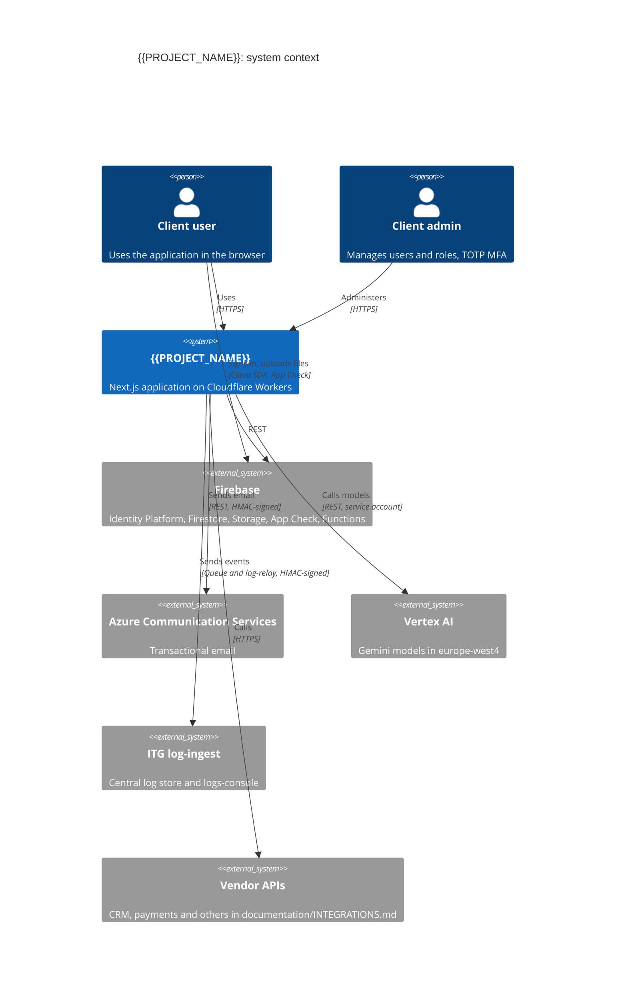
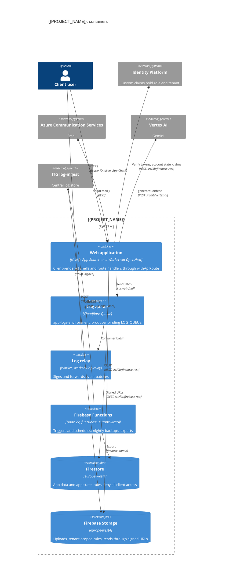

# Technology Stack

**Project**: {{PROJECT_NAME}}
**Last Updated**: {{DATE}}
**Version**: 1.0
**Standard**: ITG Software Delivery Playbook v2.2 (`steering/rules/itg/`)

---

## Overview

This document records the technology stack of {{PROJECT_NAME}} (constitution Article VI). It starts from the ITG stack (ITG-PLT-01): Next.js on Cloudflare Workers, Firebase with Identity Platform over REST, Firestore and Firebase Storage in `europe-west4`, the ITG log-ingest platform through a Cloudflare Queue, and, as Recommended defaults, Azure Communication Services email and Gemini through Vertex AI. Development SHALL use these technologies.

- The Required rows change only through a playbook change. Record every departure from a Recommended row or a default rule in [Deviations from the ITG Playbook](#deviations-from-the-itg-playbook), with the rule id it departs from (ITG-DEL-02).
- A change to this stack SHALL be approved by stakeholders before it is applied (VI-6).
- A custom abstraction layer over a framework SHALL NOT be built without Phase -1 Gate approval (VIII-2). The exceptions are the runtime-constraint clients (VIII-4): the Firebase REST client and the Vertex AI REST client.

Before Sprint 0 closes, this file and the design documents together cover the topics listed in ITG-DEL-13.

---

## System Context

Fill in the client-specific systems. Remove a box only when the project records a deviation for it.



## Containers



If the project uses PostgreSQL (ITG-DAT-02), add `ContainerDb(pg, "PostgreSQL", "Neon through Hyperdrive", "...")`. If it uses n8n (ITG-INT-06), add `System_Ext(n8n, "n8n", "...")`.

---

## Primary Technologies

The ITG stack (ITG-PLT-01, ITG-PLT-05). (new) marks a tool no ITG production project has used yet (ITG-PLT-03).

| Layer | Technology | Class | Rule |
|---|---|---|---|
| Language | TypeScript (`strict: true`), Node 22 or later (`.nvmrc`) | Required | ITG-GIT-04 |
| Frontend | Next.js (App Router), React | Required | ITG-PLT-01 |
| Server logic | Route Handlers `src/app/api/**/route.ts` through `withApiRoute`; no Server Actions | Required | ITG-SEC-13 |
| Hosting | Cloudflare Workers via OpenNext (`@opennextjs/cloudflare`), Wrangler | Required | ITG-PLT-13 |
| Authentication | Firebase Authentication with Identity Platform over REST, role and tenant in custom claims | Required | ITG-SEC-05 |
| Bot protection | App Check with reCAPTCHA Enterprise; Identity Platform reCAPTCHA enforcement | Required | ITG-SEC-01 |
| Rate limiting | Cloudflare Rate Limiting binding (new); WAF rule on `/api/*` (new) | Required | ITG-SEC-14 |
| Database | Firestore, `europe-west4` | Required | ITG-DAT-01 |
| Files | Firebase Storage; static assets through Workers Static Assets | Required | ITG-SEC-15 |
| Logs | ITG log-ingest + logs-console through a Cloudflare Queue and `workers/log-relay` (new) | Required | ITG-LOG-01 |
| Scheduled jobs | Firebase Functions (`functions/`), triggers and schedules only | Required | ITG-INT-06 |
| Error tracking | Cloudflare observability + `error_events` | Required | ITG-LOG-06 |
| Configuration | GitHub Environments: Variables and Secrets | Required | ITG-PLT-09 |
| Testing | Vitest, Playwright, React Testing Library (optional) | Required | ITG-TST-04 |
| Validation | zod | Required | ITG-PLT-06 |
| Quality | ESLint + eslint-plugin-security (new), Prettier (new), knip (new) | Required | ITG-CI-01 |
| CI/CD | GitHub Actions, `.github/workflows/deploy.yml`, rulesets (new), Dependabot (new) | Required | ITG-CI-03 |
| Email | Azure Communication Services, `src/lib/email/` | Recommended | ITG-INT-03 |
| AI | Gemini through Vertex AI in `europe-west4`, REST from `src/lib/vertex-ai/` | Recommended | ITG-SEC-20 |
| UI | shadcn/ui, Tailwind CSS, lucide-react, sonner | Recommended | ITG-PLT-05 |
| Forms | react-hook-form | Recommended | ITG-PLT-05 |
| Server / client state | TanStack Query (new) / React Context | Recommended | ITG-PLT-05 |
| Tables and charts | TanStack Table (new), Recharts | Recommended | ITG-PLT-05 |
| Internationalization | next-intl only if multilingual: [yes / no] | Recommended | ITG-PLT-07 |
| Workflows | n8n: [no / yes, which workflows] | Recommended | ITG-INT-06 |

---

## Database Decision

Decide with the diagram in `steering/rules/itg/data.md` (ITG-DAT-02).

| Question | Answer |
|---|---|
| Primary database | Firestore |
| PostgreSQL needed? | [no / yes: which large dataset the app works on] |
| Neon project, databases and users | [n/a / `<app>` and `<app>-test`, migration user and runtime user, Hyperdrive per environment] |
| Multi-tenant? | [no / yes: `tenantId` in claims and Firestore, `tenant_id` with row-level security] (ITG-SEC-10) |
| Decided on | [YYYY-MM-DD] |

---

## Runtime Constraints (Cloudflare Workers)

These apply from day one (ITG-PLT-14 to ITG-PLT-19):

- Server code talks to Firebase only through `src/lib/firebase-rest/` (`verify-id-token.ts`, `auth-admin.ts`, `firestore.ts`, `storage.ts`, `service-account.ts`), and to Vertex AI only through `src/lib/vertex-ai/`. These are runtime-constraint clients (VIII-4), documented in the designs that touch them (VIII-5).
- `firebase-admin` runs only in `functions/` and in the operator scripts under `scripts/`; an ESLint rule keeps it out of `src/` and `workers/`.
- No libraries that need `fs`, `net` or `child_process`; no Google AI SDK. PDF parsing with `unpdf`.
- `postinstall` runs the jose patch script required by the Cloudflare build.
- Rate limits use the Rate Limiting binding; other consistent state lives in Firestore or Cloudflare bindings, never in isolate memory.
- Bundle size limit: 10 MiB.

---

## Environments

| | local | staging | production |
|---|---|---|---|
| Git branch | `feature/*`, `hotfix/*` | `staging` | `master` |
| GitHub Environment | — | `staging` | `production` |
| Firebase project | `{{PROJECT_NAME}}-staging` | `{{PROJECT_NAME}}-staging` | `{{PROJECT_NAME}}-production` |
| Worker | — | `{{PROJECT_NAME}}-staging`; relay `{{PROJECT_NAME}}-log-relay-staging` | `{{PROJECT_NAME}}-production`; relay `{{PROJECT_NAME}}-log-relay-production` |
| `APP_ENV` | `local` | `staging` | `production` |
| Hostname | `localhost:3000` | `{{PROJECT_NAME}}-staging.improvetogrow.com` | [subdomain of the client's domain, Cloudflare for SaaS] |

Configuration comes only from the GitHub Environments in three classes (ITG-PLT-09): public values and server configuration are Variables, credentials are Secrets. The deploy workflow writes them to the Workers and Functions (ITG-CI-06, ITG-CI-07). Every key is listed in `.env.example` with its class, and server configuration is parsed in `src/lib/runtime-config.ts`.

---

## Integrations

One line per integration; details go in `documentation/INTEGRATIONS.md` (ITG-INT-08).

| Integration | Purpose | Called from | Events |
|---|---|---|---|
| Azure Communication Services | Transactional and auth email | `src/lib/email/` | `integration.email.*` |
| Vertex AI | [AI feature] | `src/lib/vertex-ai/` | `ai.*` |
| [Vendor] | [Purpose] | `src/lib/<vendor>/` or `src/features/<domain>/api/` | `integration.<vendor>.*` |

---

## Development Environment

```bash
nvm use                 # Node 22 or later, from .nvmrc
npm ci
npm run dev             # next dev on localhost:3000, staging Firebase project
npm run lint && npm run format:check
npx tsc --noEmit
npx vitest run
npx playwright test
npx opennextjs-cloudflare build
musubi-validate project && musubi-trace ci-check
```

---

## Dependencies

Production dependencies are audited on every PR with `npm audit --omit=dev --audit-level=high`; `functions/` is audited separately, and Dependabot alerts are on (ITG-CI-01, ITG-SEC-21). Add a package only when nothing in the stack above covers the need, and check that it runs on Workers.

| Package | Purpose | Added on |
|---|---|---|
| [package] | [why the stack above does not cover it] | [YYYY-MM-DD] |

---

## Deviations from the ITG Playbook

Silent deviation is not allowed. Record every departure from a Recommended row or a rule in `steering/rules/itg/` (ITG-DEL-02); Required rows change only through a playbook change.

| Rule | Decision | Reason | Date | Approved by |
|---|---|---|---|---|
| — | No deviations yet | — | {{DATE}} | — |

---

_Generated by MUSUBI SDD (ITG fork). Update with `/sdd-steering`._
