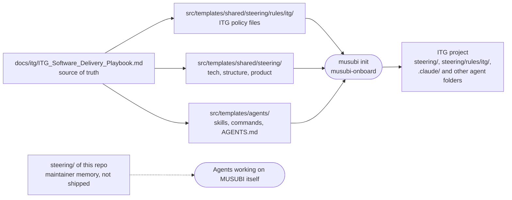

# ITG Fork Maintenance Rules

These rules are for agents and people who change **this repository**. They are not the ITG project policies: those are in `src/templates/shared/steering/rules/itg/`, and `musubi init` installs them into ITG projects.

## Template layers

`steering/` at the root of this repository describes MUSUBI itself (a Node.js CLI, profile `cli`). It is not in the npm `files` list and never reaches ITG projects. Everything an ITG project receives comes from `src/templates/`.

## Rules

- **FORK-01** `src/templates/**` SHALL implement the playbook in `docs/itg/ITG_Software_Delivery_Playbook.md`. WHEN a template and the playbook disagree, the template is the bug.
- **FORK-02** WHEN the playbook changes, the same change set SHALL update the canonical playbook and its copy in `docs/itg/` (identical files), bump the playbook version, add a `docs/itg/PLAYBOOK_CHANGELOG.md` entry, update the affected policy files and templates, and release the fork as the next `-itg.N` with a `CHANGELOG.md` entry naming the playbook version (playbook, Purpose).
- **FORK-03** The copy in `docs/itg/` is the canonical file as it is; its version is read from the `**Version X.Y` header line. Every policy file SHALL name the playbook version in its front matter (`playbook:`), cite the playbook section of each rule (`§x.y`), and give each rule a unique id `ITG-<AREA>-NN`. `tests/itg/playbook-sync.test.js` enforces this.
- **FORK-04** Decision logic SHALL be a Mermaid `flowchart` and architecture a Mermaid C4 diagram, in policies, steering templates and design templates. `tests/itg/mermaid-blocks.test.js` checks the blocks.
- **FORK-05** Slash commands SHALL be edited in `src/templates/agents/claude-code/commands/` and copied to `codex`, `cursor`, `qwen-code`, `windsurf` and `github-copilot` (`*.prompt.md`) with `npm run sync:commands`, also when only Claude Code uses a change today, so that switching agents later needs no catch-up. Copilot keeps its own `sdd-requirements`, and `gemini-cli` `.toml` files are edited by hand: apply the same change to them. `tests/itg/command-copies.test.js` detects drift.
- **FORK-06** Examples in templates SHALL use the ITG stack (Next.js on Cloudflare Workers, Firebase with Identity Platform over REST, Firestore and Firebase Storage, `withApiRoute`, Vitest, ACS, Vertex AI through REST). Do not reintroduce Prisma, JWT, bcrypt or Redis examples for ITG flows, nor what the playbook removed: Turnstile, session cookies, Cloudflare R2, Cron Triggers, Server Actions, `database/schema.sql`.
- **FORK-07** Upstream MUSUBI behavior SHALL be kept where the playbook has no rule, so that upstream releases can still be merged.
- **FORK-08** This repository's own agent files (`.claude/commands`, `.claude/skills`, `CLAUDE.md`) SHALL receive the framework changes made to the templates (SDD steps, code navigation, EARS, traceability), and SHALL NOT receive ITG project content (`steering/rules/itg/` pointers, the ITG stack examples, ITG policy tables). MUSUBI is a Node.js CLI, not an ITG client application. `tests/code-navigation-guidance.test.js` checks both: the index-first steps in both places, and no ITG policy pointer in `.claude/`.
